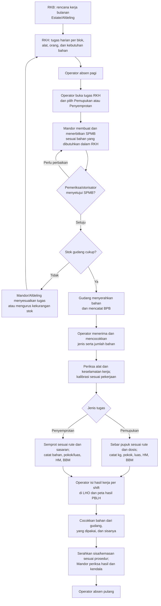
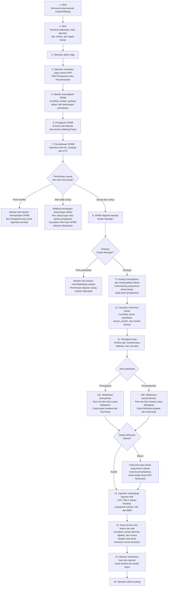

# Jelaskan MKTI untuk pemupukan sawit

Chat ID: 01a0ad4c-441c-78c1-a0be-e8964110b92f

Hanya pesan pengguna dan laporan akhir; instruksi lingkungan, reasoning, serta output tool mentah tidak diekspor. Kredensial disamarkan. Lampiran biner tetap berada di riwayat asli.

## 2026-09-17 09:57:35 WIB — Pengguna

ChatGPT apakah kamu tahu tentang MKTI untuk pemupukan pohon kelapa sawit?

---

## 2026-09-17 09:58:05 WIB — Laporan akhir assistant

**Saya belum bisa memastikan MKTI yang Anda maksud dalam konteks pemupukan kelapa sawit.** Istilah ini perlu diperjelas supaya saya tidak salah menjelaskan alat atau metodenya.

Dari rujukan yang saya temukan, penelitian di **INSTIPER Yogyakarta** menggunakan istilah **MKTI (*Boom Sprayer*)** untuk kegiatan penyemprotan pengendalian gulma di perkebunan kelapa sawit. Rujukan tersebut membahas penyemprotan gulma, sehingga belum cukup untuk menjelaskan MKTI sebagai alat atau metode pemupukan. [Sumber: Repository INSTIPER](https://eprints.instiperjogja.ac.id/id/eprint/4006/)

**MKTI yang Anda maksud itu mesin/alat untuk aplikasi pupuk, atau singkatan metode kerja di kebun Anda?** Kalau ada kepanjangan MKTI, foto alat, atau contoh penggunaannya, kirimkan agar saya bisa membahas cara kerja dan kaitannya dengan pemupukan secara tepat.

---

## 2026-09-17 10:24:31 WIB — Pengguna

Dari dokumen ini ada membahas soal MKTI, coba kamu baca untuk yang tentang MKTInya saja lalu kamu pelajari dan rangkum semuanya dan gunakan bahasa yang sederhana dan tidak terlalu berbelit agar saya mudah mengerti dan paham.

---

## 2026-09-17 10:28:08 WIB — Laporan akhir assistant

**Dalam dokumen Anda, MKTI berarti Mekanisasi Kultur Teknis Intensif: pekerjaan budidaya kelapa sawit dengan bantuan alat, disertai perencanaan, pengawasan, dan pencatatan hasil kerja.** Untuk pemupukan, alat utamanya adalah **traktor yang dipasangi penebar pupuk atau *fertilizer spreader*.**

Jadi, jawaban saya sebelumnya perlu dilengkapi: **MKTI dalam dokumen ini mencakup pemupukan sekaligus penyemprotan**, dan pada bagian pengenalan juga mencakup mekanisasi pruning serta panen.

Saya menelusuri bagian MKTI dalam [dokumen yang Anda kirim](<C:/Users/aruna/Downloads/Paket Capacity Building Preskom-Collect 2023 (1).pdf>), termasuk memeriksa gambar jalur kerja dan tabel kalibrasinya. Nomor halaman di bawah adalah **urutan halaman PDF**, karena berbeda dengan nomor yang tercetak pada slide.

**1. Apa tujuan MKTI?**

Tujuannya adalah membuat pekerjaan kebun lebih cepat, terukur, dan terkendali. Yang diperhatikan meliputi:

- Berapa pohon atau hektare yang selesai dikerjakan.
- Berapa pupuk, herbisida, dan solar yang digunakan.
- Berapa waktu kerja alat.
- Berapa biaya per hektare atau per pohon.
- Apakah hasil pekerjaan sesuai rencana.
- Kalau tidak sesuai, apa penyebab dan perbaikannya.

Dokumen menempatkan MKTI sebagai salah satu pendukung peningkatan produktivitas kebun. Angka **230 kg/pokok/tahun** yang sering disebut merupakan sasaran produksi dalam dokumen, bukan dosis pupuk dan bukan jaminan hasil hanya dengan menggunakan mesin.

**2. Kegiatan apa saja yang termasuk MKTI?**

Pada bagian pengenalan, dokumen mencantumkan:

| Kegiatan | Alat yang disebut | Penjelasan sederhana |
|---|---|---|
| Pruning | Dodos dan egrek mekanis | Membantu pemangkasan pelepah. |
| Penyemprotan | *Boom sprayer* | Membantu aplikasi cairan semprot. |
| Pemupukan | *Fertilizer spreader* | Membantu menebarkan pupuk. |
| Panen | Wuzheng Badak Super | Dicantumkan sebagai alat dalam mekanisasi kegiatan panen. |

Dalam pembahasan operasional dan aplikasi digital, MKTI paling banyak dibagi menjadi **pemupukan dan penyemprotan**.  
*Rujukan: halaman PDF 20, 97, dan 236.*

**3. Bagaimana MKTI untuk pemupukan bekerja?**

Alat yang dibahas adalah **Emdek Turbo-Spin 850**, yang dipasang pada traktor.

Cara kerjanya:

1. Pupuk dimasukkan ke tempat penampungan atau *hopper*.
2. Traktor berjalan mengikuti jalur yang sudah ditentukan.
3. Piringan berputar pada alat menyebarkan pupuk ke sisi kiri dan kanan.
4. Setelah pupuk habis, alat diisi ulang pada titik yang sudah disiapkan.
5. Pekerjaan dilanjutkan sampai area yang direncanakan selesai.

Dalam contoh pola kerja dokumen, satu lintasan melayani **empat baris tanaman: dua di kiri dan dua di kanan**. Karena itu, jalur traktor dan titik pengisian pupuk perlu diatur sejak awal.

Spesifikasi yang disebut dalam materi alat antara lain kapasitas hopper **850 liter**, perkiraan beban maksimum **850 kg**, kebutuhan traktor **55 HP atau lebih**, serta lebar sebar efektif sekitar **15–25 meter tergantung bahan**. Namun, contoh operasionalnya memakai muatan **400 kg** atau **800 kg**.

Artinya, **kapasitas maksimum alat dan jumlah pupuk yang dimuat saat bekerja bisa berbeda**.  
*Rujukan: halaman PDF 77, 228, dan 230.*

**4. Dosis pupuk harus ditentukan terlebih dahulu**

Dokumen menghubungkan rekomendasi pemupukan dengan **analisis tanah dan daun**. Rekomendasi tersebut kemudian diterapkan melalui kegiatan GoMKTI dan didukung penyediaan material melalui logistik.

Urutannya adalah:

**Analisis kebutuhan tanaman → tentukan jenis dan dosis pupuk → siapkan pupuk → atur alat → aplikasikan → periksa hasilnya.**

Dengan demikian, angka dosis yang muncul dalam contoh dokumen tidak otomatis berlaku untuk semua blok.

Ada contoh dosis **1,78 kg/pokok** dalam perencanaan tahun 2019 dan **3,5 kg/pokok** dalam contoh operasional tahun 2022. Keduanya perlu dibaca sesuai konteks masing-masing.  
*Rujukan: halaman PDF 129, 228, dan 77.*

**5. Kalibrasi adalah bagian terpenting sebelum menetapkan kemampuan alat**

**Kalibrasi berarti menguji dan menyetel alat agar jumlah pupuk yang keluar sesuai dengan dosis yang direncanakan.**

Yang harus disesuaikan antara lain:

- Kecepatan jalan traktor.
- Putaran mesin dan penggerak alat.
- Bukaan pengeluaran pupuk.
- Jangkauan sebar.
- Kondisi pupuk.
- Jumlah pohon dan jarak lintasan.

Secara sederhana, perubahan kecepatan jalan atau aliran pupuk akan mengubah jumlah pupuk yang diterima area yang dilewati. Karena itu, dokumen menekankan kecepatan yang konstan dan pengaturan pengeluaran pupuk.

Contoh pengaturan dalam materi tahun 2022:

| Pengaturan | Angka dalam contoh |
|---|---:|
| Dosis | 3,5 kg/pokok |
| Muatan pupuk | 400 kg atau 8 sak |
| Putaran mesin traktor | 2.000 RPM |
| Putaran PTO, penggerak alat | 540 RPM |
| Pengaturan aliran pupuk | Flow 5 |
| Posisi kecepatan | M-2 |
| Panjang lintasan contoh | 250 meter |

**Ini adalah pengaturan contoh dalam dokumen, bukan setelan universal untuk setiap alat dan kebun.**  
*Rujukan: halaman PDF 77–78.*

**6. Apa hasil uji lapangan yang dicatat?**

Dokumen menampilkan uji kalibrasi tanggal **30 Maret 2022**, di **BUM 4, Afdeling 17, Blok L44**, dengan luas **25,63 ha** dan populasi **148 pokok/ha**.

Hasil rata-rata waktu dari tujuh percobaan:

| Kegiatan | Rata-rata waktu |
|---|---:|
| Mengisi pupuk ke alat | 5,22 menit |
| Menaburkan pupuk satu rit | 9,23 menit |
| Satu siklus isi dan tabur | 14,45 menit |

Berdasarkan waktu tersebut, dokumen memperkirakan **sekitar 29 rit dalam tujuh jam kerja**.

Namun, uji tersebut juga mencatat hambatan nyata:

- Sebagian pupuk basah sehingga alat tersumbat.
- Pada dua percobaan, sisa pekerjaan dilanjutkan dengan tabur manual.
- Saringan dan penutup alat perlu dibuka-tutup.
- Alat perlu dibersihkan secara berkala dari gumpalan pupuk dan dilap sampai kering.

**Pelajaran utamanya: kemampuan alat di lapangan sangat dipengaruhi kondisi pupuk, kelancaran pengisian, kondisi lahan, dan gangguan alat.** Angka kapasitas mesin saja belum cukup untuk menentukan target kerja.  
*Rujukan: halaman PDF 78, nomor slide 93.*

**7. Bagaimana pekerjaan direncanakan dan dilaporkan?**

Dokumen menjelaskan alur berikut:

**Rencana kerja → pelaksanaan oleh operator dan helper → laporan hasil → input ke sistem → evaluasi.**

Pembagian tugasnya:

| Pihak | Tugas dalam alur MKTI |
|---|---|
| Ka. Ur. Afdeling | Menyiapkan rencana kerja harian pada H-1: alat, operator, lokasi, luas, jumlah pohon, dan kebutuhan pupuk. |
| Operator dan helper | Melaksanakan pekerjaan serta mencatat penggunaan bahan, waktu alat, dan hasil kerja. |
| Mandor/pengawas | Mengawasi pelaksanaan dan membantu memastikan pekerjaan sesuai rencana. |
| Krani PHM2D | Memasukkan data hasil dan penggunaan material ke OPS, E-Plantation, serta grup kerja yang ditetapkan. |
| Supervisor/manajemen | Membandingkan rencana dengan realisasi, mencari penyebab selisih, dan menentukan solusi. |

Istilah yang digunakan:

- **RKT/RKB/RKH:** rencana kerja tahunan, bulanan, dan harian.
- **PBLK:** Peta Blok Lokasi Kerja, menunjukkan lokasi yang akan dikerjakan.
- **PBLH:** Peta Blok Lokasi Hasil Kerja, menunjukkan lokasi hasil pekerjaan.
- **LHO:** formulir laporan kegiatan operator.
- **HM:** catatan jam operasi alat melalui *hour meter*.
- **SIV:** bukti pengeluaran material dari gudang.

*Rujukan: halaman PDF 146, 149, dan 228–229.*

**8. Data apa yang harus dicatat untuk pemupukan?**

Data utamanya adalah:

| Data | Kegunaannya |
|---|---|
| Nomor alat, operator, helper, tanggal, dan shift | Mengetahui siapa menggunakan alat dan kapan. |
| Blok serta jalur kerja | Mengetahui lokasi yang dikerjakan. |
| Jenis dan jumlah pupuk | Mengetahui material yang diaplikasikan. |
| Jumlah pohon yang dipupuk | Mengetahui cakupan pekerjaan pada tanaman. |
| Luas yang dipupuk | Mengetahui penyelesaian area. |
| Waktu kerja dan HM | Menilai pemanfaatan alat. |
| Pemakaian solar | Menilai konsumsi BBM. |
| Biaya tenaga kerja dan material | Menghitung biaya pekerjaan. |
| Masalah dan tindakan perbaikan | Menjelaskan penyebab hasil tidak sesuai rencana. |

Materi tahun 2023 menegaskan ukuran seperti **kg pupuk/pokok, pokok/jam, ha/jam, liter BBM/jam, liter BBM/ha, dan liter BBM/pokok**.

Dengan data tersebut, pengawas dapat menilai apakah pekerjaan sudah mencakup tanaman yang dituju dan apakah penggunaan bahan serta waktunya masuk akal.  
*Rujukan: halaman PDF 19, 146, dan 228.*

**9. Bagaimana menilai selisih rencana dan hasil?**

Dokumen menggunakan istilah **varian**, yaitu selisih rencana dengan realisasi.

Contoh pelaporan pemupukan dalam dokumen:

| Ukuran | Rencana | Realisasi | Kekurangan terhadap rencana |
|---|---:|---:|---:|
| Luas | 60 ha | 50 ha | 10 ha |
| Jumlah pohon | 8.400 pokok | 7.000 pokok | 1.400 pokok |
| Pupuk | 15.360 kg | 12.800 kg | 2.560 kg |

Contoh ini menunjukkan bahwa **pemakaian pupuk yang lebih sedikit belum tentu berarti lebih hemat**, karena area dan jumlah pohon yang selesai juga lebih sedikit.

Evaluasi harus mencari penyebabnya: apakah alat rusak, pupuk terlambat, pengisian terlalu lama, jalur sulit dilalui, atau ada kendala lain.

Catatan penggunaan pupuk juga harus cocok dengan stok:

**Stok awal + barang masuk − barang keluar = stok akhir.**

*Rujukan: halaman PDF 228. Angka pada tabel merupakan contoh laporan dalam dokumen, bukan hasil verifikasi lapangan saat ini.*

**10. Apa hubungan MKTI dengan biaya dan sistem digital?**

Biaya MKTI dalam format dokumen meliputi:

- Upah dan premi tenaga kerja.
- Pupuk atau herbisida.
- Solar, oli, dan bahan pendukung.
- Suku cadang yang dicantumkan dalam format biaya.

Hasilnya dinilai antara lain sebagai **rupiah per hektare** dan **rupiah per pokok**.

Di sisi digital:

- **GoMKTI** menjadi kelompok kegiatan mekanisasi.
- **GoMekPuk** digunakan untuk mekanisasi pemupukan.
- **GoMekPer** digunakan untuk mekanisasi perawatan, termasuk penyemprotan.
- Data dihubungkan dengan pencatatan operasional, logistik, dan peta lokasi kerja.

Fungsinya agar penggunaan pupuk, hasil kerja alat, biaya, dan lokasi pekerjaan bisa ditelusuri bersama.  
*Rujukan: halaman PDF 20, 97, 146, 221, dan 228.*

**11. Apa yang dibahas untuk MKTI penyemprotan?**

Untuk penyemprotan, alat yang digunakan adalah **boom sprayer yang terhubung ke traktor**. Dalam contoh operasional tahun 2022, sasaran semprotnya adalah **pasar pikul dan piringan**.

Materinya membahas:

- Jalur kerja dua unit dari sisi kiri dan kanan blok.
- Persiapan air melalui unit pendukung TUS pada H-1.
- Pengaturan kecepatan, nozel, tekanan, serta pengisian ulang.
- Pembagian operator, aplikator, mandor, dan shift.
- Pencatatan luas hasil, bahan yang digunakan, HM, BBM, dan biaya.

Salah satu contoh target adalah **20 ha pada shift pertama dan 16 ha pada shift kedua**, sehingga totalnya **36 ha per unit per hari**. Materi September 2022 juga menyebut pengelompokan **empat unit MKTI dan satu unit TUS**.

Angka ini merupakan **contoh target penyemprotan**, sehingga tidak boleh digunakan sebagai target pemupukan.  
*Rujukan: halaman PDF 48 dan 79–84.*

**12. Ada beberapa angka dalam dokumen yang perlu diperiksa kembali**

Dokumen ini menggabungkan materi dari beberapa tahun. Sebagian merupakan rencana, sebagian spesifikasi alat, dan sebagian hasil kalibrasi. Saya menemukan beberapa ketidaksesuaian yang perlu diketahui:

| Bagian | Catatan |
|---|---|
| Muatan 400 kg dengan dosis 3,5 kg/pokok | Secara hitungan cukup untuk sekitar 114 pokok. Pola lintasan menyebut 112 pokok. Keduanya perlu dibedakan antara hitungan dosis dan jumlah pohon pada lintasan. |
| Target 29 rit × 400 kg | Hasilnya **11.600 kg**. Slide operasional menulis 11.800 kg, sedangkan slide kalibrasi menulis 11.600 kg. |
| Luas per rit | Slide operasional menyebut 0,9 ha; tabel kalibrasi mencatat sekitar 0,76 ha pada percobaan yang melayani 112 pokok. |
| Target 60 ha/hari pada materi 2019 | Masih berupa perencanaan yang secara eksplisit disebut perlu dikalibrasi. |
| Dosis dan total pupuk pada contoh 2019 | 8.400 pokok × 1,78 kg = **14.952 kg**, berbeda dari rencana 15.360 kg yang tercantum. |
| Parameter penyemprotan | Ada angka tekanan, luasan per tangki, dan perhitungan yang tidak konsisten antarslide. |

Karena itu, **dokumen ini sangat berguna untuk memahami sistem kerja MKTI, tetapi angka dosis, kapasitas harian, dan biaya perlu dicocokkan kembali sebelum dipakai sebagai standar operasional.**

Untuk pemupukan, pesan paling kuat dari dokumen adalah: **tentukan kebutuhan tanaman, kalibrasi alat, siapkan jalur dan bahan, catat hasil nyata, lalu perbaiki penyebab selisihnya.** Keberhasilan MKTI dinilai dari pekerjaan yang selesai dengan dosis dan cakupan yang sesuai, penggunaan sumber daya yang terkendali, serta laporan yang dapat diperiksa.

---

## 2026-09-19 20:57:47 WIB — Pengguna

ChatGPT kita lanjutkan kembali, kamu telah membaca dari PDF dan saya ada tambahan dari foto, kamu baca, pelajarin dan bandingkan juga apakah sama atau beda, lalu buatkan ulang drafnya dengan bahasa yang mudah saya mengerti, apa itu MKTI, sistemnya seperti apa, flownya bagaimana, yang seperti itu lah

---

## 2026-09-19 20:58:05 WIB — Pengguna

Buatkan PDFnya yah

---

## 2026-09-19 21:03:07 WIB — Laporan akhir assistant

**PDF-nya sudah selesai dibuat, sebanyak 6 halaman**, dengan bahasa sederhana, tabel perbandingan, dan diagram alur kerja.

📄 **[Buka PDF — Panduan Sederhana MKTI, Sistem dan Alur Kerja](D:/Laragon/www/laravel-13-cms-bum/project-artifacts/mkti-20260919/Panduan_Sederhana_MKTI_Sistem_dan_Alur_Kerja.pdf)**

Isinya mencakup:

1. **Apa itu MKTI**, tujuan, serta perbedaan pemupukan dan penyemprotan.
2. **Sistem dan alur kerja**, dari menentukan kebutuhan sampai mengevaluasi hasil, termasuk pembagian tugas.
3. **Pemupukan di lapangan**, cara membaca lintasan pada foto, pengisian ulang, dan arti kalibrasi.
4. **Penyemprotan di lapangan**, pembagian jalur, dukungan suplai air, shift, dan target dalam materi.
5. **Pencatatan dan pelaporan**, penggunaan bahan, biaya, serta perbandingan rencana dengan realisasi.
6. **Hasil perbandingan foto dengan PDF**, termasuk angka yang tidak konsisten dan penjelasan koreksinya.

**Isi utama kedua foto sama dengan slide terkait dalam PDF.** Foto memperjelas pola kerja, sedangkan PDF melengkapi penjelasan kalibrasi dan pelaporannya. Angka contoh tahun 2022 diberi konteks agar tidak dianggap sebagai standar terbaru yang sudah terverifikasi.

Seluruh halaman sudah diperiksa secara visual; tabel, diagram, dan teks tidak terpotong.

---

## 2026-09-24 16:16:37 WIB — Pengguna

Tolong pindahkan dokumen terbaru ini ke folder downloads

---

## 2026-09-24 16:17:11 WIB — Laporan akhir assistant

PDF MKTI terbaru sudah dipindahkan ke folder Downloads:

[Unduh Panduan Sederhana MKTI](<C:/Users/aruna/Downloads/Panduan_Sederhana_MKTI_Sistem_dan_Alur_Kerja.pdf>)

Saya sudah memverifikasi bahwa file di lokasi baru identik dengan file asal dan file asal sudah tidak ada.

---

## 2026-09-24 16:20:55 WIB — Pengguna

Oiya yang terkait dengan SPMB untuk ambil racun dan pupuk dari gudang bagaimana, coba kamu update proses pembuatan SPMB untuk pengambilan racun dan pupuk sampai selesai aktivitas pemupukan dan penyemprotan racun

---

## 2026-09-24 16:25:47 WIB — Laporan akhir assistant

PDF MKTI sudah saya perbarui dengan proses **SPMB untuk pengambilan pupuk dan racun/herbisida**, sampai pekerjaan di blok selesai dan pemakaian bahan dicocokkan dengan catatan gudang. Versi terbaru ada di Downloads:

[Unduh Panduan MKTI dan Alur SPMB](<C:/Users/aruna/Downloads/Panduan_Sederhana_MKTI_Sistem_dan_Alur_Kerja.pdf>)

Alur yang ditambahkan adalah:

1. Afdeling membuat **RKH**: lokasi, pekerjaan, target, alat, dan kebutuhan bahan.
2. Mandor membuat **SPMB (Surat Permintaan Mandor Barang)** untuk meminta pupuk atau herbisida yang tersedia di gudang. Jika stok tidak cukup, kekurangannya masuk proses **MR** untuk pengadaan.
3. Gudang memeriksa permintaan, menyerahkan jumlah yang benar-benar keluar, dan mencatatnya pada **BPB**.
4. Tim melakukan pemupukan atau penyemprotan, lalu mencatat bahan yang benar-benar dipakai dan hasil kerja di **LHO** serta bukti pemakaian di blok.
5. Setelah pekerjaan, tim mencocokkan **barang keluar = barang dipakai + barang dikembalikan + selisih yang dijelaskan**. Kemasan bekas herbisida mengikuti alur pencatatan **BAPKMB** yang disebut dalam materi.

Saya memeriksa dasar alur ini pada PDF sumber, terutama halaman 228–229 dan 349–351. PDF terbaru berisi **8 halaman**; teks penting, pembagian halaman, dan tampilannya sudah diverifikasi. PDF lama dan skrip pembuatnya dibackup di [folder backup MKTI](<D:/Laragon/www/laravel-13-cms-bum/project-artifacts/mkti-20260919/backup>). Memori resmi `E:\AI\Memories` tidak tersedia saat pemeriksaan; tidak ada memori MKTI/SPMB yang relevan pada indeks di C. Graphify tidak diperbarui karena pekerjaan ini hanya mengubah dokumen, sesuai instruksi Anda untuk menunggu perintah pembaruan graph.

**Batasnya:** materi menjelaskan alur, tetapi tidak menetapkan format SPMB, pejabat pemberi persetujuan, atau SOP penanganan sisa bahan yang berlaku saat ini. Bagian tersebut saya tandai sebagai hal yang perlu dicocokkan dengan prosedur perusahaan, bukan saya nyatakan sebagai aturan resmi.

---

## 2026-09-24 16:36:51 WIB — Pengguna

Pindahkan ke folder Downloads

---

## 2026-09-24 16:43:24 WIB — Laporan akhir assistant

PDF MKTI terbaru sekarang berada di folder Downloads:

[Unduh Panduan MKTI dan Alur SPMB](<C:/Users/aruna/Downloads/Panduan_Sederhana_MKTI_Sistem_dan_Alur_Kerja.pdf>)

Saya sudah memverifikasi file di Downloads utuh dan menghapus salinan identiknya dari folder project-artifacts.

---

## 2026-09-24 16:44:07 WIB — Pengguna

Oiya tambahkan daftar isi dan bisa diklik dong, jadi ketika saya klik langsung mengarah ke halaman tersebut

---

## 2026-09-24 16:54:23 WIB — Laporan akhir assistant

Daftar isi yang bisa diklik sudah ditambahkan pada **halaman 2** PDF MKTI. Klik judul atau nomor halaman untuk langsung menuju bagiannya. PDF juga memiliki penanda bab di panel navigasi pembaca PDF.

[**Buka PDF MKTI terbaru di Downloads**](<C:/Users/aruna/Downloads/Panduan_Sederhana_MKTI_Sistem_dan_Alur_Kerja.pdf>)

Saya memperbarui skrip pembuat PDF di [project-artifacts](<D:/Laragon/www/laravel-13-cms-bum/project-artifacts/mkti-20260919/buat_pdf_mkti.py>) dan membackup skrip serta PDF sebelumnya di [folder backup](<D:/Laragon/www/laravel-13-cms-bum/project-artifacts/mkti-20260919/backup>). **Verifikasi:** PDF berisi 9 halaman; kedelapan entri daftar isi telah diperiksa dan semuanya menuju halaman yang tepat. Seluruh halaman juga sudah dirender untuk pemeriksaan tampilan.

Memori resmi `E:\AI\Memories` tidak tersedia saat diperiksa. Graphify tidak digunakan atau diperbarui karena perubahan ini hanya pada dokumen PDF.

---

## 2026-09-24 17:27:44 WIB — Pengguna

Ok kita lanjut ini saya kirimkan foto alurnya coba kamu periksa dan bandingkan adakah perbedaan dengan panduan sederhana terbaru yang kamu buat ini

---

## 2026-09-24 17:30:10 WIB — Laporan akhir assistant

**Ada tambahan detail, tetapi alur utamanya tidak bertentangan dengan panduan MKTI terbaru.** Foto pertama mengulang contoh penyemprotan yang sudah dibahas. Foto kedua menunjukkan slide **GoMKTI pemupukan** yang lebih rinci, dan foto ketiga adalah foto dekat bagian tabel biaya pada slide yang sama. Saya cocokkan dengan [panduan terbaru](<C:/Users/aruna/Downloads/Panduan_Sederhana_MKTI_Sistem_dan_Alur_Kerja.pdf>) dan PDF sumber, terutama halaman PDF 79 serta 146 (nomor slide 94 dan 163).

| Bagian | Hasil perbandingan |
|---|---|
| **Penyemprotan** | Sesuai dengan panduan halaman 5: dua unit bekerja dari sisi kiri dan kanan blok, TUS mendukung pengisian ulang, dan pekerjaan dibagi per shift. Foto pertama tidak menambah tahapan baru. |
| **Peta dan rute pemupukan** | Panduan halaman 4 sudah menjelaskan lintasan serta titik isi ulang. Foto kedua menambah contoh **peta rute per blok** yang lebih terperinci. |
| **Aplikasi GoMKTI** | Foto menyebut dasar pencatatan: **basis unit/alat, unit analisis Jastek, responden operator**. Panduan sudah menyebut pencatatan per alat dan operator, tetapi belum menuliskan tiga istilah ini secara tegas. |
| **Rencana dan hasil per shift** | Panduan menyebut RKH, PBLK, PBLH, HM, BBM, dan perbandingan rencana–realisasi. Foto memperlihatkan format rinci **shift 1 dan shift 2** untuk jam mulai/selesai, HM, BBM, bahan, dan luas pekerjaan. Rincian format ini belum dimuat dalam panduan. |
| **Biaya MKTI** | Panduan halaman 6 baru menjelaskan biaya secara umum. Foto memecahnya menjadi **biaya pekerja, pupuk, solar, bahan pendukung, suku cadang, total, dan biaya per hektare**. |

Ada **tiga hal pada slide foto yang perlu dibaca dengan hati-hati**:

1. **Angka Rp2.964.601,89/ha di kotak kesimpulan cocok dengan biaya material saja.** Dari angka pada slide, total material Rp132.191.598,37 dibagi total luas 44,59 ha menghasilkan sekitar Rp2.964.601,89/ha. Jika biaya pekerja ikut dihitung, totalnya sekitar **Rp2.972.399,50/ha**. Jadi angka di kotak itu jangan langsung disebut *total biaya pekerja dan material per hektare*.
2. Judul contoh menyebut **Blok I29–I33**, sedangkan bagian isian shift pada slide menyebut **J38 dan J39**. Ini tampak seperti contoh atau format yang tercampur; lokasi kerja harus dipastikan dari PBLK dan laporan hasil yang benar.
3. Pada format pemupukan, ada kolom berlabel **“Herbisida”** tetapi diikuti nama pupuk **NPK 17.10.20 + 1 TE**. Label itu tidak tepat untuk dijadikan acuan pencatatan pupuk tanpa koreksi.

**Foto-foto baru ini tidak menampilkan proses SPMB atau pengeluaran barang dari gudang**, sehingga tidak mengubah alur SPMB pada panduan halaman 7–8. Dasar alur SPMB tersebut berasal dari bagian lain PDF sumber, halaman 349 dan 351.

Kesimpulannya, panduan saat ini sudah menjelaskan **alur kerja MKTI** dengan benar secara sederhana, tetapi **belum selengkap foto kedua dan ketiga untuk format kerja GoMKTI per shift serta perhitungan biaya**. Saya hanya melakukan perbandingan; PDF belum diubah pada pemeriksaan ini. Memori resmi `E:\AI\Memories` tidak tersedia, tidak ditemukan entri MKTI/SPMB pada indeks memori C, dan Graphify tidak digunakan karena yang diperiksa adalah dokumen serta foto, bukan source code aplikasi.

---

## 2026-09-24 17:42:36 WIB — Pengguna

Coba untuk ini "tetapi **belum selengkap foto kedua dan ketiga untuk format kerja GoMKTI per shift serta perhitungan biaya**" kamu tambah tapi tetap buatnya sederhana agar saya bisa dengan cepat mengerti dan paham

---

## 2026-09-24 17:48:01 WIB — Laporan akhir assistant

Panduan MKTI sudah saya perbarui dengan penjelasan yang lebih sederhana tentang **format kerja GoMKTI per shift** dan **biaya per hektare**.

[**Buka PDF MKTI terbaru di Downloads**](<C:/Users/aruna/Downloads/Panduan_Sederhana_MKTI_Sistem_dan_Alur_Kerja.pdf>)

Dua halaman baru menjelaskan:

- **Halaman 9:** apa yang dicatat pada tiap shift—rencana blok, rute, operator, waktu dan HM alat, pupuk, BBM, luas serta pokok yang selesai—lalu cara membaca selisih antara rencana dan hasil.
- **Halaman 10:** cara menghitung biaya per hektare dengan rumus **(biaya pekerja + biaya barang) ÷ luas pekerjaan**.

Saya memakai angka pada foto sebagai contoh **rencana tahun 2020**, karena kolom realisasinya masih kosong. Angka **Rp2.964.601,89/ha** pada slide cocok dengan *biaya barang saja*; jika biaya pekerja ikut dihitung, hasilnya **Rp2.972.399,50/ha**. Keduanya bukan biaya aktual saat ini.

Saya membaca dua foto tabel GoMKTI dan halaman 146 PDF sumber, lalu memperbarui [skrip pembuat panduan](<D:/Laragon/www/laravel-13-cms-bum/project-artifacts/mkti-20260919/buat_pdf_mkti.py>). PDF dan skrip sebelumnya sudah disimpan di [folder backup](<D:/Laragon/www/laravel-13-cms-bum/project-artifacts/mkti-20260919/backup>). **Verifikasi:** PDF terbaru berisi 11 halaman, seluruh halaman sudah diperiksa tampilannya, dan 10 entri daftar isi telah diuji menuju halaman yang benar. Ini verifikasi dokumen dan perhitungan, bukan verifikasi biaya atau pekerjaan di kebun. Memori resmi `E:\AI\Memories` tidak tersedia; Graphify tidak diperbarui karena pekerjaan ini tidak mengubah source code aplikasi.

---

## 2026-09-24 17:59:08 WIB — Pengguna

Ok sekarang saya ingin kamu buatkan flow activity si user atau operator ini mulai dari RKB -> RKH -> Absen Pagi -> Lalu pilih Pemupukan atau Penyemprotan -> Mendapat SPMB dari Mandor (Buatkan juga Mandor menerbitkan SPMB) -> Dicheck sama KTU atau apalah saya lupa -> sampai melakukan proses pemupukan atau penyemprotan pokoknya sampai dengan selesai dan absen pulang

Buatnya disini aja, jangan dulu ditambahkan ke PDF terbaru.

---

## 2026-09-24 18:01:04 WIB — Laporan akhir assistant

Berikut **draf flow aktivitas MKTI** yang dimulai dari rencana kerja sampai operator absen pulang. Saya buat dengan sudut pandang operator, sambil menunjukkan pekerjaan Mandor, pemeriksa, dan gudang. **Ini saya tulis di chat saja; PDF tidak saya ubah.**



**Cara membacanya:** RKB dan RKH menyiapkan pekerjaan; operator menjalankan tugas yang sudah ditetapkan di RKH. Setelah absen pagi dan memilih tugasnya, **Mandor menerbitkan SPMB (Surat Permintaan Mandor Barang)** untuk pupuk atau herbisida. Pemeriksa mengotorisasi permintaan, lalu gudang menyerahkan jumlah yang benar-benar tersedia dengan **BPB (Berita Acara Pengeluaran Barang)**. Operator baru mencatat *pemakaian nyata* setelah bekerja.

Ada tiga angka bahan yang harus tetap dibedakan:

| Dokumen | Angka yang dicatat |
|---|---|
| **SPMB** | Jumlah yang **diminta** Mandor |
| **BPB** | Jumlah yang benar-benar **keluar dari gudang** |
| **LHO/BA pemakaian** | Jumlah yang benar-benar **dipakai di blok** |

Di akhir shift, operator mengisi **LHO** (laporan hasil), menunjukkan lokasi yang selesai pada **PBLH**, serta menyerahkan catatan bahan terpakai, sisa, HM, BBM, dan kendala kepada Mandor. Setelah serah terima pekerjaan itu, operator **absen pulang**. Krani PHM2D dapat melanjutkan input dan pencocokan laporan di sistem; langkah administrasi tersebut tidak perlu digambarkan sebagai pekerjaan operator setelah absen pulang.

**Peran pemeriksa SPMB masih perlu diberi nama sementara.** Saya memakai label *“pemeriksa/otorisator”* karena bagian SPMB pada [PDF sumber](<C:/Users/aruna/Downloads/Paket Capacity Building Preskom-Collect 2023 (1).pdf>) halaman 349 dan 351 **tidak secara jelas menyebut KTU sebagai pemberi persetujuan**. Jika prosedur perusahaan menetapkan KTU, label itu tinggal diganti menjadi KTU. Materi halaman 228–229 mendukung alur RKH, pekerjaan operator, LHO, dan input Krani PHM2D; langkah absen adalah bagian dari draf aktivitas yang Anda minta.

---

## 2026-09-24 18:05:39 WIB — Pengguna

Saya bingung dengan flownya soalnya RKB dan RKHnya ditengah bukan paling atas gitu

---

## 2026-09-24 18:05:57 WIB — Laporan akhir assistant

Betul, diagram sebelumnya bercabang dan kembali ke RKH, sehingga posisinya bisa tampil di tengah. Saya susun ulang **lurus dari atas ke bawah**, dimulai dari RKB.

**Alur utama aktivitas MKTI:**

```text
┌──────────────────────────────────────────────┐
│ 1. RKB — RENCANA KERJA BULANAN                │
│ Estate/Afdeling menetapkan pekerjaan bulanan, │
│ target, kebutuhan bahan, alat, dan tenaga.    │
└──────────────────────┬───────────────────────┘
                       ↓
┌──────────────────────────────────────────────┐
│ 2. RKH — RENCANA KERJA HARIAN                 │
│ Ka. Ur. Afdeling menyiapkan tugas harian:     │
│ blok, operator, alat, bahan, dan target kerja.│
└──────────────────────┬───────────────────────┘
                       ↓
┌──────────────────────────────────────────────┐
│ 3. OPERATOR ABSEN PAGI                        │
│ Kehadiran operator dicatat.                   │
└──────────────────────┬───────────────────────┘
                       ↓
┌──────────────────────────────────────────────┐
│ 4. OPERATOR MEMBUKA TUGAS HARI INI            │
│ Pilih tugas sesuai RKH:                       │
│ • Pemupukan, atau                            │
│ • Penyemprotan.                              │
└──────────────────────┬───────────────────────┘
                       ↓
┌──────────────────────────────────────────────┐
│ 5. MANDOR MEMBUAT SPMB                        │
│ Mandor mencantumkan bahan, jumlah, tujuan     │
│ blok, dan pekerjaan sesuai RKH.               │
└──────────────────────┬───────────────────────┘
                       ↓
┌──────────────────────────────────────────────┐
│ 6. SPMB DIPERIKSA DAN DISETUJUI               │
│ Dilakukan oleh pemeriksa yang berwenang.      │
│ Nama jabatan KTU masih perlu dikonfirmasi.    │
└──────────────────────┬───────────────────────┘
                       ↓
┌──────────────────────────────────────────────┐
│ 7. GUDANG MENYIAPKAN DAN MENYERAHKAN BAHAN     │
│ Petugas memeriksa stok, menyerahkan pupuk     │
│ atau herbisida, lalu membuat bukti keluar BPB.│
└──────────────────────┬───────────────────────┘
                       ↓
┌──────────────────────────────────────────────┐
│ 8. OPERATOR MENERIMA BAHAN                    │
│ Cocokkan jenis, jumlah, dan kondisi bahan     │
│ dengan bukti pengeluaran gudang.              │
└──────────────────────┬───────────────────────┘
                       ↓
┌──────────────────────────────────────────────┐
│ 9. PERSIAPAN KERJA                           │
│ Periksa alat, perlengkapan keselamatan,      │
│ setelan/kalibrasi, dan lokasi kerja.          │
└──────────────────────┬───────────────────────┘
                       ↓
┌──────────────────────────────────────────────┐
│ 10. LAKSANAKAN TUGAS DI BLOK                  │
│ Pemupukan: menebar pupuk sesuai rencana.      │
│ Penyemprotan: menyemprot sesuai sasaran.      │
│ Catat bahan terpakai, waktu, dan hasil kerja. │
└──────────────────────┬───────────────────────┘
                       ↓
┌──────────────────────────────────────────────┐
│ 11. OPERATOR MENYELESAIKAN LAPORAN SHIFT      │
│ Catat luas/pokok selesai, pemakaian bahan,    │
│ HM, BBM, kendala, serta pekerjaan tersisa.    │
│ Lengkapi LHO dan lokasi hasil kerja/PBLH.     │
└──────────────────────┬───────────────────────┘
                       ↓
┌──────────────────────────────────────────────┐
│ 12. SERAH TERIMA SISA BAHAN DAN ALAT          │
│ Cocokkan bahan diterima, dipakai, dan tersisa.│
│ Serahkan sisa/kemasan serta alat sesuai SOP.  │
└──────────────────────┬───────────────────────┘
                       ↓
┌──────────────────────────────────────────────┐
│ 13. MANDOR MEMERIKSA HASIL DAN LAPORAN        │
│ Periksa hasil kerja, pemakaian bahan,        │
│ kendala, dan tindak lanjut pekerjaan tersisa.│
└──────────────────────┬───────────────────────┘
                       ↓
┌──────────────────────────────────────────────┐
│ 14. OPERATOR ABSEN PULANG                     │
│ Kehadiran pulang operator dicatat.            │
└──────────────────────────────────────────────┘
```

Ini adalah **alur ketika pekerjaan berjalan normal**. Supaya urutan utamanya tetap mudah dibaca, kondisi khusus dijelaskan terpisah:

- **SPMB perlu diperbaiki:** Mandor memperbaikinya sebelum gudang mengeluarkan bahan.
- **Stok tidak cukup:** Mandor/Afdeling mengatur ulang tugas atau mengurus kekurangan bahan.
- **Pekerjaan belum selesai:** Operator mencatat hasil yang sudah dikerjakan dan sisanya untuk ditindaklanjuti dalam RKH berikutnya.

**RKB → RKH → kegiatan operator → laporan dan serah terima → absen pulang** sekarang menjadi urutan yang tetap dari paling atas sampai paling bawah.

---

## 2026-09-24 18:08:00 WIB — Pengguna

Buat seperti sebelumnya jangan kayak gini, dan masukan juga 3 poin diatas itu

---

## 2026-09-24 18:08:13 WIB — Laporan akhir assistant

Saya buat kembali dalam bentuk diagram seperti sebelumnya, dengan **RKB dan RKH di bagian paling atas**. Tiga kondisi tambahan—SPMB perlu diperbaiki, stok tidak cukup, dan pekerjaan belum selesai—sudah dimasukkan.

```mermaid
flowchart TD
    A["1. RKB<br/>Rencana kerja bulanan Estate/Afdeling"]
    A --> B["2. RKH<br/>Tentukan blok, operator, alat,<br/>bahan, dan target harian"]
    B --> C["3. Operator absen pagi"]
    C --> D["4. Operator membuka tugas sesuai RKH<br/>Pilih Pemupukan atau Penyemprotan"]
    D --> E["5. Mandor membuat dan menerbitkan SPMB<br/>Jenis bahan, jumlah, dan tujuan blok"]
    E --> F["6. Pemeriksa memeriksa SPMB<br/>KTU atau pejabat yang berwenang"]
    F --> G{"SPMB disetujui?"}

    G -- "Perlu diperbaiki" --> H["Mandor memperbaiki SPMB<br/>lalu mengajukan pemeriksaan ulang"]
    H --> I{"Hasil pemeriksaan ulang"}
    I -- "Belum disetujui" --> J["Pengambilan bahan ditunda<br/>Mandor mengatur tindak lanjut"]
    I -- "Disetujui" --> K["7. Gudang memeriksa stok"]
    G -- "Disetujui" --> K

    K --> L{"Stok mencukupi?"}
    L -- "Tidak" --> M["Mandor/Afdeling menangani kekurangan<br/>Atur ulang tugas atau ajukan pengadaan"]
    M --> N["Tugas ini ditunda atau disesuaikan<br/>RKH dan SPMB disesuaikan sebelum dilanjutkan"]
    L -- "Ya" --> O["8. Gudang menyerahkan bahan<br/>dan membuat BPB"]

    O --> P["9. Operator menerima bahan<br/>Cocokkan jenis, jumlah, dan kondisi"]
    P --> Q["10. Persiapan kerja<br/>Periksa alat, keselamatan,<br/>kalibrasi, dan rute blok"]
    Q --> R{"Jenis pekerjaan"}

    R -- "Pemupukan" --> S["11A. Melakukan pemupukan<br/>Ikuti rute dan dosis yang ditetapkan<br/>Catat pupuk terpakai serta hasil kerja"]
    R -- "Penyemprotan" --> T["11B. Melakukan penyemprotan<br/>Ikuti rute dan sasaran yang ditetapkan<br/>Catat herbisida terpakai serta hasil kerja"]

    S --> U{"Target pekerjaan selesai?"}
    T --> U
    U -- "Belum" --> V["Catat area/pokok yang belum selesai<br/>dan penyebabnya untuk RKH berikutnya"]
    U -- "Sudah" --> W["12. Operator melengkapi laporan shift<br/>LHO, PBLH, bahan terpakai,<br/>luas/pokok selesai, HM, dan BBM"]
    V --> W

    W --> X["13. Serah terima sisa bahan dan alat<br/>Cocokkan bahan diterima, dipakai, dan tersisa<br/>Tangani sisa serta kemasan sesuai SOP"]
    X --> Y["14. Mandor memeriksa hasil dan laporan<br/>Mencatat koreksi serta tindak lanjut"]
    Y --> Z["15. Operator absen pulang"]
```



Pada cabang **SPMB belum disetujui** atau **stok tidak cukup**, tugas tersebut belum masuk ke tahap pengambilan bahan dan pelaksanaan. Mandor menentukan penugasan berikutnya; jika dialihkan ke tugas lain, operator menjalankan alur sesuai RKH yang sudah disesuaikan.

Nama jabatan pemeriksa tetap sementara **“KTU atau pejabat yang berwenang”**, karena materi sumber belum memastikan siapa yang mengotorisasi SPMB.

---

## 2026-09-24 18:10:51 WIB — Pengguna

Form SPMBnya seperti ini

---

## 2026-09-24 18:11:09 WIB — Laporan akhir assistant

**Form ini memperjelas pembagian perannya: KTU termasuk pemeriksa, sedangkan persetujuan diberikan oleh Estate Manager.** Jadi, bagian pemeriksaan SPMB pada flow sebelumnya perlu diperbarui.

Bagian tanda tangan pada form menunjukkan:

| Tahap | Pihak yang tercantum |
|---|---|
| **Diminta oleh** | **Mandor** dan **AST AFD/TRKSI** — Asisten Afdeling/Traksi |
| **Diperiksa oleh** | **Ka. Gudang** dan **KTU** |
| **Disetujui oleh** | **Estate Manager** |

Form menunjukkan **kelompok tanggung jawab tersebut**, tetapi tidak menjelaskan apakah pemeriksaan Ka. Gudang harus selalu lebih dahulu daripada KTU. Karena itu, keduanya saya tempatkan dalam satu tahap pemeriksaan.

Berikut flow yang sudah disesuaikan dengan form, tetap dimulai dari RKB di paling atas:



**Saat Mandor menyiapkan SPMB, isian yang terlihat pada form adalah:**

| Kelompok | Isian |
|---|---|
| Identitas permintaan | Nomor SPMB, tanggal, dan gudang |
| Referensi dokumen | Nomor MR, PO, dan BAPB |
| Tujuan pemakaian | Unit kerja, afdeling, blok, dan alokasi ke |
| Rincian barang | Nama dan spesifikasi barang, satuan, jumlah, terbilang, account, dan keterangan pemakaian |
| Pengesahan | Mandor, Asisten Afdeling/Traksi, Ka. Gudang, KTU, dan Estate Manager |

Kolom **MR, PO, dan BAPB** merupakan referensi dokumen yang disediakan pada form. Keberadaan kolom tersebut **belum berarti setiap pengambilan pupuk atau herbisida harus membuat MR dan PO baru**; pengisiannya perlu mengikuti dokumen pengadaan/penerimaan yang terkait dan prosedur perusahaan.

Form juga mencantumkan pembagian lembar: **putih untuk Logistik, merah untuk Pemohon, dan kuning untuk Logistik JKO**. Dengan bukti form ini, label sementara pada flow sebelumnya dapat diganti menjadi **“diperiksa Ka. Gudang dan KTU → disetujui Estate Manager.”**

---

## 2026-09-24 18:13:17 WIB — Pengguna

Yang poin 6 itu maksudnya gimana yah?

---

## 2026-09-24 18:13:37 WIB — Laporan akhir assistant

**Poin 6 berarti SPMB yang sudah disiapkan Mandor diajukan sebagai permintaan resmi dengan keterlibatan Asisten Afdeling/Traksi.**

Pada form yang Anda kirim, bagian **“Diminta Oleh”** memiliki dua tempat tanda tangan:

- **Mandor**
- **AST AFD/TRKSI** atau Asisten Afdeling/Traksi

Contohnya, Mandor menyiapkan permintaan **400 kg pupuk untuk pekerjaan di Blok A**. Sebelum diteruskan ke Ka. Gudang dan KTU, permintaan itu dilengkapi pengesahan dari pihak yang tercantum pada bagian “Diminta Oleh”.

Namun, **form tersebut tidak menjelaskan urutan tanda tangan Mandor dan Asisten**, atau siapa yang secara fisik mengisi formulir. Jadi, tulisan saya sebelumnya bisa dibuat lebih jelas.

Poin **5 dan 6 sebaiknya digabung** menjadi:

> **Mandor menyiapkan SPMB sesuai RKH, lalu bagian “Diminta Oleh” ditandatangani oleh Mandor dan Asisten Afdeling/Traksi.**

Setelah itu alurnya:

**Mandor dan Asisten mengajukan → Ka. Gudang dan KTU memeriksa → Estate Manager menyetujui → Gudang menyerahkan barang.**

---

## 2026-09-24 18:33:08 WIB — Pengguna

Coba buatkan PDFnya termasuk penjelasannya juga yah

---

## 2026-09-24 21:18:15 WIB — Pengguna

Tolong tiap kali kamu buat file PDFnya langsung dipindah ke folder Downloads

---

## 2026-09-24 21:20:27 WIB — Laporan akhir assistant

Baik. Mulai sekarang, setiap PDF yang saya buat atau perbarui akan langsung saya tempatkan di **`C:\Users\aruna\Downloads`**, lalu saya berikan tautan ke file tersebut.

File kerja, backup, dan hasil pemeriksaan tetap disimpan di `project-artifacts`.

---

## 2026-09-24 21:20:46 WIB — Pengguna

Sudah kamu pindahkan file PDF terbaru ke folder Downloads

---

## 2026-09-24 21:21:43 WIB — Laporan akhir assistant

**Sudah.** Saya baru memeriksa bahwa PDF di Downloads **sama dengan versi revisi terakhir**, termasuk perubahan PBLK sebelum RKH, pemeriksaan gudang setelah persetujuan Estate Manager, dan peminjaman antar-estate.

[**Buka PDF Flow Activity MKTI terbaru**](<C:/Users/aruna/Downloads/Alur_Aktivitas_MKTI_RKB_RKH_SPMB_Operator.pdf>)

---

## 2026-09-24 21:23:04 WIB — Pengguna

Dari poin keenam kenapa jadi membingungkan gini?

<image name=[Image #1] path="C:\Users\aruna\AppData\Local\Temp\codex-clipboard-9a237da1-e8c7-4c90-907a-f8c72f25f4e0.png">

</image>

---

## 2026-09-24 21:23:56 WIB — Pengguna

Jangan ada kalimat dari draf terus lihat pada halaman keberapa?!

---

## 2026-09-24 21:26:26 WIB — Pengguna

Poin ini juga nggak ada saya lihat dihasil revisi kamu:

"untuk stok cukup atau tidaknya herbisida/puouk bukan mengubah SPMB/RKH melainkan melakukan peminjaman pada estate lain (catatan: biasanya pemesanan pupuk/herbisida suada melewati oe hitungan RKT)"

---

## 2026-09-24 21:27:35 WIB — Pengguna

Coba check lagi semuanya pastikan hasil reviewnya masuk, disesuaikan dan perbarui

---

## 2026-09-24 21:31:24 WIB — Laporan akhir assistant

**Sudah saya periksa ulang seluruhnya dan perbarui PDF di Downloads.** Semua poin review Anda sudah masuk ke diagram dan penjelasannya.

[**Buka PDF Flow Activity MKTI terbaru**](<C:/Users/aruna/Downloads/Alur_Aktivitas_MKTI_RKB_RKH_SPMB_Operator.pdf>)

| Poin review | Hasil akhir |
|---|---|
| Urutan perencanaan | **RKB → PBLK → RKH** |
| Pengajuan SPMB | Mandor menyiapkan; **Mandor dan Asisten menandatangani** |
| Persetujuan | **Estate Manager menyetujui dan menandatangani SPMB** |
| Pemeriksaan gudang | Ka. Gudang memeriksa SPMB **saat Mandor mengambil bahan, setelah persetujuan Estate Manager** |
| Stok tidak cukup | **Pinjam pupuk/herbisida dari estate lain**, lalu lanjutkan pengeluaran setelah bahan diterima |
| SPMB/RKH saat stok kurang | **Tidak diubah karena kekurangan stok** |
| Dasar pemesanan bahan | Dicantumkan bahwa pemesanan biasanya sudah berdasarkan **perhitungan RKT** |
| Serah terima bahan | **Gudang → Mandor → Operator** |
| Persiapan unit | **P2H unit dan pengisian solar** |
| Pemupukan | Berdasarkan **dosis per pokok dan jumlah pokok** |
| Penyemprotan | Berdasarkan **luas areal semprot** |
| Kalimat yang membingungkan | “Asumsi draf”, “lihat halaman”, dan tahap KTU yang belum dikonfirmasi sudah dihapus |

**Verifikasi selesai:** 14 pemeriksaan isi dan urutan lulus, kedua halaman sudah diperiksa secara visual, dan file di Downloads identik dengan hasil yang diuji. Versi sebelumnya sudah disimpan di [folder backup](<D:/Laragon/www/laravel-13-cms-bum/project-artifacts/mkti-flow-20260924/backup>).

File Downloads terakhir diperbarui **24 September 2026 pukul 21.29**. Jika PDF lama masih terbuka, tutup lalu buka kembali melalui tautan di atas.

---

## 2026-10-01 16:46:35 WIB — Pengguna

ChatGPT coba dong untuk singkatan seperti PBLK, LHO dsb. Dibuat penjelasannya itu apa jadi informatif coba diupdate PDF terbarunya

---

## 2026-10-01 16:48:45 WIB — Pengguna

Termasuk dari foto-foto yang saya kirimkan yah, kali aja ada penjelasannya juga disitu terkait singkatan-singkatannya

---

## 2026-10-01 16:52:56 WIB — Laporan akhir assistant

**PDF terbaru sudah diperbarui dengan penjelasan singkatan, termasuk istilah dari foto-foto yang Anda kirim.** File sudah tersedia di Downloads:

[**Buka PDF MKTI — Flow dan Penjelasan Singkatan**](<C:/Users/aruna/Downloads/Alur_Aktivitas_MKTI_RKB_RKH_SPMB_Operator.pdf>)

PDF sekarang berisi **4 halaman**: flowchart, penjelasan flow, daftar singkatan dalam alur, serta istilah pada foto dan form SPMB. Contoh penjelasan yang ditambahkan:

| Singkatan | Arti dan kegunaan |
|---|---|
| **PBLK** | **Peta Blok Lokasi Kerja** — menunjukkan lokasi yang akan dikerjakan. |
| **PBLH** | **Peta Blok Lokasi Hasil Kerja** — menunjukkan lokasi yang sudah dikerjakan. |
| **LHO** | Dijelaskan sesuai fungsinya sebagai **form laporan hasil kerja operator**: lokasi, bahan terpakai, hasil pekerjaan, jam alat, dan kendala. |
| **P2H** | **Program Perawatan Harian**, sesuai istilah yang tertulis dalam materi Preskom. |
| **SPMB** | **Surat Permintaan Mandor Barang**, sesuai tulisan pada foto formulir Anda. |
| **HM** | **Hour Meter** — pencatat jam operasi alat. |
| **BBM** | **Bahan Bakar Minyak** — dalam pekerjaan ini terutama solar untuk unit. |

Istilah lain seperti RKT, RKB, RKH, BPB, EM, KTU, MR, PO, SIV, RPM, PTO, NPK, dan satuan kerja juga dijelaskan. Untuk istilah yang kepanjangannya tidak tertulis jelas pada sumber, saya menjelaskan kegunaannya tanpa menetapkan kepanjangan resmi.

**Hasil pemeriksaan:** tampilan keempat halaman sudah diperiksa dan seluruh 14 pemeriksaan alur operasional tetap lulus. Versi sebelumnya sudah dibackup di [folder backup MKTI](<D:/Laragon/www/laravel-13-cms-bum/project-artifacts/mkti-flow-20260924/backup>).

---

## 2026-10-01 16:57:15 WIB — Pengguna

Tambahkan dan masukan juga dong catatan yang dari saya, termasuk materi atau list revisinya dan foto-foto yang pernah saya kirim:


ChatGPT flow activity yang kamu buat termasuk yang kamu buatkan PDF ada revisi yang cukup banyak, berikut revisinya:

Review flow mkti dari file PDF terbaru yang kamu buat:

- poin nomor 2 harusnya PBLK baru RKH mengikuti
- poin 6 SPMB  di periksa oleh KA gudang pada saat mandor ingin mengambil pupuk/herbisida saat SPMB suda di ttd olh estate manager (jadi point 8)
- untuk stok cukup atau tidaknya herbisida/puouk bukan mengubah SPMB/RKH melainkan melakukan peminjaman pada estate lain (catatan: biasanya pemesanan pupuk/herbisida suada melewati oe hitungan RKT)
- poin nomor 9 seharusnya mandor menerima barang yang di keluarkan gudang lalu di serahkan pada oprator
- pada point 10 (priksa P2H unit, isi solar)
- point 11A pupuk mengikutin dosis perpokok dan jumlah pokok yang akan di pupuk
- point 11B semprot ber patokan dengan luasan areal semprot bukan hitungan pokok
- catatan: gudang memeriksa SPMB hanya setelah persetujuan ESTATE MANAGER


Kamu tambahkan dan masukan tapi yang rapih agar bagus dan mudah untuk dilihat dan dibaca

<image name=[Image #1] path="C:\Users\aruna\Downloads\WhatsApp Image 2026-09-24 at 17.17.05.jpeg">

</image>
<image name=[Image #2] path="C:\Users\aruna\Downloads\WhatsApp Image 2026-09-24 at 17.17.28.jpeg">

</image>
<image name=[Image #3] path="C:\Users\aruna\Downloads\WhatsApp Image 2026-09-24 at 17.17.52.jpeg">

</image>
<image name=[Image #4] path="C:\Users\aruna\Downloads\IMG_20260919_192836.jpg.jpeg">

</image>
<image name=[Image #5] path="C:\Users\aruna\Downloads\IMG_20260919_192829.jpg.jpeg">

</image>

---

## 2026-10-01 17:01:59 WIB — Laporan akhir assistant

**PDF terbaru sudah saya lengkapi dan rapikan**, termasuk catatan revisi Anda, ringkasan materi, dan foto-foto yang pernah Anda kirim. File sudah tersimpan di Downloads:

[**Buka PDF MKTI lengkap — Flow, Catatan Revisi, dan Lampiran Foto**](<C:/Users/aruna/Downloads/Alur_Aktivitas_MKTI_RKB_RKH_SPMB_Operator.pdf>)

Susunannya sekarang **12 halaman**:

| Halaman | Isi |
|---|---|
| **1–2** | Flowchart dan penjelasan proses yang sudah mengikuti koreksi Anda |
| **3–4** | Penjelasan singkatan dan istilah pada materi serta form |
| **5** | **Delapan catatan revisi Anda**, dirapikan bahasanya dengan makna tetap sama |
| **6** | Ringkasan materi foto, catatan perhitungan, dan **indeks yang bisa diklik** |
| **7–12** | **Enam foto lampiran**, termasuk foto form SPMB, masing-masing disertai keterangan singkat |

Foto ditempatkan **satu per halaman dalam orientasi landscape**, dengan rasio asli agar tidak terpotong atau berubah bentuk. Untuk foto tabel yang sejak awal kurang tajam, saya menambahkan penjelasan teks agar informasinya lebih mudah dipahami.

**Pemeriksaan selesai:** seluruh catatan revisi dan foto sudah masuk, 12 tautan indeks berfungsi, 14 pemeriksaan alur operasional lulus, dan semua halaman sudah diperiksa tampilannya. Versi sebelumnya tersimpan di [folder backup](<D:/Laragon/www/laravel-13-cms-bum/project-artifacts/mkti-flow-20260924/backup>).

---

## 2026-10-01 17:03:41 WIB — Pengguna

Kalau ambil dari materi ini bagaimana, apakah kebanyakan, saya tanya kamu dulu jangan langsung eksekusi?

---

## 2026-10-01 17:04:07 WIB — Laporan akhir assistant

**Bisa diambil dari materi tersebut, dan menurut saya tidak kebanyakan jika yang dimasukkan hanya bagian yang mendukung pembahasan MKTI.** Kalau seluruh PDF 382 halaman digabungkan, dokumen akan terlalu panjang untuk tujuan Anda: cepat memahami alur pekerjaan.

Materi itu juga berisi contoh dari beberapa tahun. Jadi, isinya perlu dipilih dengan tetap memakai **koreksi operasional Anda sebagai acuan flow terbaru**.

Saya menyarankan pembagiannya seperti ini:

| Bagian | Materi yang dipilih | Cara menyajikan |
|---|---|---|
| **Pengertian MKTI** | Tujuan, kegiatan, dan alat yang digunakan | Ringkasan sederhana sekitar satu halaman |
| **Perencanaan dan alur kerja** | PBLK, RKH, SPMB, pengeluaran bahan, pelaksanaan, dan pelaporan | Flow yang sudah Anda koreksi, dilengkapi penjelasan singkat |
| **Pemupukan** | Dosis per pokok, jumlah pokok, lintasan, pengisian ulang, dan kalibrasi | Ambil poin penting serta gambar yang paling jelas |
| **Penyemprotan** | Luas areal, lintasan, suplai air, pengisian ulang, dan pembagian shift | Ringkasan yang menekankan ukuran hasil berupa luas |
| **Pencatatan dan biaya** | LHO, PBLH, HM, BBM, rencana–realisasi, dan biaya per hektare | Satu contoh yang dijelaskan langkah demi langkah |
| **Materi asli pendukung** | Slide pilihan yang menjadi sumber penjelasan | Lampiran di bagian belakang |

**Yang sebaiknya tidak dimasukkan** adalah materi umum perusahaan, panen, pengangkutan TBS, pabrik, serta slide berulang yang tidak membantu menjelaskan MKTI. Angka pada slide yang sudah kita temukan tidak konsisten juga perlu diberi penjelasan, agar tidak terbaca sebagai patokan operasional.

Untuk tampilannya, **slide asli dari PDF bisa menggantikan foto papan yang isinya sama**. Teks dan tabelnya biasanya lebih jelas. Foto form SPMB tetap berguna karena menunjukkan formulir yang Anda pakai. Dengan cara ini, halaman bertambah karena ada informasi penting, bukan karena materi yang sama ditampilkan berulang.

Menurut saya, susunan yang paling cocok adalah **bagian utama yang ringkas untuk dipahami, lalu lampiran materi asli untuk diperiksa lebih dalam**. Target sekitar **12–16 halaman** masih masuk akal, tetapi jumlah akhirnya mengikuti materi yang benar-benar diperlukan.

Pada tahap ini saya hanya memberikan pertimbangan; **belum ada file yang saya ubah**.

---

## 2026-10-01 17:09:21 WIB — Pengguna

Oiya ada singkatan atau istilah EMDECK itu apa yah?

---

## 2026-10-01 17:09:46 WIB — Laporan akhir assistant

**EMDECK yang Anda maksud kemungkinan adalah “EMDEK”**, seperti yang tertulis pada materi dan foto Anda. **EMDEK merupakan nama merek alat**, sehingga di materi itu dipakai untuk menyebut alat yang digunakan dalam pekerjaan MKTI.

Pada materi Anda, ada dua penyebutan utama:

| Istilah | Maksudnya |
|---|---|
| **EMDEK Fertilizer Spreader** | Alat penebar pupuk yang dipasang pada traktor. Pupuk dimasukkan ke penampung, kemudian alat menyebarkannya saat traktor berjalan. |
| **EMDEK Tractor Mounted Sprayer / Boom Sprayer** | Alat semprot yang dipasang pada traktor untuk kegiatan penyemprotan. |

Misalnya, kalimat **“isi pupuk ke Emdek”** pada foto berarti **memasukkan pupuk ke penampung alat penebar pupuk EMDEK**.

Pada gambar yang bertuliskan **“Kioti Emdek”**, *Kioti* merujuk pada merek traktornya, sedangkan *Emdek* merujuk pada merek alat tambahan yang dipasang pada traktor tersebut.

Untuk penjelasan dalam dokumen, istilahnya bisa ditulis sederhana:

> **EMDEK:** merek alat pertanian yang digunakan dalam materi MKTI, antara lain alat penebar pupuk (*fertilizer spreader*) dan alat semprot (*sprayer*).

---

## 2026-10-02 13:39:26 WIB — Pengguna

Ok ChatGPT ada revisi dari saya soal alur aktivitas atau flow activitynya, ternyata kita harus buat lebih detail lagi, kalau sekarang hanya untuk user operator, belum ada flow activity untuk user mandor, estate manager, KTU dsb.

Saya ada contoh flow activity per user dan menurut saya lengkap, saya kirim kan link websitenya nanti kamu lihat dan pelajari di tab atau bagian Flow Proses dan linknya ini [https://app.diagrams.net/#G1kzhR4FFWozrngwqde1qM6zYch8cTW317#%7B%22pageId%22%3A%22AiLA2Dl_eb1K4rV_zQmP%22%7D](https://app.diagrams.net/#G1kzhR4FFWozrngwqde1qM6zYch8cTW317#%7B%22pageId%22%3A%22AiLA2Dl_eb1K4rV_zQmP%22%7D) ingat kamu hanya melihatnya yah, ini saya buka dari Chrome, kalau ada kesulitan kamu langsung take over aja browser Chrome saya dan ingat jangan edit-edit apapun di canvasnya.

<image name=[Image #1] path="C:\Users\aruna\AppData\Local\Temp\codex-clipboard-88aaa699-7a48-46a4-ab89-9b8c4d53a9e5.png">

</image>

---

## 2026-10-02 13:43:27 WIB — Pengguna

Lanjutkan proses yang tertunda.

---

## 2026-10-02 13:47:46 WIB — Laporan akhir assistant

**Sudah saya lanjutkan dan pelajari tab FLOW PROSES langsung di Chrome.** Saya hanya membaca isi diagram dan menggeser tampilan. Tidak ada objek, teks, koneksi, atau pengaturan canvas yang saya ubah.

Sekarang saya memahami bentuk yang Anda inginkan: **setiap jenis pengguna mempunyai jalur aktivitas sendiri, kemudian jalur-jalur itu terhubung saat ada penyerahan tugas, pemeriksaan, persetujuan, atau pengolahan data.** Bentuk ini disebut *swimlane*, yaitu diagram dengan baris atau kolom terpisah untuk setiap peran.

Pada contoh tersebut, pembagiannya seperti ini:

| Pengguna/peran yang terlihat | Aktivitas yang ditampilkan |
|---|---|
| **Admin CMS** | Login, Master Data, Administrasi, Konfigurasi, Dashboard, data Karyawan/GIS, RKB, Approval RKB, RKH, Approval RKH, serta Change Cover. |
| **Pemanen** | Login → RKH → Panen & Pruning Progresif atau Maintenance → input hasil pekerjaan. |
| **Staff** | Login → List Maintenance → Verifikasi Hasil Maintenance. |
| **Krani Panen & Krani Timbang** | Login, verifikasi total janjang dan brondolan tiap TPH, penimbangan DT beserta muatan, serta penimbangan DT tanpa muatan. |
| **Driver** | Login → RKH → pengangkutan TBS atau kegiatan lain; terdapat juga aktivitas P2H, PM10, dan pengisian solar. |
| **Mandor** | Login → Absensi → input kehadiran pegawai; serta Inspeksi → input hasil inspeksi panen. |
| **Sistem** | Menghubungkan data kegiatan ke Kegiatan Harian, Kalkulasi Gaji, dan Laporan. |

**Perbedaannya dengan PDF MKTI yang kita buat cukup mendasar.** PDF sebelumnya menunjukkan urutan pekerjaan dari awal sampai selesai dengan nama pelaku pada tiap kotak. Contoh Anda memperlihatkan secara terpisah:

- **Siapa yang memulai pekerjaan.**
- **Apa yang dikerjakan masing-masing pengguna.**
- **Data atau dokumen apa yang dihasilkan.**
- **Siapa yang menerima, memeriksa, dan menyetujui hasilnya.**
- **Ke mana proses berjalan jika perlu koreksi atau ada kendala.**

Untuk MKTI, pembagian jalurnya perlu mencakup setidaknya peran berikut:

| Jalur MKTI | Aktivitas yang perlu diperlihatkan berdasarkan pembahasan kita |
|---|---|
| **Afdeling / Asisten** | Menyiapkan perencanaan RKB → PBLK → RKH serta terlibat dalam pengajuan SPMB. |
| **Mandor** | Membuat dan mengajukan SPMB, mengambil bahan dari gudang, menyerahkannya kepada operator, serta memeriksa hasil pekerjaan. |
| **Estate Manager** | Memeriksa permintaan SPMB, memberikan persetujuan dan tanda tangan, atau mengembalikannya untuk diperbaiki. |
| **KTU** | Perlu dijelaskan aktivitas nyatanya dan kapan dilakukan. Form mencantumkan KTU sebagai pemeriksa, tetapi waktunya belum Anda tetapkan. |
| **Ka. Gudang / petugas gudang** | Memeriksa SPMB setelah persetujuan Estate Manager, mengecek stok, mencatat pengeluaran, dan menyerahkan bahan kepada Mandor. |
| **Operator / Helper** | Absen, menerima tugas dan bahan, P2H, isi solar, pemupukan atau penyemprotan, mencatat hasil, serah terima, dan absen pulang. |
| **Krani / administrasi laporan** | Mengolah laporan operator dan penggunaan bahan sesuai pembagian tugas yang berlaku. |
| **Sistem** | Menghubungkan rencana, SPMB, pengeluaran bahan, hasil pekerjaan, sisa bahan, dan laporan. Ini perlu ditetapkan sebagai rancangan proses sistem. |

Hubungan antarjalur yang paling penting, misalnya:

**Mandor membuat SPMB → Estate Manager menyetujui → Ka. Gudang memeriksa saat pengambilan → Gudang menyerahkan kepada Mandor → Mandor menyerahkan kepada Operator → Operator melaporkan hasil → Mandor memeriksa.**

Koreksi operasional Anda tetap menjadi dasar: **PBLK sebelum RKH, peminjaman antar-estate jika stok kurang, pemupukan berdasarkan dosis dan jumlah pokok, serta penyemprotan berdasarkan luas areal.**

Contoh **FLOW PROSES** yang saya baca berfokus pada **GoHarvest dan GoKut**; saya tidak menemukan jalur khusus Estate Manager, KTU, atau proses SPMB di tab tersebut. Jadi, contoh ini memberi pola penyajian yang baik, sementara aktivitas tiap peran MKTI tetap harus memakai proses yang sudah Anda jelaskan. **PDF belum saya ubah pada tahap pembacaan ini.**

---

## 2026-10-02 14:01:07 WIB — Pengguna

Iya link website yang berikan itu kan panduan dan referensi bahwa kita harus buat sedetail itu untuk masing-masing pengguna di MKTI jadi jelas alur semua penggunannya itu seperti apa, bisa kamu langsung buat di file PDF terbaru dulu, jadi pisah dengan PDF yang sudah ada sebelumnya?

---

## 2026-10-02 14:03:50 WIB — Pengguna

<send_user_message_question_reply>
[{"questionItemId":"[\"request_user_input_async\",\"call_aG3lbsfeQrpZEXzqdBM0zwsn\",0]","question":"Untuk melengkapi jalur KTU secara tepat: apa yang diperiksa KTU pada SPMB, dan pemeriksaannya dilakukan sebelum atau sesudah persetujuan Estate Manager?","answer":"Harusnya sesudah persetujuan Estate Manager, tanpa persetujuan Estate Manager KTU tidak bisa memeriksa atau mendapatkan SPMB"}]
</send_user_message_question_reply>

---

## 2026-10-02 14:18:24 WIB — Pengguna

Lanjutkan proses yang tertunda

---

## 2026-10-02 14:19:41 WIB — Laporan akhir assistant

**PDF alur aktivitas MKTI per pengguna sudah selesai dan tersimpan di Downloads sebagai file baru**, terpisah dari PDF sebelumnya.

[**Buka PDF — MKTI Flow Aktivitas Per Pengguna**](<C:/Users/aruna/Downloads/MKTI_Flow_Aktivitas_Per_Pengguna.pdf>)

Dokumen berisi **12 halaman A3 landscape** dengan daftar isi yang bisa diklik:

| Halaman | Isi |
|---|---|
| **1** | Panduan membaca dan daftar isi |
| **2–3** | Diagram **swimlane**: hubungan antarperan dari perencanaan, pengambilan bahan, pelaksanaan, sampai pelaporan |
| **4** | Admin CMS |
| **5** | Asisten / Afdeling |
| **6** | Mandor |
| **7** | Estate Manager |
| **8** | KTU |
| **9** | Ka. Gudang / Petugas Gudang |
| **10** | Operator / Helper, termasuk cabang pemupukan dan penyemprotan |
| **11** | Krani PHM2D / Administrasi |
| **12** | Proses sistem, status, dan hubungan data |

Setiap jalur menjelaskan **aktivitas pengguna, respons atau pencatatan sistem, serta pihak yang menerima hasilnya**. Aturan terbaru Anda sudah diterapkan: **KTU hanya menerima dan dapat memeriksa SPMB setelah Estate Manager menyetujuinya.**

Saya sudah memeriksa tampilan seluruh halaman, tujuan 12 tautan daftar isi, dan konsistensi aturan utama—PBLK sebelum RKH, peminjaman antar-estate, serah terima **Gudang → Mandor → Operator**, serta perbedaan ukuran pekerjaan pupuk dan semprot.

Bagian login, menu, status, dan respons sistem disajikan sebagai **rancangan fungsi aplikasi**. Rincian pemeriksaan KTU masih ditulis secara umum karena Anda baru memastikan waktu aksesnya setelah persetujuan Estate Manager.

---

## 2026-10-02 14:31:39 WIB — Pengguna

Ini kan kamu sudah buatkan masing-masing user ya tapi ini benar-benar sendiri-sendiri gini tanpa satu sama lain terhubung alurnya, tidak seperti di link yang saya berikan?

---

## 2026-10-02 14:38:39 WIB — Laporan akhir assistant

**Betul, PDF sebelumnya belum memenuhi maksud Anda.** Alur tiap pengguna sudah dirinci, tetapi hubungan antar penggunanya belum menjadi diagram utama seperti contoh website.

Sekarang sudah saya perbaiki dengan **satu diagram besar yang menghubungkan seluruh pengguna dalam baris swimlane**, dibaca dari kiri ke kanan:

[**Buka PDF MKTI — Alur Terhubung Semua Pengguna**](<C:/Users/aruna/Downloads/MKTI_Flow_Aktivitas_Terhubung.pdf>)

Pada **halaman pertama**, Anda bisa mengikuti hubungan langsung antara:

- **Afdeling → Mandor:** RKB, PBLK, RKH, dan pengajuan SPMB.
- **Mandor/Asisten → Estate Manager:** pemeriksaan, persetujuan, atau pengembalian untuk koreksi.
- **Estate Manager → KTU:** SPMB diteruskan setelah disetujui dan ditandatangani.
- **Mandor → Gudang → Mandor → Operator:** pengambilan dan serah terima bahan, termasuk cabang peminjaman antar-estate.
- **Operator → Mandor → Krani → Sistem:** pelaksanaan pekerjaan, pemeriksaan hasil, pencocokan bahan, dan pelaporan.
- **Sistem → Afdeling:** rekap hasil dan tindak lanjut pekerjaan tersisa.

Warna panah membedakan **proses/serah terima**, **data sistem**, serta **koreksi atau kendala**. Diagram per pengguna tetap tersedia setelahnya sebagai penjelasan tambahan.

Diagram utama menggunakan halaman lebar agar semua peran terlihat dalam satu bidang; **perbesar dengan zoom untuk membaca rincian kotaknya**. Saya sudah memeriksa tampilannya, memastikan seluruh **41 aktivitas terhubung melalui 48 koneksi**, serta memeriksa ulang tautan pada bagian pelengkap. File terbaru sudah berada di Downloads dengan nama **MKTI_Flow_Aktivitas_Terhubung.pdf**.

---

## 2026-10-02 14:40:44 WIB — Pengguna

Sudah saya check yang halaman Alur Terhubung semua pengguna masih bingung, bisa disamakan dengan contoh web yang saya kasih yang di Flow Prosesnya?

---

## 2026-10-02 14:45:03 WIB — Pengguna

Karena tidak ada batas akses data, perecanaan, spmb dst juga

---

## 2026-10-02 14:46:24 WIB — Pengguna

<send_user_message_question_reply>
[{"questionItemId":"[\"request_user_input_async\",\"call_EApBWQHFyeydn4diI1vC2lzD\",0]","question":"Saya menangkap maksud Anda: diagram jangan dibagi menjadi tahap/kolom “Akses & Data”, “Perencanaan”, “SPMB”, dan seterusnya; cukup jalur per pengguna seperti contoh Flow Proses, lalu aktivitasnya terhubung langsung. Apakah ini yang Anda maksud?","answer":"Seperti yang sekarang tapi ada batas untuk akses data, perencanaan, spmb dst"}]
</send_user_message_question_reply>

---

## 2026-10-02 14:56:41 WIB — Laporan akhir assistant

**Sudah selesai dan PDF di Downloads sudah diperbarui.**

[**Buka PDF MKTI — Alur Terhubung dengan Pembatas Tahap**](<C:/Users/aruna/Downloads/MKTI_Flow_Aktivitas_Terhubung.pdf>)

Halaman pertama sekarang mengikuti susunan yang Anda maksud:

- **Baris mendatar** untuk masing-masing pengguna.
- **Enam kolom tahap** dengan garis pembatas: **Akses → Data & Perencanaan → SPMB & Persetujuan → Pengambilan Bahan → Pelaksanaan → Pelaporan & Penutupan**.
- **Panah antarbaris** untuk menunjukkan perpindahan tugas, dokumen, bahan, dan hasil kerja.
- Aktivitas ditempatkan di kolom tahap yang sesuai, sehingga proses tiap pengguna dapat dibaca dari kiri ke kanan.

Saya sudah memeriksa tampilan diagram, keberadaan keenam pembatas tahap, dan seluruh **12 tautan navigasi pelengkap**. PDF berisi **13 halaman**, dengan diagram terhubung sebagai halaman utama dan rincian per pengguna setelahnya. Versi sebelumnya sudah dibackup sebelum file Downloads diganti.

---

## 2026-10-02 15:01:27 WIB — Pengguna

Ini yang "Hanya setelah EM setuju" dan "Pengajuan SPMB" ini apa dan yang buat RKB, PBLK dan RKH itu siapa yang buat dan approve juga, harus dipikirkan juga tuh

---

## 2026-10-02 15:02:48 WIB — Laporan akhir assistant

**Betul, bagian perencanaan pada diagram saya masih kurang lengkap.** RKB, PBLK, dan RKH belum cukup hanya ditampilkan sebagai kotak berurutan; harus jelas **siapa yang menyusun, siapa yang memeriksa, siapa yang menyetujui, dan kepada siapa hasilnya diteruskan**.

Dua tulisan pada panah yang Anda tanyakan maksudnya:

| Tulisan sekarang | Maksudnya | Tulisan yang lebih jelas |
|---|---|---|
| **Pengajuan SPMB** | Mandor dan Asisten mengirimkan SPMB kepada Estate Manager untuk diperiksa dan disetujui. | **Mandor/Asisten mengajukan SPMB kepada Estate Manager** |
| **Hanya setelah EM setuju** | Sistem baru meneruskan SPMB kepada KTU setelah Estate Manager menyetujui dan menandatanganinya. | **SPMB disetujui dan ditandatangani EM → diterima KTU** |

Tulisan tersebut adalah **keterangan perpindahan dokumen**, bukan aktivitas tambahan. Pada diagram, nama pengirim, dokumen, dan penerimanya memang perlu dibuat lebih jelas.

Saya sudah memeriksa kembali materi sumber. Hasilnya:

| Dokumen | Pembuat/pihak yang terlibat menurut materi | Persetujuan yang bisa dipastikan |
|---|---|---|
| **RKB** | Materi yang diperiksa menempatkannya sebagai perencanaan kebun. **Pembuat spesifiknya belum dapat saya pastikan.** | Pemberi persetujuan RKB belum dapat dipastikan dari bagian tersebut. |
| **PBLK** | PIC kebun yang disebut: **Ka. Ur. Afdeling, Mandor Perawatan/Sarpra, dan GIS Kebun**. | Materi menjelaskan verifikasi dan persetujuan **peta dasar**, tetapi belum menunjukkan satu pejabat sebagai pemberi persetujuan akhir PBLK harian. |
| **RKH** | Materi pemupukan dan penyemprotan menyebut **dibuat Ka. Ur. Afdeling pada H-1**. | Pemberi persetujuan RKH belum disebut secara jelas pada bagian tersebut. |

Ada perbedaan penting pada **PBLK**: peta dasar dibuat dan diverifikasi bersama pihak kebun, GIS, PHM2D, dan Audit. **Persetujuan peta dasar tidak boleh langsung saya anggap sama dengan persetujuan setiap PBLK harian.** Rujukannya ada pada [PDF sumber](<C:/Users/aruna/Downloads/Paket Capacity Building Preskom-Collect 2023 (1).pdf>), halaman PDF 67–70. Pembuat RKH disebut pada halaman PDF 228–229.

Jadi, alur perencanaan perlu dilengkapi dengan pola:

**Penyusun membuat dokumen → pemeriksa memeriksa → pemberi persetujuan memutuskan → jika perlu koreksi, kembali ke penyusun → setelah disetujui, diteruskan ke proses berikutnya.**

Saya perlu keterangan Anda untuk mengisi pihak-pihaknya secara tepat:

- **RKB:** siapa yang membuat, memeriksa, dan menyetujui?
- **PBLK harian:** apakah disusun bersama Ka. Ur. Afdeling, Mandor, dan GIS? Siapa yang mengesahkan?
- **RKH:** apakah benar dibuat Ka. Ur. Afdeling? Siapa yang menyetujui sebelum dibagikan kepada Mandor dan Operator?

Dengan jawaban itu, jalur perencanaan bisa disambungkan secara jelas ke jalur pengguna yang berwenang, tanpa menebak bahwa semua persetujuan dilakukan Estate Manager.

---

## 2026-10-02 15:03:40 WIB — Pengguna

Siapa-siapanya coba lihat semua berkas dan foto termasuk list revisi yang pernah saya kasih ke kamu, masa nggak ada inisiatif untuk check dari semua berkas dan foto tersebut sih?

---

## 2026-10-02 15:04:29 WIB — Pengguna

Jadi alur yang sekarang baru kamu buat lengkap dan yang terbaru data-datanya

---

## 2026-10-02 16:11:24 WIB — Laporan akhir assistant

**Proses yang tertunda sudah selesai. PDF di Downloads sudah saya perbarui berdasarkan penelusuran PDF Preskom, foto-foto, form SPMB, referensi FLOW PROSES, dan seluruh koreksi Anda.**

[**Buka PDF MKTI terbaru — Alur Terhubung dan Pembagian Peran**](<C:/Users/aruna/Downloads/MKTI_Flow_Aktivitas_Terhubung.pdf>)

Penelusuran ulang menemukan beberapa peran penting yang sebelumnya terlewat:

| Bagian | Pembagian tugas yang sekarang dimasukkan |
|---|---|
| **RKB** | Materi menugaskan **Koord. Kasie, Kasie, dan Supervisor** menyusun, mengevaluasi, serta mengawal RKT/RKB/RKH dalam kerangka perencanaan umum. |
| **Usulan pekerjaan** | **Mandor Perawatan** menyusun rencana berdasarkan peta dasar dan progres pekerjaan, lalu melaporkannya kepada Ka. Ur. Afdeling. |
| **PBLK** | **GIS Kebun bersama Ka. Ur. Afdeling** membuat PBLK. Ka. Ur. Afdeling mengecek dan mengirimkannya; **Supervisor ED mengevaluasi rencana**. |
| **RKH MKTI** | Materi khusus pemupukan dan penyemprotan menyebut **Ka. Ur. Afdeling menyiapkan RKH pada H-1**. |
| **PBLH** | Mandor melaporkan realisasi, lalu **GIS bersama Ka. Ur. Afdeling membuat PBLH**. **Audit dan PHM2D memverifikasi serta menandatangani**, kemudian Ka. Ur. Afdeling mengirimkannya dan Supervisor ED mengevaluasi hasil. |

Ini juga memperbaiki penjelasan sebelumnya: **Operator menyediakan laporan/data hasil pekerjaan; pembuatan PBLH melibatkan GIS dan Ka. Ur. Afdeling.**

PDF sekarang berisi **11 halaman**, termasuk diagram terhubung, matriks pembuat–pemeriksa–persetujuan, penjelasan perencanaan, serta **empat slide sumber asli** sebagai bukti. Seluruh tautan indeks dan bookmark sudah diperiksa, dan file di Downloads sudah dicocokkan dengan hasil yang diuji. Versi sebelumnya tersimpan di [folder backup](<D:/Laragon/www/laravel-13-cms-bum/project-artifacts/mkti-per-pengguna-20261002/backup>).

**Masih ada satu batas informasi yang saya tulis secara jelas:** sumber yang tersedia belum menetapkan nama pejabat pemberi **approval formal RKB dan RKH** secara tegas. Materi menjelaskan penyusunan dan evaluasinya, sedangkan contoh website menampilkan fitur approval tanpa menyebut pejabat operasionalnya. Karena itu, saya tidak mengarang bahwa approval tersebut pasti dilakukan Estate Manager atau Admin CMS.

“Terbaru” pada dokumen ini berarti **hasil pemeriksaan terkini atas bahan yang Anda berikan, dengan koreksi operasional Anda sebagai acuan utama**.

---

## 2026-10-02 16:12:20 WIB — Pengguna

Ini apa yah?

<image name=[Image #1] path="C:\Users\aruna\AppData\Local\Temp\codex-clipboard-33bde175-7328-45c2-8c62-f3137245d371.png">

</image>

---

## 2026-10-02 16:12:59 WIB — Laporan akhir assistant

Pada potongan gambar itu ada **dua aktivitas Mandor di waktu yang berbeda**:

| Kotak | Maksudnya |
|---|---|
| **“Mandor menerima bahan lalu menyerahkan kepada Operator”** | **Sebelum pekerjaan dimulai**, Mandor menerima pupuk/herbisida dari gudang, mencocokkan jenis dan jumlahnya, lalu menyerahkan bahan kepada Operator. |
| **“Mandor laporkan realisasi kepada Ka. Ur. Afdeling H-0 [S1]”** | **Setelah pekerjaan dilaksanakan**, Mandor melaporkan hasil aktual kepada Kepala Urusan Afdeling: berapa pokok yang dipupuk atau luas yang disemprot, bahan yang dipakai, dan kendala pekerjaan. |

Istilah kecil pada diagram itu berarti:

- **H-0:** hari pelaksanaan pekerjaan, yaitu hari yang sama.
- **[S1]:** kode rujukan yang saya tambahkan untuk materi sumber—halaman PDF 71, nomor slide 86.
- **Rekonsiliasi bahan:** mencocokkan jumlah bahan yang diterima, dipakai, dikembalikan, dan masih tersisa.

**Tulisan saya terlalu teknis untuk kotak flow.** Kotak kanan lebih mudah dipahami jika ditulis:

> **Mandor melaporkan hasil kerja hari ini kepada Kepala Urusan Afdeling.**

Sedangkan tulisan pada panah dapat diganti menjadi:

> **Cocokkan bahan diterima, dipakai, dan sisa.**

Kode **[S1]** cukup ditempatkan pada daftar sumber agar tidak mengganggu pembacaan diagram.

---

## 2026-10-02 16:13:44 WIB — Pengguna

Sama ini juga seperti terputus gitu, perbaiki dan rapihkan ini saya lihat dan membacanya bingung kok putus gini dan tanda panahnya dari mana gitu

<image name=[Image #1] path="C:\Users\aruna\AppData\Local\Temp\codex-clipboard-a64150cb-58f4-43f6-9dc2-effebf5d6cf2.png">

</image>

---

## 2026-10-02 16:17:54 WIB — Laporan akhir assistant

**Sudah saya perbaiki dan rapikan seluruh panahnya**, termasuk bagian pada gambar Anda. PDF terbaru sudah diperbarui di Downloads:

[**Buka PDF MKTI — Alur dan Panah yang Sudah Dirapikan**](<C:/Users/aruna/Downloads/MKTI_Flow_Aktivitas_Terhubung.pdf>)

Perbaikan utamanya:

- **Gudang → Mandor** sekarang tersambung langsung ke kotak Mandor.
- **Mandor → Operator** menggunakan jalur terpisah agar arah penyerahan bahan jelas.
- Setiap konektor memiliki **titik awal dan kepala panah di kotak tujuan**.
- Garis diperjelas dan jalur yang berputar atau menembus kotak diperbaiki.
- Tulisan Mandor disederhanakan menjadi **“Mandor melaporkan hasil kerja hari ini kepada Ka. Ur. Afdeling”**, dan kode sumber seperti **[S1]** dihapus dari kotak aktivitas.

Saya sudah memeriksa tampilan diagram dan menguji **61 konektor**, serta memastikan 11 tautan indeks tetap menuju halaman yang benar. Versi sebelum perbaikan sudah dibackup.

Jika PDF lama masih terbuka, tutup lalu buka kembali melalui tautan di atas agar yang tampil adalah versi terbaru.

---

## 2026-10-05 09:06:23 WIB — Pengguna

ChatGPT bagian teks atau kalimat yang berantakan ini tolong diperbaiki, tidak hanya yang ada digambar ini saja tapi diblock flow lain juga

<image name=[Image #1] path="C:\Users\aruna\AppData\Local\Temp\codex-clipboard-04befbce-4a86-475f-b3a7-471dcba8b84b.png">

</image>

---

## 2026-10-05 09:13:14 WIB — Laporan akhir assistant

**Teks seluruh kotak flow dan label panah sudah saya perbaiki**, termasuk bagian lain di luar gambar yang Anda kirim. PDF terbaru sudah diperbarui di Downloads:

[**Buka PDF MKTI — Tata Teks yang Sudah Dirapikan**](<C:/Users/aruna/Downloads/MKTI_Flow_Aktivitas_Terhubung.pdf>)

Perbaikannya mencakup:

- Label **“Cukup”, “Kurang”, dan “Setuju”** ditempatkan di ruang kosong agar tidak masuk ke kotak aktivitas.
- Judul aktivitas dibuat **tebal**, dengan keterangan singkat di bawahnya.
- Kalimat panjang disederhanakan dan dipenggal menjadi **dua atau tiga baris**.
- Teks dipusatkan dengan jarak yang konsisten dari tepi kotak.

Saya memeriksa diagram secara keseluruhan serta memperbesar bagian perencanaan, SPMB, gudang, dan pelaporan. Pemeriksaan tata letak pada **85 kotak dan 5 label panah** lulus; konektor dan tautan indeks juga tetap valid.

Versi sebelumnya sudah disimpan di [folder backup](<D:/Laragon/www/laravel-13-cms-bum/project-artifacts/mkti-per-pengguna-20261002/backup>). Jika PDF masih terbuka, tutup lalu buka kembali melalui tautan di atas untuk melihat pembaruan **5 Oktober 2026**.

---

## 2026-10-05 09:13:52 WIB — Pengguna

Yang bagian "kurang" "cukup" dan "Gudang -> Mandor" dsb diperbaiki juga dong dan jangan membuat saya bingung itu apa gitu?

<image name=[Image #1] path="C:\Users\aruna\AppData\Local\Temp\codex-clipboard-50a52b4b-71ac-43b0-9e75-593de28611c8.png">

</image>

---

## 2026-10-05 09:17:32 WIB — Laporan akhir assistant

**Sudah saya perbaiki agar keterangannya langsung menjelaskan maksud prosesnya.** PDF terbaru sudah diperbarui di Downloads:

[**Buka PDF MKTI — Keterangan Alur yang Diperjelas**](<C:/Users/aruna/Downloads/MKTI_Flow_Aktivitas_Terhubung.pdf>)

Perubahannya:

| Sebelumnya | Sekarang |
|---|---|
| **Cukup** | **Jumlah bahan mencukupi** |
| **Kurang** | **Jumlah bahan belum mencukupi** |
| **Setuju** | **SPMB disetujui Estate Manager** |
| **Gudang → Mandor** di samping garis | Ditulis di kotak: **Gudang menyerahkan bahan kepada Mandor** |
| **Mandor → Operator** di samping garis | Ditulis di kotak Mandor: **Mandor menyerahkan bahan kepada Operator** |

Dengan demikian, **kalimat di dalam kotak menjelaskan aktivitas**, sedangkan **panah menunjukkan kelanjutan atau penerima hasilnya**. Label stok juga ditempatkan dekat cabang yang dimaksud.

Saya sudah memeriksa tampilan, memastikan teks tidak bertumpuk dengan kotak, serta memverifikasi konektor dan tautan indeks. Versi sebelumnya sudah dibackup.

---

## 2026-10-05 09:19:29 WIB — Pengguna

Ada dua update revisi dari saya:


1. Konektor arrownya dibuat lebih bagus lagi.
2. Dan untuk yang "Jumlah bahan mencukupi" "Jumlah bahan belum mencukupi" dijadikan block flow jadi jelas jadi ada dua pilihan flow gitu loh.

<image name=[Image #1] path="C:\Users\aruna\AppData\Local\Temp\codex-clipboard-8e115847-32f1-4a37-8989-3c7ca35f1559.png">

</image>

---

## 2026-10-05 09:28:21 WIB — Laporan akhir assistant

**Kedua revisi sudah diterapkan dan PDF terbaru sudah diperbarui di Downloads.**

[**Buka PDF MKTI — Konektor dan Cabang Stok Terbaru**](<C:/Users/aruna/Downloads/MKTI_Flow_Aktivitas_Terhubung.pdf>)

Bagian stok sekarang memiliki **belah ketupat keputusan dan dua kotak cabang yang jelas**:

- **Jumlah bahan mencukupi** → catat BPB dan serahkan bahan kepada Mandor.
- **Jumlah bahan belum mencukupi** → pinjam dari estate lain → setelah bahan tersedia, lanjutkan pencatatan BPB dan penyerahan bahan.

Konektor sudah diperhalus dengan **sudut melengkung, jarak antarkotak yang lebih lega, dan kepala panah yang lebih jelas**. Persilangan garis diberi lengkung kecil agar dapat dibedakan dari percabangan.

Berikut potongan hasilnya:


Tampilan sudah diperiksa, **63 konektor dan seluruh tautan indeks lulus pemeriksaan**, serta versi sebelumnya sudah dibackup.

---

## 2026-10-05 09:29:10 WIB — Pengguna

Ditempat lain seperti yang digambar ini juga diperbaiki dong

<image name=[Image #1] path="C:\Users\aruna\AppData\Local\Temp\codex-clipboard-eecfc6ec-8372-49f6-a576-fb51ad9dbcd9.png">

</image>

---

## 2026-10-05 09:35:23 WIB — Laporan akhir assistant

**Sudah saya terapkan juga pada bagian persetujuan SPMB dan percabangan lainnya.** PDF terbaru sudah diperbarui di Downloads:

[**Buka PDF MKTI — Percabangan Flow yang Sudah Dirapikan**](<C:/Users/aruna/Downloads/MKTI_Flow_Aktivitas_Terhubung.pdf>)

Sekarang pola percabangannya konsisten:

- **Persetujuan SPMB:** keputusan **“SPMB dapat disetujui?”** bercabang ke **“SPMB disetujui”** atau **“SPMB perlu diperbaiki”**.
- **Ketersediaan bahan:** bercabang ke kotak **“Jumlah bahan mencukupi”** atau **“Jumlah bahan belum mencukupi”**.
- **Jenis pekerjaan:** bercabang ke **pemupukan** atau **penyemprotan**.

Pada bagian SPMB, jalur koreksi kembali ke Mandor/Asisten melalui konektor tersendiri. Jalur yang disetujui diteruskan setelah Estate Manager menandatangani dokumen.


Saya sudah memeriksa tampilan serta menguji **65 konektor dan seluruh tautan indeks**. Versi sebelumnya sudah dibackup.

---

## 2026-10-05 09:42:47 WIB — Pengguna

Nice sudah cukup bagus tapi masih ada beberapa arrow konektornya yang seperti patah gitu dan terlalu mepet dengan block flownya gitu loh

<image name=[Image #1] path="C:\Users\aruna\AppData\Local\Temp\codex-clipboard-33874974-079a-4c23-af16-f4cb0bcf7ce6.png">

</image>

---

## 2026-10-05 09:55:39 WIB — Laporan akhir assistant

Sudah saya rapikan konektornya di seluruh diagram dan **PDF terbaru sudah tersimpan di folder Downloads**.

[**Buka PDF MKTI terbaru**](C:/Users/aruna/Downloads/MKTI_Flow_Aktivitas_Terhubung.pdf)

Jarak antarkotak diperlebar tanpa mengecilkan teks, belokan panah dibuat lebih halus, dan ujung panah diberi ruang lurus agar tidak terlalu mepet. Khusus bagian **PBLK → pemeriksaan PBLK → RKH**, panah masuk dan keluar sekarang memakai sisi kotak yang berbeda sehingga lebih mudah diikuti.

Saya sudah memeriksa tampilan hasilnya dan menjalankan pemeriksaan **65 konektor**, jarak terhadap kotak, serta daftar isi yang bisa diklik—semuanya lulus. Salinan di Downloads juga sudah diverifikasi identik dengan PDF yang diperiksa; versi sebelumnya telah dibackup.

---

## 2026-10-05 09:58:57 WIB — Pengguna

Ok nice, tapi saya ingin tanya sama kamu di dalam flow activitynya kan sudah ada P2H saya lihat, kalau PM10 belum ada yah? Soalnya saya dapat feedback seperti digambar yang saya lampirkan ini?

<image name=[Image #1] path="C:\Users\aruna\AppData\Local\Temp\codex-clipboard-8834e408-f5a8-4abf-9606-f89a4fb41160.png">

</image>

---

## 2026-10-05 10:00:57 WIB — Laporan akhir assistant

**Iya, PM10 belum tercantum dalam flow activity PDF terbaru.** Saya sudah mengecek file di Downloads: yang ada saat ini adalah **“Periksa P2H unit → Isi solar sebelum bekerja”**. Jadi, feedback pada gambar Anda memang menunjukkan bagian yang perlu ditambahkan.

**P2H dan PM10 perlu dibedakan:**

- **P2H — Program Perawatan Harian:** pemeriksaan dan perawatan unit setiap hari sebelum digunakan.
- **PM10:** berkaitan dengan perawatan berkala. Materi Anda menyebut **Preventive Maintenance** serta **perawatan rutin satu kali setiap 10 hari**. Ini mendukung pemahaman PM10 sebagai perawatan berkala 10 hari, sedangkan rincian pemeriksaannya perlu mengikuti checklist unit yang berlaku.

Di [materi Capacity Building](<C:/Users/aruna/Downloads/Paket Capacity Building Preskom-Collect 2023 (1).pdf>), halaman 42–43 mencantumkan P2H dan PM10 sebagai kegiatan terpisah, dan halaman 148 menyebut P2H rutin serta perawatan rutin 1×10 hari. Artinya, **melakukan P2H belum otomatis berarti PM10 sudah dilakukan**.

Menurut saya, penambahan yang tepat pada flow adalah **“Periksa status dan jadwal PM10”**, bukan langsung “Lakukan PM10” setiap pagi. Usulan alurnya:

**Operator menerima bahan → Lakukan P2H unit → Periksa status/jadwal PM10 → Isi solar → Pemupukan atau penyemprotan.**

Pada pemeriksaan PM10, dibuat dua pilihan block flow:

| Kondisi | Alur berikutnya |
|---|---|
| **PM10 masih berlaku / belum jatuh tempo** | Lanjutkan persiapan dan gunakan unit apabila hasil P2H juga menyatakan unit layak. |
| **PM10 jatuh tempo / belum selesai dilakukan** | Laporkan kepada Mandor dan petugas workshop untuk tindak lanjut perawatan sebelum unit digunakan. |

Dengan begitu, alur Operator juga terhubung dengan pihak yang menangani perawatan unit. **PDF belum saya ubah pada tahap ini**, karena Anda sedang menanyakan penjelasannya terlebih dahulu.

---

## 2026-10-05 10:08:52 WIB — Pengguna

Kalau dari foto-foto flow yang saya kirim bagaimana?

---

## 2026-10-05 10:10:16 WIB — Laporan akhir assistant

**Dari foto-foto yang Anda kirim, saya belum menemukan PM10 pada bagian materi yang terbaca.** Yang secara jelas menyebut PM10 adalah **screenshot feedback terbaru**, yaitu permintaan untuk menambahkan pengecekan PM10 di bagian P2H.

Saya sudah membuka kembali foto-fotonya. Hasilnya seperti ini:

| Foto yang Anda kirim | Isi yang terlihat | Kaitannya dengan PM10 |
|---|---|---|
| **Operasional pemupukan — Fertilizer Spreader** | Dosis pupuk, pengaturan traktor, kapasitas tabung, lintasan, pengisian ulang, waktu dan hasil kerja. | Tidak terlihat penyebutan PM10 atau checklist perawatan unit. |
| **Operasional penyemprotan — Boom Sprayer** | Kecepatan, nozzle, tekanan, kapasitas tabung, lintasan, pengisian ulang dan target per shift. Ada lokasi **Workshop** pada gambar. | Tulisan *Workshop* menunjukkan lokasi, tetapi belum menjelaskan pemeriksaan PM10. |
| **Foto GoMKTI, peta rute dan tabel biaya per shift** | PBLK, rute kerja, rencana–realisasi–selisih, penggunaan bahan serta biaya pegawai dan barang. | Tidak terlihat aturan atau alur PM10 pada bagian yang terbaca. Beberapa tulisan kecil juga kurang jelas. |
| **Foto formulir SPMB** | Permintaan barang, pemeriksaan dan persetujuan. | Tidak memuat pemeriksaan P2H atau PM10. |
| **Screenshot contoh “Flow Proses” di diagrams.net** | Ada aktivitas **Maintenance** pada jalur Pemanen dan **Verifikasi Hasil Maintenance** pada jalur Staff. | Ini belum membuktikan adanya PM10 unit. Dari bagian yang terlihat, aktivitas tersebut berada dalam alur pekerjaan Pemanen. |
| **Screenshot feedback terbaru** | “Di bagian P2H bisa ditambah pengecekan PM10…” | **Ini menjadi masukan yang jelas untuk menambahkan pengecekan PM10 pada flow MKTI.** |

Jadi, **foto operasional membantu menjelaskan cara pemupukan dan penyemprotan, sedangkan penambahan pengecekan PM10 berasal dari feedback terbaru Anda**. Foto-foto tersebut belum menjelaskan siapa yang memeriksa PM10, apa checklist-nya, dan siapa yang memastikan perawatannya selesai.

Untuk flow, tulisan yang paling sesuai dengan feedback itu adalah **“Periksa status/jadwal PM10 unit”**, ditempatkan di bagian persiapan unit bersama P2H. Jalur tindak lanjut perawatannya perlu memakai aturan workshop yang berlaku; usulan saya sebelumnya belum bisa dianggap sebagai prosedur yang sudah dibuktikan oleh foto-foto tersebut.

---

## 2026-10-05 10:11:57 WIB — Pengguna

Kalau dari yang foto-foto yang saya kirim ini juga belum ada yah PM10 nya?

<image name=[Image #1] path="C:\Users\aruna\AppData\Local\Temp\codex-clipboard-bd730955-0c0b-446b-b41b-4bdd6b36634d.png">

</image>

---

## 2026-10-05 10:12:21 WIB — Laporan akhir assistant

**Iya, kelima foto yang terlihat pada gambar ini sudah termasuk yang saya periksa tadi. Pada bagian yang terbaca, PM10 belum disebutkan secara jelas.**

Urutannya dari kiri ke kanan:

1. **Foto kumpulan papan materi:** terlihat materi penyemprotan, GoMKTI dan materi perusahaan; tidak terlihat penyebutan PM10.
2. **Foto aplikasi GoMKTI:** membahas PBLK, rute kerja dan pencatatan pekerjaan per shift; tidak terlihat PM10.
3. **Foto tabel pekerjaan dan biaya:** membahas rencana, realisasi, selisih serta biaya pegawai dan barang; tidak terlihat PM10.
4. **Foto operasional penyemprotan:** membahas pengaturan alat, lintasan, pengisian ulang dan target penyemprotan; tidak terlihat PM10.
5. **Foto operasional pemupukan:** membahas dosis, kapasitas alat, lintasan, pengisian ulang dan hasil pemupukan; tidak terlihat PM10.

**Artinya, foto-foto tersebut belum mendokumentasikan alur PM10.** Ini tidak berarti PM10 tidak dilakukan di kebun—hanya saja keterangannya belum terlihat dalam materi foto yang Anda kirim. Dasar yang jelas untuk menambahkannya ke flow saat ini adalah **feedback terbaru tentang pengecekan PM10 pada bagian P2H**.

---

## 2026-10-05 10:13:33 WIB — Pengguna

Ok coba kamu tambahkan terlebih dahulu alur PM10nya

---

## 2026-10-05 10:23:35 WIB — Pengguna

Lanjutkan proses yang tertunda sampai selesai

---

## 2026-10-05 10:24:39 WIB — Laporan akhir assistant

**Sudah selesai. Alur PM10 sudah ditambahkan ke PDF terbaru dan file sudah tersimpan di folder Downloads.**

[**Buka PDF MKTI terbaru dengan alur PM10**](C:/Users/aruna/Downloads/MKTI_Flow_Aktivitas_Terhubung.pdf)

Pengecekan PM10 ditempatkan **setelah P2H dan sebelum pengisian solar serta pekerjaan lapangan**, dengan dua pilihan flow yang jelas:

- **PM10 masih berlaku / belum jatuh tempo:** Operator melanjutkan persiapan, mengisi solar, lalu melakukan pemupukan atau penyemprotan.
- **PM10 perlu tindak lanjut:** Operator melapor kepada Mandor → Mandor berkoordinasi dengan Workshop/Mekanik → Workshop memeriksa riwayat dan menyelesaikan perawatan bila diperlukan → hasilnya dicatat dan kesiapan unit dikonfirmasi → Mandor menyampaikan kepada Operator → Operator melanjutkan persiapan.

Saya juga menambahkan **jalur pengguna Workshop/Mekanik** pada diagram utama dan **penjelasan P2H–PM10 di halaman 7**. Daftar isi yang bisa diklik sudah diperbarui.

PDF sekarang berisi **12 halaman**. Pemeriksaan **79 konektor**, jarak terhadap kotak, penempatan teks, dan tautan daftar isi semuanya lulus. Salinan di Downloads sudah diverifikasi identik dengan hasil yang diperiksa, dan versi sebelumnya telah dibackup.

Pembagian tugas PM10 melalui Mandor dan Workshop dicatat sebagai **usulan alur berdasarkan feedback Anda**, karena foto-foto yang diberikan belum menetapkan rincian tanggung jawab tersebut.

---

## 2026-10-05 10:34:40 WIB — Pengguna

Ini yang dimaksud PM10 masih berlaku dan sudah tidak berlaku apa yah, emang dari materi yang saya berikan ada kalimat seperti itu?

---

## 2026-10-05 10:35:41 WIB — Laporan akhir assistant

**Tidak, kalimat “PM10 masih berlaku” atau “PM10 sudah tidak berlaku” bukan kalimat dari materi yang Anda berikan.** Itu istilah yang saya tambahkan saat menyusun percabangan flow. Maaf, istilah tersebut kurang tepat karena memberi kesan PM10 memiliki masa berlaku seperti sertifikat.

Maksud saya sebelumnya adalah membedakan **perawatan yang sudah dipenuhi sesuai jadwal** dengan **perawatan yang masih perlu ditindaklanjuti**. Namun, saya seharusnya tidak menyajikannya sebagai aturan yang sudah ditetapkan dalam materi.

Saya sudah mengecek kembali [PDF materi sumber](<C:/Users/aruna/Downloads/Paket Capacity Building Preskom-Collect 2023 (1).pdf>). Yang tertulis adalah:

| Bagian materi | Keterangan yang ada |
|---|---|
| **Halaman 42–43**, materi operator Dump Truck/GoKut | Ada kegiatan **PM10**, insentif, dan ketentuan terkait pelaksanaannya. |
| **Halaman 145** | Ada perbandingan **rencana perawatan 10 hari dengan realisasi perawatan 10 hari**. |
| **Halaman 148** | Ada **“P2H rutin, Perawatan rutin 1 × 10 hari”** dalam pembahasan *Preventive Maintenance*. |

**Keterangan tersebut belum menetapkan bahwa PM10 mempunyai status “berlaku/tidak berlaku”, aturan jatuh tempo untuk unit MKTI, atau bahwa unit otomatis harus ditahan berdasarkan status tersebut.** Jalur Mandor–Workshop yang saya tambahkan juga merupakan usulan koordinasi, bukan alur yang tertulis lengkap dalam foto atau materi.

Karena feedback Anda meminta **pengecekan PM10 pada bagian P2H**, penamaan yang lebih tepat adalah **“Periksa pelaksanaan dan catatan PM10”**. Jika diperlukan percabangan, yang diperiksa sebaiknya **kesesuaian rencana dengan realisasi perawatan**, mengikuti jadwal yang benar-benar ditetapkan workshop.

PDF belum saya ubah pada jawaban ini. Istilah “masih berlaku” memang perlu dikoreksi agar tidak menimbulkan pengertian yang tidak didukung materi.

---

## 2026-10-05 10:36:07 WIB — Pengguna

Coba kamu koreksi

---

## 2026-10-05 10:39:50 WIB — Laporan akhir assistant

**Sudah saya koreksi, dan PDF terbaru sudah tersimpan di Downloads.**

[**Buka PDF MKTI terbaru — koreksi alur PM10**](C:/Users/aruna/Downloads/MKTI_Flow_Aktivitas_Terhubung.pdf)

Alurnya sekarang memakai **“Periksa pelaksanaan PM10 → Realisasi PM10 sesuai rencana?”**, dengan dua pilihan:

- **Realisasi sesuai rencana dan catatan lengkap:** lanjut ke persiapan kerja, mengikuti hasil P2H dan ketentuan unit.
- **Realisasi belum sesuai atau catatan belum lengkap:** laporkan kepada Mandor → koordinasikan dengan Workshop → cocokkan data dan lakukan tindak lanjut sesuai SOP → catat hasil serta sampaikan arahan kepada Operator.

Saya menghapus istilah **“masih berlaku”, “tidak berlaku”, dan “jatuh tempo”**, serta penjelasan otomatis menahan unit. Koreksi diterapkan pada diagram utama, ringkasan pelaksanaan, dan **halaman 7 tentang P2H–PM10**. Jalur Mandor–Workshop tetap dijelaskan sebagai **usulan koordinasi**, karena materi belum menetapkan seluruh tanggung jawab PM10 untuk MKTI.

Tampilan hasil sudah diperiksa; pemeriksaan **79 konektor, penempatan teks, dan tautan daftar isi pada 12 halaman** lulus. Salinan di Downloads sudah diverifikasi identik dengan hasil yang diperiksa, dan versi sebelumnya sudah dibackup.

---

## 2026-10-07 09:22:19 WIB — Pengguna

ChatGPT ini dokumen terakhir bisa disebut DRAFT nggak sih?

---

## 2026-10-07 09:22:55 WIB — Laporan akhir assistant

**Iya, dokumen terakhir lebih tepat disebut DRAFT.** Isinya sudah tersusun dan bisa dipakai untuk pembahasan atau review, tetapi masih ada bagian yang perlu dikonfirmasi oleh pihak operasional.

Saya sudah memeriksa kembali PDF terbaru. Alasannya:

- **Pembuat persetujuan RKB dan RKH belum ditetapkan secara jelas** dari materi yang tersedia.
- **Alur PM10 melalui Operator → Mandor → Workshop masih merupakan usulan koordinasi**, belum dikonfirmasi sebagai prosedur perusahaan.
- **Rincian PM10 khusus unit MKTI**, termasuk pemeriksa dan tanggung jawabnya, belum dijelaskan lengkap dalam materi atau foto.

Judul yang cocok adalah:

**DRAFT — Alur Aktivitas MKTI Terhubung Antar Pengguna**

Di bawah judul bisa ditambahkan keterangan singkat:

> **Untuk review dan konfirmasi alur kerja oleh pihak operasional.**

Dokumen ini bisa menjadi dasar untuk meminta review Mandor, Asisten/Ka. Ur. Afdeling, KTU, Kepala Gudang, Estate Manager, dan pihak Workshop. Setelah tanggung jawab serta alurnya dikonfirmasi dan disetujui oleh pihak yang berwenang, barulah statusnya dapat ditetapkan sebagai **final**.

Pemeriksaan teks, konektor, dan daftar isi yang sudah dilakukan memastikan kualitas penyajian PDF. **Pengesahan kebenaran prosedur operasional tetap memerlukan konfirmasi pihak perusahaan.**

---

## 2026-10-07 09:26:20 WIB — Pengguna

Coba kamu check lagi diagram flow activity dan konten dibawahnya apakah sudah sesuai dengan semua materi yang saya kirim, termasuk perhitungan penggajiannya juga?

---

## 2026-10-07 09:33:26 WIB — Laporan akhir assistant

**Sudah saya cek ulang. Hasilnya: alur operasional utama sudah mengikuti sebagian besar materi dan koreksi Anda, tetapi PDF terbaru belum mencakup semuanya. Bagian perhitungan penggajian serta proses sampai pembayaran gaji juga belum ada.**

Saya membandingkan PDF terbaru dengan materi sumber 382 halaman, lima foto papan materi, foto SPMB, catatan revisi Anda, dan dokumen terdahulu. Pemeriksaan ini menemukan beberapa bagian yang belum ikut terbawa saat dokumen dikembangkan menjadi flow antar pengguna.

| Bagian yang diperiksa | Hasil review |
|---|---|
| **PBLK sebelum RKH** | Sudah sesuai koreksi Anda. RKH MKTI dibuat Ka. Ur. Afdeling pada H-1 sesuai materi. |
| **SPMB dan persetujuan EM** | Sudah sesuai: KTU menerima setelah EM menyetujui; gudang memeriksa saat Mandor mengambil bahan setelah tanda tangan EM. |
| **Stok kurang dan penerimaan bahan** | Sudah sesuai: pinjam dari estate lain, tanpa mengubah SPMB/RKH; bahan diterima Mandor, lalu diserahkan kepada Operator. |
| **Pemupukan dan penyemprotan** | Sudah sesuai: pupuk berdasarkan dosis × jumlah pokok; semprot berdasarkan luas areal. |
| **Pelaporan dan absensi** | LHO, evaluasi hasil, PBLH, input Krani, absen pagi dan pulang sudah ada. |
| **PM10** | Istilah “masih berlaku” sudah dikoreksi. Pembagian tugas Mandor–Workshop masih dijelaskan sebagai usulan koordinasi. |
| **Catatan pemesanan berdasarkan RKT** | **Belum tertulis kembali di PDF terbaru**, padahal Anda sudah meminta dan catatan itu ada pada PDF sebelumnya. |
| **Biaya, upah, premi dan pembayaran** | **Belum lengkap.** Diagram baru sampai rekap hasil/biaya dan evaluasi. |

**Ada beberapa bagian diagram dan penjelasan yang masih perlu dilengkapi atau diperjelas.**

- **Aktivitas lapangan terlalu diringkas.** Kalibrasi/setelan alat, suplai air TUS, pengisian ulang, pergantian shift dan parkir akhir belum menjadi langkah yang jelas. Materi foto dan PDF halaman 77–84 membahas kegiatan tersebut.
- **Format per shift belum lengkap.** Foto GoMKTI mencatat Operator/Helper per shift, waktu, HM, BBM, rencana, realisasi, selisih, serta biaya. PDF terbaru baru merangkum sebagian datanya.
- **Hasil pemeriksaan KTU belum jelas diteruskan ke siapa.** Jalurnya berhenti pada “Catat hasil pemeriksaan dan tindak lanjut”. Penerimanya perlu diperjelas tanpa mengarang urutan pemeriksaan yang belum dikonfirmasi.
- **Evaluasi Supervisor dan pembaruan peta digital masih tercampur.** Materi juga melibatkan GIS dan IT JKO dalam pembaruan peta; tugas ini perlu dibedakan.
- **Glosarium singkatan belum ikut lengkap.** Penjelasan RKT/RKB/RKH, PBLK/PBLH, SPMB/BPB/SIV, KTU, HM dan lainnya yang ada pada dokumen terdahulu belum dikumpulkan kembali.

**Untuk penggajian, biaya pekerjaan per hektare harus dibedakan dari pendapatan setiap orang.**

Pada [foto biaya GoMKTI](<C:/Users/aruna/Downloads/WhatsApp Image 2026-09-24 at 17.17.52.jpeg>) dan PDF sumber halaman 146, saya menghitung ulang angka **rencana tahun 2020**:

| Komponen gabungan dua shift | Hasil |
|---|---:|
| Luas pekerjaan | 44,59 ha |
| Biaya pekerja menurut total slide | Rp347.695,51 |
| Biaya material | Rp132.191.598,37 |
| Total pekerja + material | Rp132.539.293,88 |
| **Biaya material saja per hektare** | **Rp2.964.601,89/ha** |
| **Biaya pekerja + material per hektare** | **Rp2.972.399,50/ha** |

Jadi, angka akhir **Rp2.964.601,89/ha pada foto cocok dengan material saja**. Jika yang dimaksud total biaya pekerjaan termasuk pekerja, hasilnya **Rp2.972.399,50/ha**. Keduanya **bukan nominal gaji seorang Operator**. Kolom premi dan realisasi pada contoh tersebut juga belum memberikan perhitungan payroll lengkap.

**Materi sumber sebenarnya mempunyai informasi pendapatan yang belum masuk ke PDF terbaru**, antara lain:

- **Halaman 68:** insentif pengiriman PBLK/PBLH. Contoh Mandor: Rp15.000 untuk PBLK dan Rp15.000 untuk PBLH; dua pengiriman yang memenuhi ketentuan menghasilkan Rp30.000. Sumber mensyaratkan waktu pengiriman. Ini ketentuan dalam materi tahun 2022, belum terverifikasi sebagai tarif aktif sekarang.
- **Halaman 82:** grafik pendapatan Operator, Aplikator dan Mandor Semprot, dibedakan menurut shift dan prestasi kerja.
- **Halaman 190:** contoh alur daftar upah: **Kasie → Personalia → HRD JKO → Dirops → Dirut → Keuangan → pembayaran melalui sistem bank**. Namun, konteks slide ini GoHarvest/GoKut tahun 2020, sehingga belum boleh langsung dinyatakan sebagai SOP payroll MKTI terkini.

Rujukan halaman tersebut ada pada [PDF materi sumber](<C:/Users/aruna/Downloads/Paket Capacity Building Preskom-Collect 2023 (1).pdf>). Tarif atau insentif P2H/PM10 untuk Driver Dump Truck juga tidak otomatis menjadi tarif Operator MKTI.

Agar penggajian tercakup, flow masih memerlukan **data kehadiran dan hasil kerja terverifikasi → pemeriksaan komponen upah tiap orang → kalkulasi sesuai ketentuan → daftar upah → verifikasi/persetujuan → pembayaran dan bukti/slip**. Tarif, syarat premi/insentif, potongan, dan pejabat yang berwenang harus memakai aturan yang benar-benar berlaku.

Pemeriksaan teknis PDF tetap lulus untuk **79 konektor, penempatan teks dan daftar isi**. Itu memastikan kualitas penyajian, **belum membuktikan seluruh prosedur dan payroll sudah benar**. Karena kekurangan di atas, status **DRAFT** masih tepat.

Saya menyimpan rincian temuan dan perhitungan di [hasil review](/D:/Laragon/www/laravel-13-cms-bum/project-artifacts/mkti-per-pengguna-20261002/review-kesesuaian-20261007/hasil-review.md). **PDF aktif belum saya ubah pada pemeriksaan ini.**

---

## 2026-10-07 09:39:39 WIB — Pengguna

Dari poin-poin dibawah ini sudah? (abaikan seperti poin nomor 2, poin nomor nomor 6 karena ini hasil revisi dari file pdf lama kamu ambil dan cerna kalimatnya saja)


- poin nomor 2 harusnya PBLK baru RKH mengikuti
- poin 6 SPMB  di periksa oleh KA gudang pada saat mandor ingin mengambil pupuk/herbisida saat SPMB suda di ttd olh estate manager (jadi point 8)
- untuk stok cukup atau tidaknya herbisida/puouk bukan mengubah SPMB/RKH melainkan melakukan peminjaman pada estate lain (catatan: biasanya pemesanan pupuk/herbisida suada melewati oe hitungan RKT)
- poin nomor 9 seharusnya mandor menerima barang yang di keluarkan gudang lalu di serahkan pada oprator
- pada point 10 (priksa P2H unit, isi solar)
- point 11A pupuk mengikutin dosis perpokok dan jumlah pokok yang akan di pupuk
- point 11B semprot ber patokan dengan luasan areal semprot bukan hitungan pokok
- catatan: gudang memeriksa SPMB hanya setelah persetujuan ESTATE MANAGER


Dan materi dari foto-foto ini juga yang saya kirim ke kamu

<image name=[Image #1] path="C:\Users\aruna\Downloads\ChatGPT Image Oct 7, 2026, 09_39_23 AM.jpg">

</image>
<image name=[Image #2] path="C:\Users\aruna\Downloads\ChatGPT Image Oct 7, 2026, 09_39_17 AM.jpg">

</image>
<image name=[Image #3] path="C:\Users\aruna\Downloads\ChatGPT Image Oct 7, 2026, 09_39_11 AM.jpg">

</image>
<image name=[Image #4] path="C:\Users\aruna\Downloads\ChatGPT Image Oct 7, 2026, 09_39_05 AM.jpg">

</image>
<image name=[Image #5] path="C:\Users\aruna\Downloads\ChatGPT Image Oct 7, 2026, 09_38_59 AM.jpg">

</image>

---

## 2026-10-07 09:41:00 WIB — Laporan akhir assistant

**Untuk daftar revisi Anda, isi utamanya sudah masuk ke PDF terbaru, kecuali catatan bahwa pemesanan pupuk/herbisida biasanya sudah berdasarkan perhitungan RKT. Untuk materi dari kelima foto, belum semuanya dijelaskan secara lengkap.**

Saya mengabaikan nomor poin lama dan memeriksa maksud kalimatnya. Kelima file foto yang Anda kirim sekarang juga identik dengan foto sebelumnya, jadi tidak ada materi baru yang berbeda pada salinan ini.

| Isi revisi Anda | Status dalam PDF terbaru |
|---|---|
| **PBLK dibuat lebih dahulu, kemudian RKH mengikuti.** | **Sudah.** Pembuatan dan pemeriksaan PBLK dihubungkan dengan pembuatan RKH. |
| **Ka. Gudang memeriksa SPMB saat Mandor mengambil bahan, setelah ditandatangani Estate Manager.** | **Sudah.** Waktu pemeriksaan dan syarat tanda tangan EM tertulis dalam diagram serta penjelasan. |
| **Stok kurang dipenuhi melalui peminjaman antar-estate, bukan mengubah SPMB/RKH.** | **Sudah untuk alur peminjaman.** Namun, **catatan pemesanan berdasarkan RKT belum ikut tercantum kembali.** |
| **Mandor menerima barang dari gudang, lalu menyerahkannya kepada Operator.** | **Sudah.** Urutannya tertulis dan tersambung: **Gudang → Mandor → Operator**. |
| **Periksa P2H unit dan isi solar.** | **Sudah.** Keduanya ada pada persiapan sebelum pekerjaan lapangan. Pengecekan PM10 juga sudah ditambahkan berdasarkan feedback Anda. |
| **Pemupukan mengikuti dosis per pokok dan jumlah pokok yang akan dipupuk.** | **Sudah.** Tertulis **dosis per pokok × jumlah pokok**. |
| **Penyemprotan berpatokan pada luas areal semprot, bukan hitungan pokok.** | **Sudah.** Alur utama menyatakan penyemprotan berdasarkan **luas areal semprot**. |
| **Gudang memeriksa SPMB hanya setelah persetujuan Estate Manager.** | **Sudah.** Jalur pemeriksaan gudang berasal dari SPMB yang telah disetujui dan ditandatangani EM. |

**Untuk materi foto, yang sudah masuk baru sebagian inti pembahasannya:**

| Foto | Yang sudah masuk | Yang belum lengkap dalam PDF terbaru |
|---|---|---|
| **Foto 1 — Pemupukan/Fertilizer Spreader** | Dasar dosis per pokok, jumlah pokok dan pencatatan hasil. | Pengaturan/kalibrasi alat, kapasitas muatan, pola lintasan, titik isi ulang, siklus kerja dan target contoh dalam foto. |
| **Foto 2 — Penyemprotan/Boom Sprayer** | Dasar luas areal dan pencatatan pemakaian bahan. | Pembagian lintasan kiri–kanan, suplai air TUS, pengisian ulang, pembagian target per shift dan penutupan shift dengan tabung terisi. |
| **Foto 3 — Detail biaya GoMKTI** | Ada kotak umum **“Rekap hasil dan biaya”**. | Tabel upah/HK/premi per pekerja, biaya material, total biaya dan contoh perhitungan per hektare belum dimasukkan. |
| **Foto 4 — Aplikasi GoMKTI dan rute** | PBLK, Operator, pelaporan serta perbandingan rencana dengan realisasi. | Format lengkap per unit dan per shift: identitas pekerja, waktu, HM, BBM, material, hasil, selisih, masalah dan solusi. |
| **Foto 5 — Kumpulan papan materi** | Bagian MKTI-nya sudah menjadi referensi diagram. | Rincian operasional dan format biaya yang terlihat pada papan belum seluruhnya diterjemahkan menjadi penjelasan sederhana. |

**Poin yang perlu saya luruskan: foto sudah dipakai sebagai referensi, tetapi itu belum berarti seluruh isinya sudah dimasukkan ke PDF terbaru.** Beberapa penjelasan foto dan contoh biaya ada di PDF terdahulu, lalu belum ikut terbawa ke versi flow antar pengguna.

Khusus foto biaya, tabel tersebut memuat **rencana biaya pekerja dan material**. Itu bisa menjadi dasar penjelasan biaya MKTI, tetapi belum cukup untuk menyatakan perhitungan gaji aktual setiap orang sudah lengkap—kolom premi/realisasinya belum berisi perhitungan payroll lengkap.

Jadi, yang masih perlu dilengkapi adalah **catatan RKT, rincian aktivitas lapangan dari foto, format kerja per shift, serta penjelasan biaya dan upah**. PDF belum saya ubah pada pemeriksaan ini.

---

## 2026-10-07 09:42:41 WIB — Pengguna

Ok bagus, setelah saya lihat dokumen PDF terbaru dari kamu, dibawah diagram flow activitynya masih berantakan dalam arti ketika orang baru lihat itu pasti bingung banget harus mulai membaca dan memahaminya dari mana, bisa kamu buat agar langsung bisa paham dan tau harus baca dan memulainya dari mana?

---

## 2026-10-07 09:48:09 WIB — Laporan akhir assistant

**Sudah saya rapikan agar pembaca baru tahu harus mulai dari mana. PDF terbaru sudah tersimpan di Downloads.**

[**Buka PDF MKTI terbaru dengan panduan membaca**](C:/Users/aruna/Downloads/MKTI_Flow_Aktivitas_Terhubung.pdf)

Tepat di bawah diagram sekarang ada penanda **“MULAI MEMBACA DI SINI”**, yang mengarahkan pembaca ke kotak **“Susun dan evaluasi RKB”** pada jalur **Koord. Kasie / Kasie / Supervisor ED**. Setelah itu, pembaca mengikuti enam tahap:

1. **Rencana kerja:** RKB → PBLK → RKH.
2. **Pengajuan SPMB:** Mandor/Asisten → persetujuan Estate Manager.
3. **Pengambilan bahan:** Gudang → Mandor → Operator.
4. **Persiapan unit:** P2H → pengecekan PM10 → pengisian solar.
5. **Pekerjaan lapangan:** pemupukan atau penyemprotan.
6. **Pelaporan dan penutupan:** laporan hasil, pemeriksaan, serah terima, dan absen pulang.

Saya juga menambahkan **halaman 2, “Mulai dari Sini: Panduan Membaca Flow”**, dengan bahasa sederhana. Halaman ini menjelaskan cara mencari pengguna yang bertugas, mengikuti kepala panah, dan memilih cabang yang sesuai. **Kotak-kotak panduannya bisa diklik** untuk membuka penjelasan terkait.

Tampilan sudah diperiksa, **17 tautan panduan dan daftar isi valid**, serta pemeriksaan 79 konektor lulus. PDF sekarang berisi **13 halaman**, dan versi sebelumnya sudah dibackup.

Pembaruan ini merapikan cara membaca dokumen. Kelengkapan materi operasional dan penggajian yang ditemukan pada review sebelumnya masih menjadi pekerjaan lanjutan.

---

## 2026-10-07 09:55:04 WIB — Pengguna

Saya mau tanya, coba lihat gambar SS yang saya kirim ini, ini kenapa ada dua begini yah?

<image name=[Image #1] path="C:\Users\aruna\AppData\Local\Temp\codex-clipboard-a1b80391-eb79-4bad-a166-7b5cad5019d2.png">

</image>

---

## 2026-10-07 09:55:41 WIB — Laporan akhir assistant

**Ada dua karena saya membuat ringkasan di bawah diagram dan panduan lengkap di halaman berikutnya. Namun, judul serta isinya terlalu mirip, sehingga terlihat seperti pengulangan. Itu kekurangan penyajian dari saya.**

Dua bagian pada screenshot tersebut adalah:

- **“Mulai Membaca di Sini” di bawah diagram:** ringkasan enam tahap untuk membantu pembaca mengikuti alur.
- **“Mulai dari Sini: Panduan Membaca Flow” pada halaman 2:** penjelasan lebih lengkap tentang enam tahap yang sama, pengguna yang terlibat, dan cara mengikuti panah.

Tujuannya memberikan ringkasan lalu rincian, tetapi pembaca malah bisa bingung **panduan mana yang harus dibaca terlebih dahulu**.

Penyajian yang lebih jelas adalah:

1. **Di bawah diagram cukup petunjuk singkat:** mulai dari kotak RKB, cari pengguna yang bertugas, lalu ikuti kepala panah. Ringkasan enam kotak tidak perlu diulang di sini.
2. **Halaman 2 menjadi satu-satunya panduan lengkap**, dengan judul **“Panduan Membaca Diagram”** dan enam tahap yang sudah disusun.

Dengan susunan itu, bagian bawah diagram menunjukkan **titik mulai**, sedangkan halaman 2 menjelaskan **cara mengikuti prosesnya**.

---

## 2026-10-07 10:00:02 WIB — Pengguna

Ok coba kamu perbaiki dulu dah

---

## 2026-10-07 10:02:16 WIB — Laporan akhir assistant

**Sudah saya perbaiki dan PDF terbaru sudah disimpan di Downloads.**

[**Buka PDF MKTI terbaru**](C:/Users/aruna/Downloads/MKTI_Flow_Aktivitas_Terhubung.pdf)

Sekarang susunannya lebih jelas:

- **Di bawah diagram:** hanya **“Petunjuk Awal”** berisi tiga baris singkat—mulai dari kotak RKB, ikuti pengguna dan kepala panah, lalu klik tautan panduan jika membutuhkan penjelasan.
- **Halaman 2:** menjadi satu-satunya **“Panduan Membaca Diagram”** yang menjelaskan enam tahap secara lengkap.

Pengulangan enam kotak di bawah diagram sudah dihapus. Tautan panduan dan daftar isi sudah diperiksa, pemeriksaan **79 konektor** lulus, dan versi sebelumnya sudah dibackup.

---

## 2026-10-07 11:02:04 WIB — Pengguna

Ok nice, btw PDF ini bisa diupload ke Google Sheet gitu nggak sih, saya mau tanya dulu ke kamu?

---

## 2026-10-07 11:04:08 WIB — Laporan akhir assistant

**Bisa dipakai bersama Google Sheets, tetapi PDF-nya disimpan di Google Drive, lalu tautannya dimasukkan ke Google Sheets.** PDF tidak langsung berubah menjadi spreadsheet yang bisa diedit melalui fitur impor Google Sheets. Format impor spreadsheet yang didukung antara lain Excel, CSV dan TSV. [Dokumentasi Google tentang konversi file](https://developers.google.com/workspace/drive/api/guides/manage-uploads)

Untuk dokumen MKTI kita, pilihannya seperti ini:

| Tujuan Anda | Cara yang sesuai |
|---|---|
| **Membagikan PDF agar orang lain bisa membaca diagram dan penjelasannya** | Upload PDF ke **Google Drive**, lalu bagikan aksesnya. Drive mendukung penyimpanan dan pratinjau PDF. |
| **Menaruh dokumen sebagai referensi dalam Google Sheets** | Masukkan **tautan PDF dari Drive** ke sel Sheets. Orang yang memiliki izin akses bisa membuka PDF melalui tautan tersebut. |
| **Mengedit isi atau menghitung biaya/upah di Google Sheets** | Isi yang diperlukan harus disusun menjadi **tabel spreadsheet**, misalnya aktivitas, pengguna, hasil kerja, biaya dan komponen upah. |
| **Mengedit kotak serta panah diagram** | Perlu file sumber diagram yang dapat diedit. Upload PDF saja tidak membuat kotak dan panahnya menjadi objek diagram di Sheets. |

Dua pilihan pertama didukung melalui [upload file ke Google Drive](https://support.google.com/drive/answer/2424368?hl=id) dan [penambahan tautan di Google Sheets](https://support.google.com/docs/answer/45893?hl=id).

**Untuk kebutuhan review MKTI, menurut saya yang paling praktis adalah PDF di Google Drive dan Google Sheets untuk mencatat revisi.** Misalnya, Sheets berisi kolom **bagian/halaman, catatan revisi, pemberi masukan, tindak lanjut, dan status**, dengan tautan PDF di bagian atas. Diagram tetap dibaca dalam PDF, sementara masukan dari beberapa orang terkumpul rapi di Sheets.

Kalau tujuan Anda nanti untuk perhitungan biaya atau penggajian, kita bisa menyiapkan tabel dan rumusnya tersendiri di Sheets setelah aturan perhitungannya jelas.

**Saya belum mengupload atau mengubah file apa pun; ini baru penjelasan pilihannya.**

---

## 2026-10-07 11:05:12 WIB — Pengguna

Oiya pada bagian bawah lebih tepatnya pada halaman 10-13 saya belum melihat adanya foto penghitungan dari foto materi yang saya kirim, apakah kurang jelas atau apa?

---

## 2026-10-07 11:05:55 WIB — Laporan akhir assistant

**Betul, foto tabel perhitungan biaya yang Anda kirim belum dimasukkan ke PDF terbaru. Penyebabnya adalah lampiran yang saya susun belum lengkap, bukan karena foto Anda tidak bisa digunakan.**

Saya sudah mengecek kembali. Halaman 10–13 saat ini berisi:

| Halaman PDF terbaru | Isi yang dilampirkan |
|---|---|
| **10** | Ketentuan pembuatan **PBLK dan PBLH**. |
| **11** | Tugas perencanaan dan evaluasi **RKT, RKB dan RKH**. |
| **12** | Siklus laporan MKTI pemupukan, termasuk contoh kebutuhan pupuk dan hasil kerja. |
| **13** | Siklus laporan MKTI penyemprotan, termasuk contoh kebutuhan larutan dan hasil kerja. |

Jadi, **halaman 12–13 memang memuat contoh hitungan bahan, tetapi belum memuat foto tabel GoMKTI tentang upah pekerja, biaya material, dan total biaya per hektare** yang Anda maksud.

Foto detail biaya Anda masih bisa digunakan. Beberapa angka kecil memang agak buram, tetapi materi yang sama tersedia lebih jelas pada **halaman 146 PDF sumber**, sehingga angka dapat dicocokkan tanpa menebak.

Bagian yang seharusnya dilengkapi adalah:

- **Foto GoMKTI keseluruhan**, agar pembaca melihat hubungan antara pekerjaan, rute, shift dan biaya.
- **Foto detail tabel biaya**, yang memuat belanja pegawai, barang/material, dan total biaya.
- **Tabel angka yang diketik ulang serta penjelasan hitungannya**, supaya pembaca tidak harus memperbesar foto untuk memahami setiap angka.

Penjelasannya juga perlu membedakan **biaya pekerjaan per hektare** dengan **upah atau pendapatan tiap pekerja**, serta menandai bahwa angka pada foto adalah contoh **rencana tahun 2020**.

**Ini memang kekurangan penyusunan PDF dari saya.** Foto-foto tersebut sudah saya baca sebagai referensi, tetapi belum saya lampirkan dan jelaskan secara lengkap di versi terbaru. PDF belum saya ubah pada jawaban ini.

---

## 2026-10-07 11:13:04 WIB — Pengguna

Coba kamu lampirkan juga

---

## 2026-10-07 11:16:25 WIB — Laporan akhir assistant

**Sudah saya lampirkan kedua foto materi GoMKTI, dan PDF terbaru sudah tersimpan di Downloads.**

[**Buka PDF MKTI terbaru dengan lampiran foto perhitungan**](C:/Users/aruna/Downloads/MKTI_Flow_Aktivitas_Terhubung.pdf)

Lampiran barunya ada pada:

- **Halaman 14:** foto GoMKTI keseluruhan—pekerjaan, peta/rute, dan format pencatatan per shift.
- **Halaman 15:** foto detail tabel upah pekerja, biaya material, dan total biaya.

Di bawah setiap foto sudah ada keterangan singkat. Untuk foto biaya, saya juga menjelaskan perbedaan **biaya material Rp2.964.601,89/ha** dengan **total pekerja dan material Rp2.972.399,50/ha**, serta menandai bahwa angka tersebut merupakan contoh **rencana tahun 2020**.

PDF sekarang berisi **15 halaman**. Foto asli tertanam utuh, tampilan dan tautan daftar isi sudah diperiksa, dan versi sebelumnya sudah dibackup.

---

## 2026-10-07 13:48:16 WIB — Pengguna

Ini isi draft PDFnya belum termasuk sama penghitungan gajinya yah?

---

## 2026-10-07 13:49:22 WIB — Laporan akhir assistant

**Betul, draft PDF terbaru belum memuat perhitungan gaji lengkap untuk masing-masing pekerja.** Yang sudah ada adalah **foto contoh upah dan biaya pekerjaan**, beserta penjelasan singkatnya.

Saya sudah mengecek kembali PDF 15 halaman tersebut. Perbedaannya seperti ini:

| Bagian | Status |
|---|---|
| Alur aktivitas MKTI dari perencanaan sampai pelaporan dan absen pulang | **Sudah ada.** |
| Foto tabel contoh upah/HK dan premi pekerja per shift | **Sudah dilampirkan pada halaman 14–15**, sebagai contoh rencana tahun 2020. |
| Penjelasan biaya pekerja + material dan biaya per hektare | **Sudah ada.** |
| Rumus gaji tiap Operator, Helper/Aplikator dan Mandor berdasarkan kehadiran serta hasil kerja | **Belum ada.** |
| Ketentuan mendapatkan premi/insentif, perhitungan total pendapatan, pemeriksaan daftar upah dan pembayaran | **Belum dimasukkan sebagai alur lengkap.** |

**Angka biaya per hektare pada lampiran belum bisa langsung dianggap sebagai gaji Operator.** Angka tersebut menunjukkan biaya pekerjaan dibagi luas yang dikerjakan. Perhitungan gaji harus menjelaskan komponen yang diterima **setiap orang**, dasar perhitungannya, dan syarat memperoleh premi atau insentif.

Jadi, cakupan dokumen sekarang adalah **draft alur aktivitas MKTI dengan lampiran contoh biaya**. Untuk mencakup penggajian, masih perlu ditambahkan penjelasan perhitungan per pekerja dan jalur dari data kerja yang diperiksa hingga pembayaran, dengan membedakan **contoh dalam materi lama** dan **ketentuan MKTI yang berlaku**.

---

## 2026-10-07 13:55:48 WIB — Pengguna

Berarti untuk sekarang hanya bisa memasukan hitungan yang dari foto aja, belum bisa langsung ke penghitungan penggajian?

---

## 2026-10-07 13:56:54 WIB — Laporan akhir assistant

**Betul, untuk menghitung gaji aktual yang akan dibayarkan, datanya belum cukup. Namun, kita sudah bisa membuat contoh perhitungan dari angka pada foto dan materi PDF—tidak hanya melampirkan fotonya.**

Yang bisa dibuat sekarang:

| Bagian | Bisa dilakukan sekarang? |
|---|---|
| Menghitung biaya pekerja, material dan total biaya per hektare dari contoh foto | **Bisa.** Angka dasarnya tersedia. |
| Menjelaskan contoh upah/HK serta insentif yang tercantum dalam materi | **Bisa**, dengan mencantumkan tahun dan ketentuannya sebagai contoh materi. |
| Menyusun struktur perhitungan dan alur penggajian | **Bisa sebagai draft**, dengan menandai aturan yang masih perlu dikonfirmasi. |
| Menentukan gaji final setiap Operator, Helper/Aplikator dan Mandor untuk dibayarkan | **Belum dapat dipastikan**, karena aturan dan data aktualnya belum lengkap. |

Untuk gaji final, kita perlu mengetahui **tarif upah/HK yang berlaku, jumlah hari kerja yang diakui, dasar dan tarif premi, syarat insentif, serta potongan dan periode pembayarannya**. Angka rencana dalam materi tahun 2020 atau 2022 belum otomatis menjadi aturan yang berlaku sekarang.

**Bagian berikutnya dalam PDF sudah bisa berupa “Contoh Perhitungan Upah dan Biaya Berdasarkan Materi”.** Kita dapat menjelaskan angka yang tersedia secara sederhana, sambil membedakannya dari perhitungan gaji aktual yang masih membutuhkan ketentuan perusahaan dan data kerja masing-masing orang.

---

## 2026-10-07 13:57:26 WIB — Pengguna

Selain dari foto, materi dari PDFnya juga belum ada yah?

---

## 2026-10-07 13:58:31 WIB — Laporan akhir assistant

**Di PDF sumber yang Anda kirim sebenarnya sudah ada materi tentang upah, premi, insentif, dan pembayaran. Yang belum lengkap adalah pembahasannya di draft PDF yang saya buat.** Maaf, jawaban sebelumnya bisa memberi kesan bahwa materi penggajian hanya tersedia dari foto.

Saya sudah mengecek kembali [PDF materi sumber](<C:/Users/aruna/Downloads/Paket Capacity Building Preskom-Collect 2023 (1).pdf>). Bagian yang relevan antara lain:

| Halaman PDF sumber | Materi yang tersedia |
|---|---|
| **68** | Insentif pengiriman **PBLK/PBLH** untuk Ka. Ur. Afdeling, Mandor, GIS, Audit dan PHM2D, termasuk ketentuan waktu pengiriman. |
| **82** | Grafik pendapatan **Operator, Aplikator dan Mandor Semprot**, per hari dan per bulan, dibedakan menurut shift dan prestasi kerja. |
| **104** | Komponen belanja pegawai, termasuk **HK, premi, insentif dan natura** untuk PHT/PHL. |
| **146** | Format GoMKTI berisi contoh **upah/HK, kolom premi, biaya material dan biaya per hektare**. Ini materi yang sama dengan foto biaya Anda. |
| **190** | Contoh **alur daftar upah sampai pembayaran**: pengajuan, verifikasi, persetujuan, release dan pembayaran. Konteksnya GoHarvest/GoKut. |

**Artinya, bahan untuk memperluas penjelasan penggajian sudah tersedia dari PDF, bukan hanya foto.** Kita dapat menjelaskan contoh upah, insentif, hubungan pendapatan dengan hasil kerja, serta contoh proses pembayaran berdasarkan materi tersebut.

Namun, materi itu berasal dari beberapa tahun dan jenis pekerjaan. **Belum semuanya bisa langsung dijadikan satu rumus gaji MKTI yang berlaku sekarang.** Contohnya, alur pembayaran GoHarvest/GoKut perlu dibedakan dari aturan khusus MKTI, dan angka lama perlu diberi tahun serta konteks.

Pada **draft terbaru 15 halaman**, yang baru masuk adalah foto GoMKTI dan penjelasan singkat biaya. **Materi insentif, grafik pendapatan, serta alur pembayaran dari PDF sumber belum saya masukkan lengkap.** Jadi, kekurangannya ada pada kelengkapan draft yang saya susun, bukan karena PDF Anda tidak memiliki materi terkait penggajian.

---

## 2026-10-07 14:00:13 WIB — Pengguna

Ok coba kamu tambahkan ke PDFnya lalu bandingkan dan selaraskan antara yang dimateri PDF dan foto apakah ada perbedaan perhitungan jadi kamu nggak asal masukin aja ke dokumen PDF kita, lalu masuk ke halaman yang cocok dan tidak membuat bingung yang membaca secara keseluruhan dokumen PDF kita

---

## 2026-10-07 14:20:31 WIB — Pengguna

Ini sekalian sumber foto seperti ini dihilangkan saja

<image name=[Image #1] path="C:\Users\aruna\AppData\Local\Temp\codex-clipboard-4207c709-5dca-45bb-b506-9aa045da8178.png">

</image>

---

## 2026-10-07 14:22:35 WIB — Laporan akhir assistant

**Sudah saya hapus baris “Sumber foto pengguna” beserta nama file fotonya. PDF terbaru juga sudah selesai ditambahkan materi upah, insentif, dan pembayaran yang telah dibandingkan dengan PDF sumber serta foto.**

[**Buka PDF MKTI terbaru di Downloads**](C:/Users/aruna/Downloads/MKTI_Flow_Aktivitas_Terhubung.pdf)

Bagian baru ditempatkan setelah penjelasan aktivitas kerja, dengan urutan:

| Halaman | Isi |
|---|---|
| **9** | Hubungan hasil kerja, kehadiran, dan komponen upah setiap pekerja. |
| **10** | Perbandingan angka upah dan biaya pada PDF sumber dengan foto, termasuk contoh hitungnya. |
| **11** | Insentif menurut peran, syarat pengiriman PBLK/PBLH, serta perbedaan dasar hari dan koefisien pada sumber. |
| **12** | Pemeriksaan daftar upah sampai pembayaran, dengan konteks alur referensi dari materi. |
| **14–21** | Slide sumber pendukung untuk memeriksa kembali penjelasan. |
| **22–23** | Kedua foto GoMKTI, **tanpa tulisan nama file foto**. |

Perbedaan hitungan sudah dijelaskan, terutama **Rp2.964.601,89/ha untuk material saja** dan **Rp2.972.399,50/ha untuk pekerja ditambah material**. Selisih Rp0,01 pada jumlah upah Shift 1 serta perbedaan dasar hitungan insentif juga diberi catatan.

Dokumen sekarang berisi **23 halaman** dan ditandai **DRAFT untuk review**. Contoh dari tahun serta jenis pekerjaan berbeda dijelaskan sesuai konteksnya; tarif dan ketentuan gaji aktual MKTI masih memerlukan aturan perusahaan yang berlaku.

Hitungan, tampilan, konektor, dan tautan daftar isi sudah diperiksa. Salinan di Downloads sudah diverifikasi identik dengan hasil yang diperiksa, dan versi sebelumnya sudah dibackup.

---

## 2026-10-07 14:23:08 WIB — Pengguna

Oiya PBLH itu apa yah?

---

## 2026-10-07 14:23:53 WIB — Laporan akhir assistant

**PBLH adalah Peta Blok Lokasi Hasil Kerja.**

Sederhananya, PBLH adalah **peta yang menunjukkan bagian kebun yang sudah dikerjakan**, misalnya area yang sudah dipupuk atau disemprot. Peta ini membantu tim melihat hasil pekerjaan dan bagian yang masih tersisa.

Perbedaannya dengan PBLK:

- **PBLK — Peta Blok Lokasi Kerja:** menunjukkan lokasi yang **direncanakan akan dikerjakan**.
- **PBLH — Peta Blok Lokasi Hasil Kerja:** menunjukkan lokasi yang **benar-benar sudah dikerjakan**.

**Contoh:** rencana penyemprotan hari ini 10 hektare, tetapi yang selesai 8 hektare. PBLH menandai lokasi 8 hektare yang sudah selesai, sehingga tim tahu bagian 2 hektare yang masih perlu dikerjakan.

Dalam materi Anda, **Mandor melaporkan hasil pekerjaan kepada Ka. Ur. Afdeling**, lalu **GIS bersama Ka. Ur. Afdeling membuat PBLH**. Setelah itu, **Audit dan PHM2D memverifikasi serta menandatanganinya**.

---

## 2026-10-08 13:26:02 WIB — Pengguna

ChatGPT saya mendapatkan berkas materi terbaru lagi, coba kamu baca dan analisa dan bandingkan dengan file PDF yang sudah kita buat terbaru ini

---

## 2026-10-08 13:36:03 WIB — Laporan akhir assistant

**Sudah saya baca dan bandingkan dengan PDF terbaru. Excel ini menambah informasi yang cukup besar, terutama rumus pengupahan, pembagian tugas, dan format pencatatan hasil kerja. Namun, beberapa rumus di dalam Excel belum konsisten, sehingga belum aman untuk langsung menyalinnya sebagai ketentuan final ke PDF.**

Saya memeriksa **17 sheet, termasuk dua sheet tersembunyi**, menelusuri rumus dan nilai hasil yang tersimpan, serta menghitung ulang contoh pentingnya. Berkasnya: :codex-file-citation{path="C:/Users/aruna/Downloads/FORM GO MKTI DAN GO BLOK (1).xlsx" purpose="source" artifact_kind="workbook"}

**1. Materi ini sudah menyediakan dasar penghitungan upah yang lebih jelas**

Sheet **“14”** berisi aturan berikut:

| Jenis pekerja/pekerjaan | Ketentuan yang tertulis |
|---|---|
| **Tarif HK PHT** | **Rp125.221 per hari** |
| **Tarif HK PHL** | **Rp150.266 per hari** |
| **PB** | Mengikuti data HRD |
| **Aplikator/perawatan dengan basis** | **Hasil kerja ÷ basis × tarif HK sesuai golongan** |
| **Pekerjaan borongan** | **Hasil kerja × tarif borong** |
| **Operator Emdek** | Gaji pokok sesuai golongan; premi **(hasil kerja − basis 4.000 kg/HK) × Rp45/kg** |
| **Operator MKTI dengan basis hektare** | Gaji pokok sesuai golongan; premi **(hasil kerja − basis 5 ha/HK) × Rp37.566/ha** |
| **Mandor Perawatan** | Gaji pokok sesuai golongan; bagian ini belum memberikan rumus premi tambahan. |

Angka dan aturan tersebut memang tertulis pada workbook. Status penerapannya sebagai ketentuan perusahaan tetap perlu mengikuti konfirmasi pemilik materi. :codex-file-citation{path="C:/Users/aruna/Downloads/FORM GO MKTI DAN GO BLOK (1).xlsx" purpose="source" artifact_kind="workbook" sheet="14" range="B2:K24"}

Ini berarti penjelasan kita sebelumnya bisa diperbarui: **bahan rumus penggajian sekarang sudah tersedia, tetapi perlu diselaraskan karena aturan tertulis dan contoh rumusnya berbeda.**

**2. Perbedaan terpenting ada antara sheet aturan dan sheet contoh**

Pada sheet **“15”**, beberapa pekerja ditulis **PHT**, tetapi rumus upahnya mengambil **Rp150.266**, yaitu tarif **PHL**. Hal ini terjadi pada contoh Operator Emdek, Operator Sprayer, dan Mandor.

Selain tarif golongan, rumus preminya juga berbeda:

- **Emdek:** aturan tertulis menggunakan **kelebihan dari 4.000 kg × Rp45/kg**. Contoh rumus justru menggunakan **seluruh hasil kerja × Rp7,4335/kg**.
- **Sprayer:** aturan tertulis menggunakan **kelebihan dari 5 ha × Rp37.566/ha**. Contoh rumus membagi tarif itu dengan 5 menjadi **Rp7.513,20/ha**, lalu mengalikannya dengan **seluruh hasil kerja**.

Contoh perbedaannya:

| Kasus pekerja berlabel PHT | Jika mengikuti aturan tertulis sheet “14” | Hasil rumus pada sheet “15” |
|---|---:|---:|
| Emdek: hasil **6.000 kg**, basis 4.000 kg | Rp125.221 + (2.000 × Rp45) = **Rp215.221** | **Rp194.867** |
| Emdek: hasil **4.000 kg**, tepat basis | **Rp125.221** | **Rp180.000** |
| Sprayer: hasil **7 ha**, basis 5 ha | Rp125.221 + (2 × Rp37.566) = **Rp200.353** | **Rp202.858,40** |
| Sprayer: hasil **5 ha**, tepat basis | **Rp125.221** | **Rp187.832** |

**Ini bukan sekadar selisih pembulatan; dasar perhitungannya berbeda.** Tabel di atas membandingkan dua isi sumber, belum menetapkan salah satunya sebagai gaji yang harus dibayarkan. :codex-file-citation{path="C:/Users/aruna/Downloads/FORM GO MKTI DAN GO BLOK (1).xlsx" purpose="source" artifact_kind="workbook" sheet="15" range="D25:O35"}

**Ada juga contoh yang sudah selaras secara hitungan:**

- Aplikator PHL, basis 5 ha, hasil 7 ha: **7 ÷ 5 × Rp150.266 = Rp210.372,40**.
- Aplikator PHL, basis 5 ha, hasil 3 ha: **3 ÷ 5 × Rp150.266 = Rp90.159,60**.
- Bongkar muat pupuk 2.000 kg dengan tarif contoh Rp15/kg: **Rp30.000**.

Contoh tersebut cocok dengan rumus tertulis untuk pekerjaan berbasis dan borongan. :codex-file-citation{path="C:/Users/aruna/Downloads/FORM GO MKTI DAN GO BLOK (1).xlsx" purpose="source" artifact_kind="workbook" sheet="15" range="H8:O19"}

**3. Dibandingkan dengan PDF kita, alur pengguna perlu dibuat lebih terperinci**

| Bagian PDF sekarang | Tambahan dari Excel |
|---|---|
| **Operator/Helper masih digabung** | Emdek membedakan **Operator, Aplikator 1–2, dan tenaga muat pupuk 1–2**. Hasil dan upah setiap orang perlu dicatat terpisah. |
| **RKH masih dijelaskan secara umum** | Ada pilihan unit, Operator pengganti/*cover*, pembagian volume kerja, material, dosis, kuantitas, dan status approval. |
| **Pencatatan hasil masih berupa ringkasan LHO** | Ada rincian **per rit**: volume, pokok, meter lari, waktu mulai–selesai, dokumentasi, HM awal–akhir, dan kendala. |
| **Pemupukan berdasarkan dosis dan pokok** | Tetap selaras. Contoh RKH Excel: **4.000 kg ÷ 1.600 pokok = 2,5 kg/pokok**. |
| **Semprot berdasarkan hektare** | Tetap selaras. Excel memakai **ha sebagai volume kerja**, sementara jumlah pokok menjadi data pendukung. |
| **Rekap biaya dominan Rp/ha** | Laporan Emdek juga memakai **Rp/kg dan Rp/pokok**; Sprayer memakai **Rp/ha dan Rp/pokok**. |

Rincian RKH tersebut terlihat pada sheet **“5,6,7”**, bagian Emdek dan Mounted Sprayer. :codex-file-citation{path="C:/Users/aruna/Downloads/FORM GO MKTI DAN GO BLOK (1).xlsx" purpose="source" artifact_kind="workbook" sheet="5,6,7" range="B25:AJ50"}

Ada dua tambahan peran yang perlu diperhatikan:

- **Absensi tenaga perawatan:** catatan workbook meminta bentuk khusus *upkeep* di akun **Mandor Rawat**. Ini perlu diselaraskan dengan langkah “Operator absen pagi” pada diagram kita, terutama siapa yang melakukan pencatatan absensinya. :codex-file-citation{path="C:/Users/aruna/Downloads/FORM GO MKTI DAN GO BLOK (1).xlsx" purpose="source" artifact_kind="workbook" sheet="List" range="C6:G7"}
- **Pengisian solar:** sheet tersembunyi **“PENGISIAN SOLAR”** menyebut laporan diisi oleh **Kepala Tangki**. Jadi kegiatan Operator menerima/mengisi solar dan kegiatan petugas mencatat pengisian perlu dibedakan. :codex-file-citation{path="C:/Users/aruna/Downloads/FORM GO MKTI DAN GO BLOK (1).xlsx" purpose="source" artifact_kind="workbook" sheet="PENGISIAN SOLAR" range="B2:I9"}

**4. Ada beberapa masalah rumus laporan yang juga perlu dibereskan**

- **12 rumus mengandung referensi rusak `#REF!`**, tetapi dibungkus `IFERROR(...,0)` sehingga tampil sebagai nol. Letaknya pada perhitungan produktivitas sheet **“19”**. Nol tersebut tidak membuktikan perhitungannya benar. :codex-file-citation{path="C:/Users/aruna/Downloads/FORM GO MKTI DAN GO BLOK (1).xlsx" purpose="source" artifact_kind="workbook" sheet="19" range="J15:J26"}
- Kolom **Ltr/HM** pada laporan Emdek memakai pembagian **HM ÷ liter**, sehingga arahnya terbalik terhadap judul kolom. Laporan Sprayer mempunyai pola yang sama. :codex-file-citation{path="C:/Users/aruna/Downloads/FORM GO MKTI DAN GO BLOK (1).xlsx" purpose="source" artifact_kind="workbook" sheet="20" range="AA12:AA13"} :codex-file-citation{path="C:/Users/aruna/Downloads/FORM GO MKTI DAN GO BLOK (1).xlsx" purpose="source" artifact_kind="workbook" sheet="21" range="Y12:Y13"}
- Total dosis pada laporan Emdek **menjumlahkan dosis tiap baris**. Untuk dosis gabungan kg/pokok, yang perlu dihitung adalah **total kg ÷ total pokok**. :codex-file-citation{path="C:/Users/aruna/Downloads/FORM GO MKTI DAN GO BLOK (1).xlsx" purpose="source" artifact_kind="workbook" sheet="20" range="D25:I25"}
- Dua rumus pada form Emdek mengarah ke berkas lain, **“FORM GO MKTI DAN GO BLOK (2).xlsx”**, yang tidak tersedia di Downloads saat diperiksa. Hasilnya belum dapat ditelusuri lengkap. :codex-file-citation{path="C:/Users/aruna/Downloads/FORM GO MKTI DAN GO BLOK (1).xlsx" purpose="source" artifact_kind="workbook" sheet="9, 12" range="AC54:AC56"}

**5. Bagian mana dari PDF yang sebaiknya dipertahankan atau diperbarui?**

**Halaman 9–12 perlu diperbarui** dengan rumus dan contoh dari Excel, disertai penjelasan konflik antar-sheet. Angka tahun 2020–2022 pada PDF dan foto tetap berguna sebagai materi historis, tetapi jangan dicampur dengan tarif workbook ini menjadi satu perhitungan.

**Diagram perlu dilengkapi** dengan pembagian tugas Aplikator, tenaga muat pupuk, pencatat absensi perawatan, dan Kepala Tangki. Hubungan RKH, input per rit, hasil per pekerja, serta laporan biaya juga menjadi lebih jelas dari Excel ini.

Sementara itu, workbook **belum merinci PBLK/PBLH, SPMB, pemeriksaan KTU/gudang, atau siapa pejabat yang menyetujui RKB/RKH**. Ketiadaan bagian tersebut tidak membatalkan koreksi operasional yang sebelumnya Anda berikan. Pemeriksaan PM10 juga belum dijabarkan khusus untuk MKTI; gambar contoh yang tertanam masih berupa laporan GoTBS.

**Kesimpulan saya: Excel ini sangat berguna untuk melengkapi draft kita, tetapi rumus Operator pada sheet “14” dan “15” harus dikonfirmasi terlebih dahulu sebelum dipilih sebagai acuan final.** Perlakuan saat hasil di bawah basis dan saat satu orang bekerja pada beberapa blok dalam sehari juga perlu jelas agar upah pokok tidak terhitung ganda.

Excel dan PDF **belum saya ubah**. Pemeriksaan dilakukan terhadap isi, rumus, nilai tersimpan, dan hitungan ulang mandiri; belum berupa pengujian ulang seluruh workbook di aplikasi Microsoft Excel.

- :codex-followup[Siapkan pertanyaan konfirmasi]{prompt="Buatkan daftar pertanyaan singkat untuk pemilik Excel, terutama konflik rumus sheet 14 dan 15, tarif PHT/PHL, hasil di bawah basis, serta pekerjaan beberapa blok dalam satu hari."}
- :codex-followup[Perbarui draft PDF]{prompt="Perbarui PDF MKTI berdasarkan Excel ini. Masukkan bagian yang sudah jelas, tandai konflik rumus yang perlu konfirmasi, pertahankan sumber lama sesuai konteks, dan simpan PDF terbaru ke Downloads."}
- :codex-followup[Buat simulasi pembanding]{prompt="Buatkan simulasi perbandingan hitungan sheet 14 dan sheet 15 untuk Operator Emdek, Operator Sprayer, Aplikator, Pemuat dan Mandor, tanpa menetapkan salah satunya sebagai aturan final."}
