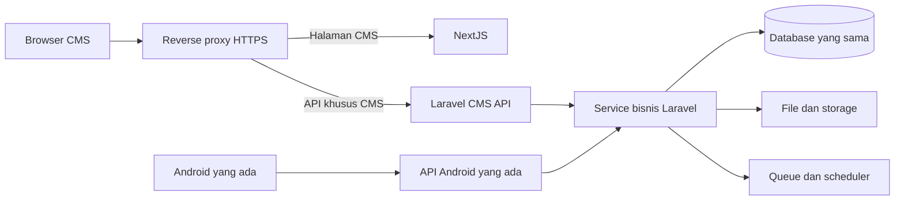

# Rancang pemisahan CMS NextJS

Chat ID: 01a0cce7-14e4-7f20-902d-b076fefb6fa3

Hanya pesan pengguna dan laporan akhir; instruksi lingkungan, reasoning, serta output tool mentah tidak diekspor. Kredensial disamarkan. Lampiran biner tetap berada di riwayat asli.

## 2026-09-23 13:14:55 WIB — Pengguna

ChatGPT saya ada rencana seperti ini, jadi sekarang kan CMS BUM ini benar-benar di framework Laravel 13 nya dan ada API untuk komunikasi data ke aplikasi mobile di Android, nah saya ada rencana dimana CMS BUM ini dipisah dengan dibuat dari NextJS jadi si Laravel 13nya menjadi full backend API untuk aplikasi mobile di Android dan juga CMS yang menggunakan NextJS ini.

Saya ingin kamu membuatkan saya rencana dan rancangan lengkap sepenuh yang aman, efisien dan presisi termasuk untuk CMS NextJSnya, untuk template atau temanya seperti apa di CMS NextJSnya ini kamu pakai aja tema atau template di CMS BUM yang sekarang, masukin juga kedalam rencana dan rancangannya.

Ingat jangan langsung eksekusi yah, hanya baru buat rencana dan rancangannya, harus lengkap, efisien, presisi dan aman, sehingga harapan saya sama sekali tidak ada error ataupun bug tidak jelas dan anomali, yang seharusnya sekarang tidak ada error dan bug, malah ada error dan bug nantinya, saya tidak mau seperti itu nantinya.

Dan untuk data graphifynya kalau belum diupdate sebaiknya update dulu, mungkin kamu butuh data dari situ juga.

---

## 2026-09-23 13:15:59 WIB — Pengguna

Untuk API ke aplikasi Android sebaiknya tidak usah deh, karena memang sudah ada APInya tinggal API untuk CMS NextJSnya aja sih yang perlu dimatangkan dan dsb yang perlu disesuaikan untuk kebutuhan CMS NextJSnya.

---

## 2026-09-23 13:16:38 WIB — Laporan akhir assistant

Untuk rancangan deployment CMS NextJS, apakah rencananya tetap memakai VPS/server yang sama dengan Laravel sekarang? Jika belum diputuskan, saya akan memakai asumsi satu VPS terlebih dahulu, dengan proses NextJS dan Laravel terpisah serta reverse proxy.
- Satu VPS, proses terpisah
- Server frontend dan backend terpisah
- Belum diputuskan

---

## 2026-09-23 14:28:49 WIB — Pengguna

Lanjutkan prosesnya

---

## 2026-09-23 14:31:51 WIB — Laporan akhir assistant

**Rancangan lengkapnya sudah saya susun, dengan fokus pada API khusus CMS NextJS. API Android yang sudah ada tetap dipertahankan.** Belum ada implementasi NextJS, perubahan source aplikasi, migrasi database, atau perubahan aturan bisnis.

Dokumen utama berisi 17 bagian, sekitar 6.500 kata, beserta inventaris route dan bukti pemeriksaan:

- **[Buka rancangan lengkap CMS NextJS](/D:/Laragon/www/laravel-13-cms-bum/project-artifacts/nextjs-cms-plan_20260923/RANCANGAN-CMS-NEXTJS.md)**
- [Inventaris 1.272 route Laravel](/D:/Laragon/www/laravel-13-cms-bum/project-artifacts/nextjs-cms-plan_20260923/route-inventory.csv)
- [Hasil verifikasi akhir artefak dan Graphify](/D:/Laragon/www/laravel-13-cms-bum/project-artifacts/nextjs-cms-plan_20260923/verification_20260923_143137_886302.json)

**Rekomendasi utama saya: migrasi bertahap, dengan NextJS menangani antarmuka CMS dan Laravel tetap menjadi pemilik seluruh aturan bisnis.**



Dengan rancangan ini, perubahan frontend tidak memerlukan pemindahan database atau penulisan ulang rumus payroll ke JavaScript. Service yang sudah ada digunakan kembali setelah ketergantungan dan perilakunya diperiksa.

**Pembagian tanggung jawab yang direncanakan adalah sebagai berikut.**

| Bagian | Tanggung jawab |
|---|---|
| **NextJS** | Halaman, navigasi, tabel, filter, form, grafik, peta, dan interaksi pengguna |
| **API CMS Laravel** | Login CMS, validasi, permission, pembatasan akses data, kontrak JSON, dan error |
| **Service Laravel** | Aturan bisnis, kalkulasi, transaksi database, approval, dan integrasi |
| **Queue/scheduler Laravel** | Impor, pekerjaan berat, notifikasi, dan pekerjaan berkala |
| **API Android** | Tetap memakai kontrak dan autentikasi yang sudah ada |

API CMS diusulkan memakai namespace **`/api/cms/v1`**, terpisah dari API Android. Kontraknya mencakup autentikasi, profil, navigasi, konfigurasi tampilan, list/detail/CRUD, lookup, dashboard, report, export, status pekerjaan, payroll, dan GIS.

Format response, pagination, validasi, status HTTP, permission, efek samping, dan perilaku retry ditentukan secara eksplisit. Endpoint kalkulasi, approval, closing, dan commit impor diperlakukan sebagai tindakan bisnis tersendiri.

**Untuk autentikasi CMS, pilihan paling sederhana yang sesuai source saat ini adalah mempertahankan session Laravel.**

Pemeriksaan source menunjukkan guard `web` menggunakan session, sedangkan guard `api` menggunakan Passport. Rancangan memanfaatkan pemisahan tersebut:

- Browser CMS dan API CMS berada pada origin yang sama melalui reverse proxy.
- Login CMS memakai session Laravel, cookie HttpOnly, HTTPS, serta perlindungan CSRF.
- NextJS tidak membuat sistem akun atau autentikasi kedua.
- Logout CMS tidak mencabut token Android.
- Tidak menyimpan token autentikasi di localStorage.
- Setiap permintaan tetap diperiksa permission dan cakupan datanya oleh Laravel.

Pendekatan ini menggunakan mekanisme session Laravel yang sudah tersedia. Untuk deployment NextJS, dokumentasi resminya juga merekomendasikan reverse proxy pada self-hosting. [Laravel Authentication](https://laravel.com/framework/docs/13.x/authentication), [Next.js Self-Hosting](https://nextjs.org/docs/app/guides/self-hosting).

**Tema NextJS akan mengikuti CMS BUM sekarang.**

Dari layout dan CSS aktif yang diperiksa, acuannya adalah Bootstrap custom, Aruna/Admin v6, warna BUM, Roboto, logo yang digunakan sekarang, sidebar, drawer navigasi, footer akun, tabel, filter, modal, dan pagination.

Yang dipertahankan mencakup:

- Warna utama BUM **`#F68B1F`** dan sekunder **`#1E398D`**.
- Identitas merek, nama menu, urutan navigasi, dan label.
- Kepadatan tabel dan pola kerja form.
- Sidebar yang dapat diciutkan serta navigasi layar kecil.
- Perilaku pencarian, filter ketat/longgar, sorting, pagination, dan export.
- Pola grafik dan peta yang relevan.

Interaksi Vue dibangun ulang sebagai komponen React. CSS dan aset yang sesuai dapat digunakan kembali setelah dipilah. Script Vue/global lama tidak dimasukkan begitu saja ke React karena bisa menimbulkan benturan pengelolaan DOM.

Sebelum pemindahan UI, rancangan mewajibkan screenshot dan pengukuran tampilan CMS lama pada beberapa ukuran layar. **Kesamaan visual saat ini baru ditentukan dari source; belum dibuktikan melalui perbandingan browser.**

**Ada beberapa risiko khusus dari source sekarang yang sudah dimasukkan ke rancangan.**

| Temuan | Implikasi untuk migrasi |
|---|---|
| Controller CMS mencampur Blade, JSON, redirect, dan operasi bisnis | API CMS perlu adapter yang jelas tanpa menulis ulang aturan bisnis |
| Permission lama berkaitan dengan menu dan URI | API baru harus memeriksa izin action dan resource secara eksplisit |
| Akun memiliki `access_data` dan `access_location` | Filter browser tidak boleh memperluas akses estate/afdeling |
| Payroll memiliki operasi baca dan kalkulasi | Membuka halaman, filter, atau export tidak boleh memicu rekalkulasi |
| Impor GIS memiliki tahap review dan commit | UI baru tidak boleh memintas tahapan tersebut |
| Komponen backend dipakai beberapa kanal | Perubahan service bersama wajib diuji terhadap konsumen yang terdampak |

Temuan tersebut menjadi **syarat pemeriksaan dan pengujian**, bukan perubahan yang langsung saya terapkan.

**Urutan migrasinya dibuat agar setiap modul bisa diperiksa dan dikembalikan secara terpisah.**

| Tahap | Hasil yang dituju |
|---|---|
| 1. Baseline | Pemetaan halaman, endpoint, service, permission, data, export, dan perilaku lama |
| 2. Fondasi | API CMS, session/CSRF, profil, navigasi, dan kerangka tema NextJS |
| 3. Pilot baca | Satu modul sederhana: list, detail, filter, pagination, dan akses data |
| 4. Pilot tulis | Create/edit/delete/upload dengan pengujian kegagalan dan concurrency |
| 5. Modul pendukung | Administrasi, referensi, konfigurasi, dan staffing secara bertahap |
| 6. Dashboard/report | Kesamaan dataset, scope, agregasi, cache, dan export |
| 7. Transaksi | Workflow, approval, closing, dan efek samping |
| 8. Payroll | Kesamaan hasil perhitungan, pembulatan, bulk, dan audit |
| 9. GIS kompleks | Impor, review, commit, koreksi, dan export |
| 10. Cutover | Pengalihan route, pemantauan, rollback, lalu penghentian UI lama |

Modul yang belum lolos tetap memakai CMS lama. Jumlah route tidak langsung diterjemahkan menjadi estimasi waktu; jadwal yang lebih presisi dibuat setelah pilot menunjukkan beban implementasi dan UAT yang nyata.

**Pengamanan terhadap bug dan anomali menjadi bagian wajib, bukan pekerjaan tambahan di akhir.**

Dokumen menjabarkan pengujian untuk:

- Submit ganda dan request paralel.
- Timeout setelah data sebenarnya sudah tersimpan.
- Dua pengguna menyunting record yang sama.
- Android atau CMS lama menulis data yang juga sedang digunakan CMS baru.
- Session habis saat form terisi.
- Cache yang tertukar antar pengguna atau cakupan akses.
- Respons filter lama datang setelah filter baru.
- Upload gagal dan file lama masih harus dipertahankan.
- Worker gagal/restart saat impor atau pekerjaan berat.
- Perbedaan hasil payroll, total report, dan export.
- Akses langsung ke ID, download, atau endpoint di luar hak pengguna.

**Saya tidak dapat menjanjikan “pasti nol bug”.** Yang dapat dibuat presisi adalah syarat kelulusannya: hasil bisnis kritis cocok dengan baseline, skenario wajib lulus, tidak ada masalah keamanan/konsistensi kritis yang terbuka, dan rollback telah diuji sebelum modul dialihkan.

Rollback juga dibedakan antara **mengembalikan UI** dan **memulihkan database**. Mengembalikan UI tidak boleh otomatis me-restore seluruh database karena transaksi baru dari Android maupun CMS bisa ikut hilang.

**Graphify sudah diperbarui dan pemeriksaan akhirnya lolos.**

Hasil terakhir:

- **1.638 file terwakili**: 1.630 AST dan 8 metadata.
- **8.550 node** dan **18.742 relasi**.
- Hash AST dan metadata cocok dengan source saat diperiksa.
- Tidak ditemukan duplicate ID atau dangling edge.
- HTML graph menggunakan script lokal.

Pada pemeriksaan antara, manifest aktif sempat kembali memuat hash lama setelah refresh pertama berhasil. Penyebab perubahan output tersebut belum teridentifikasi. Saya melakukan refresh kedua dan pemeriksaan independen; **hasil akhir pada 14:31 WIB lolos**. Kejadian ini dicatat di dokumen agar tidak disembunyikan.

Backup Graphify terakhir berada di:

[Backup Graphify sebelum refresh terakhir](/D:/Laragon/www/laravel-13-cms-bum/project-artifacts/graphify-manual-update_20260923_142923_110387/backup/graphify-out)

Query yang digunakan mencakup autentikasi/permission/menu, `MasterDataEmployee2Service`, `DriverPayrollService`, dan `OilPalmTreeMapController`. Relasi `INFERRED` tetap diperlakukan sebagai petunjuk navigasi, kemudian diperiksa pada source.

**Batas verifikasi sesi ini juga jelas.**

Yang sudah diperiksa adalah konfigurasi auth, dependency, bootstrap/routes, layout/CSS tema, controller dan service terpilih, registrasi route Laravel, serta integritas Graphify. File utama yang dibaca dan batas pemeriksaannya tercantum dalam dokumen.

Belum dilakukan pengujian browser per role, seluruh endpoint, payroll/GIS end-to-end, atau kapasitas server produksi. Suite PHPUnit penuh tidak dijalankan karena konfigurasi database uji terpisah belum ditetapkan secara eksplisit pada konfigurasi yang diperiksa.

Drive `E:` tidak tersedia pada sesi ini, sehingga memori utama di sana belum dapat dibaca. Memori terkait di C digunakan untuk workflow Graphify dan diverifikasi ulang terhadap kondisi proyek.

**Hasil pekerjaan ini adalah dokumen rancangan, inventaris route, dan pembaruan Graphify. Source aplikasi tidak diubah; perubahan Android milik Anda tetap dipertahankan.** Deployment sementara diasumsikan satu VPS dengan proses Laravel dan NextJS terpisah; lokasi project NextJS, hostname, role produksi, dan modul pilot ditandai sebagai keputusan yang perlu dikunci sebelum implementasi.

---

## 2026-09-23 15:53:12 WIB — Pengguna

Ok dirancangan file .md nya ada list halaman apa saja yang dijadikan API CMS?

---

## 2026-09-23 15:53:28 WIB — Laporan akhir assistant

**Sudah ada daftar kelompok modul dan rancangan endpoint inti, tetapi belum ada daftar lengkap satu per satu halaman CMS beserta API yang dibutuhkan setiap halaman.** Jadi, untuk bagian pemetaan halaman, dokumen tersebut memang masih perlu dilengkapi.

Isi yang sudah tersedia saat ini:

| Bagian dokumen | Isi | Kelengkapan |
|---|---|---|
| [Bagian 2.3 — Inventaris kelompok route](/D:/Laragon/www/laravel-13-cms-bum/project-artifacts/nextjs-cms-plan_20260923/RANCANGAN-CMS-NEXTJS.md:40) | Kelompok Transaction, Configuration, Dashboard, GIS, Report, Administration, Awesome Admin, Staffing, dan Calculation | Baru tingkat kelompok modul dan jumlah route |
| [Bagian 5.2 — Kontrak endpoint inti](/D:/Laragon/www/laravel-13-cms-bum/project-artifacts/nextjs-cms-plan_20260923/RANCANGAN-CMS-NEXTJS.md:123) | Login, profil, navigasi, Employee, lookup, dashboard, report, export, payroll, dan GIS | Rancangan inti; belum merinci seluruh halaman |
| [Inventaris route CSV](/D:/Laragon/www/laravel-13-cms-bum/project-artifacts/nextjs-cms-plan_20260923/route-inventory.csv) | Seluruh 1.272 entri route yang terdaftar, termasuk method, URL, controller/action, dan middleware | Lengkap sebagai inventaris route, belum sebagai pemetaan halaman → API CMS |

**Yang perlu ditambahkan agar sesuai dengan permintaan Anda tentang rancangan lengkap adalah matriks per halaman**, misalnya dengan susunan berikut:

| Halaman CMS | Fungsi di halaman | API CMS yang dibutuhkan | Backend yang digunakan kembali | Permission/scope | Tahap migrasi |
|---|---|---|---|---|---|
| Daftar Karyawan | List, cari, filter, sortir, pagination | List Employee dan lookup filter | Controller/service Employee yang diverifikasi | Hak baca dan cakupan data | Pilot baca |
| Detail Karyawan | Melihat detail dan foto | Detail Employee dan akses file | Service Employee | Hak baca terhadap record tersebut | Pilot baca |
| Tambah/Edit Karyawan | Mengisi form, upload foto, simpan | Lookup, create/update, upload | FormRequest dan service terkait | Hak tambah/edit | Pilot tulis |
| Payroll Driver | Daftar, detail, kalkulasi, export | Endpoint baca, command kalkulasi, dan export yang terpisah | `DriverPayrollService` | Hak akses data dan tindakan kalkulasi | Fase payroll |
| Impor Pokok | Upload, status, review, commit | Endpoint tiap tahap impor | Service dan job impor yang sudah ada | Hak impor, ownership, dan scope | Fase GIS |

Contoh di atas menunjukkan bentuk pemetaannya; **belum merupakan daftar final seluruh halaman**.

Secara teknis, **halamannya dibangun di NextJS, sedangkan kebutuhan data dan tindakan pada halaman tersebut dilayani API Laravel**. Satu halaman bisa membutuhkan beberapa endpoint, dan satu endpoint bisa dipakai beberapa halaman. Karena itu, 1.272 route tidak boleh dianggap sebagai 1.272 halaman atau semuanya otomatis dijadikan API CMS baru.

Saya perlu meluruskan penyampaian sebelumnya: **dokumen sudah luas pada sisi arsitektur, keamanan, migrasi, dan pengujian, tetapi belum lengkap pada pemetaan setiap halaman ke kontrak API-nya.** Bagian ini seharusnya dimatangkan pada tahap perencanaan sebelum implementasi dimulai.

---

## 2026-09-23 15:54:11 WIB — Pengguna

Ok coba kamu matangkan lagi

---

## 2026-09-23 17:48:30 WIB — Pengguna

Lanjutkan

---

## 2026-09-23 18:07:45 WIB — Pengguna

Lanjutkan

---

## 2026-09-23 18:09:13 WIB — Laporan akhir assistant

**Rancangannya sudah saya matangkan. Sekarang file utama memuat daftar halaman satu per satu, lengkap dengan rujukan kebutuhan API dan status migrasinya.** Pekerjaan tetap sebatas perencanaan; source aplikasi dan API Android tidak diubah.

Langsung buka **[Bagian 18 — Daftar halaman dan keputusan migrasi](/D:/Laragon/www/laravel-13-cms-bum/project-artifacts/nextjs-cms-plan_20260923/RANCANGAN-CMS-NEXTJS.md:503)**.

Dokumennya sekarang terdiri dari:

| Dokumen | Isi |
|---|---|
| **[Rancangan utama](/D:/Laragon/www/laravel-13-cms-bum/project-artifacts/nextjs-cms-plan_20260923/RANCANGAN-CMS-NEXTJS.md)** | Arsitektur, keamanan, tema, migrasi, pengujian, serta daftar halaman pada bagian 18–21 |
| **[Daftar halaman dan API CMS](/D:/Laragon/www/laravel-13-cms-bum/project-artifacts/nextjs-cms-plan_20260923/DAFTAR-HALAMAN-DAN-API-CMS.md)** | Rincian setiap halaman: URL, handler, view, service, modal, field/binding, kebutuhan API, akses, dan tahap migrasi |
| **[Katalog endpoint CMS](/D:/Laragon/www/laravel-13-cms-bum/project-artifacts/nextjs-cms-plan_20260923/KATALOG-ENDPOINT-CMS.md)** | Route lama → klasifikasi → proposal method/path API CMS → controller dan lokasi source |
| **[Temuan dan syarat sebelum migrasi](/D:/Laragon/www/laravel-13-cms-bum/project-artifacts/nextjs-cms-plan_20260923/GATE-DAN-TEMUAN-MIGRASI.md)** | Route atau halaman yang perlu ditinjau sebelum dipindahkan |

**Ada 206 route halaman yang sudah dicatat**, berdasarkan method aktif yang memanggil view. Pembagiannya:

| Kelompok | Jumlah route halaman |
|---|---:|
| Autentikasi, termasuk alias login | 6 |
| Akun | 1 |
| Administration | 15 |
| Awesome Admin | 16 |
| Calculation / Payroll | 12 |
| Configuration | 31 |
| Dashboard | 2 |
| GIS Master Data | 25 |
| Varian GIS Web | 3 |
| Notification Log | 2 |
| Report | 23 |
| Staffing | 16 |
| Transaction | 54 |
| **Total** | **206** |

Angka ini merupakan **route halaman yang ditemukan pada source**, bukan klaim bahwa ada 206 menu aktif untuk setiap pengguna. Isi menu aktual masih bergantung pada database, role, dan hak akses.

**Setiap halaman sekarang mempunyai pemetaan yang bisa ditelusuri.** Informasinya meliputi:

- ID halaman, judul dari source, URL lama, dan usulan URL NextJS.
- Controller/action beserta file dan nomor baris.
- View yang digunakan.
- Dependency service pada controller, dengan penanda bahwa import belum membuktikan pemanggilan pada setiap action.
- Middleware lama dan cakupan akses yang diwajibkan untuk API baru.
- Modal serta nama field/binding yang ditemukan.
- Kebutuhan data awal dan endpoint pendukung.
- Proposal method/path API CMS.
- Tahap migrasi dan alasan penahanan bila belum layak dipindahkan.

Hubungan yang ditemukan langsung pada view/JavaScript dibedakan dari hubungan yang baru menjadi **kandidat karena berada pada controller yang sama**. Jadi, dokumen tidak menganggap semua method controller otomatis harus dijadikan API.

**Beberapa keputusan rancangan juga sudah diperjelas berdasarkan source.**

1. **BPJS tetap menggunakan pola form modal.**  
   Halaman utama memiliki modal tambah/edit/delete. Method halaman create/edit yang kosong tidak dijadikan alasan untuk membuat halaman NextJS tambahan.

2. **Payroll memisahkan pembacaan dari kalkulasi.**  
   List, detail, filter, dan export dipisahkan dari tindakan kalkulasi. Route GET yang memang memicu tindakan tulis diusulkan menggunakan method mutasi pada API CMS baru.

3. **Dashboard dipetakan sebagai halaman dengan banyak dataset pendukung.**  
   Dataset grafik dan tabel tidak dihitung sebagai halaman tersendiri. Referensi dataset lama dan v2 tetap dibedakan sampai kesamaan perhitungannya terbukti.

4. **Impor Pokok mempertahankan alur review dan commit.**  
   Status, rows, review, audit blok, persetujuan, dan tindakan impor tetap dipetakan. Rancangan tidak menyederhanakannya menjadi upload yang langsung menulis data.

5. **Halaman yang belum jelas ditahan, bukan dibuat berdasarkan tebakan.**  
   Contohnya beberapa route turunan Approval Harvest RKH merujuk view yang belum ditemukan. Workflow index/AJAX-nya harus diperiksa terpisah sebelum memutuskan apakah halaman turunan itu memang diperlukan.

**Hasil pemetaan halaman memiliki status berikut.**

| Status | Jumlah | Makna |
|---|---:|---|
| Terpetakan dari source | 181 | Route, method, dan view ditemukan; masih memerlukan pengujian runtime |
| View belum ditemukan | 17 | Tidak boleh dimigrasikan otomatis |
| Varian halaman perlu ditinjau | 5 | Terutama varian map; penggunaannya harus dipastikan |
| Memerlukan keputusan fitur | 2 | Signup CMS dan recovery testing |
| Alias login | 1 | Tidak membutuhkan halaman login kedua |

Selain itu, tercatat **59 route dengan method handler yang tidak ditemukan**, **29 route dengan method kosong**, dan **13 route GET dengan sinyal tindakan tulis**. Ini **temuan statis, bukan jumlah bug runtime yang sudah terbukti**. Sebagian route bisa merupakan peninggalan, diagnostik, atau tidak dipakai karena alurnya melalui modal.

Dua method `getRKBUpdate` juga sudah diperiksa langsung: keduanya membaca status, sehingga tidak dimasukkan ke kelompok tindakan tulis hanya karena namanya mengandung kata “update”.

**Verifikasi artefaknya sudah lulus.**

- Seluruh **1.272 route** tercakup dalam katalog.
- Seluruh **206 ID halaman** terdapat pada dokumen utama dan dokumen rincian.
- **229 route API existing** tetap ditandai untuk dipertahankan.
- Tidak ada rujukan halaman/endpoint yang kehilangan ID tujuan.
- Tidak ada duplikasi pasangan method/path pada proposal endpoint yang dihasilkan.
- Hash **320 file source** yang digunakan cocok saat pemeriksaan akhir: 98 file controller, 192 Blade/include, dan 30 JavaScript.
- Syntax script pemeriksaan artefak lolos.
- Pemeriksaan Graphify kembali lolos; graph tidak diperbarui karena source aplikasi tidak berubah.

Buktinya tersedia pada **[laporan verifikasi pemetaan](/D:/Laragon/www/laravel-13-cms-bum/project-artifacts/nextjs-cms-plan_20260923/page-api-mapping/verification_20260923_180843_941290.json)**.

Dokumen utama sebelumnya juga sudah dibackup sebelum diperbarui: **[backup rancangan sebelumnya](/D:/Laragon/www/laravel-13-cms-bum/project-artifacts/nextjs-cms-plan_20260923/page-api-mapping/backups/20260923_180015/RANCANGAN-CMS-NEXTJS.md)**.

**Batas yang masih tersisa sudah tertulis di rancangan:** menu aktual per role, perilaku browser, schema input/output final setiap operasi, dan kesamaan hasil bisnis belum diuji. Pemetaan ini sudah jauh lebih konkret untuk menjadi dasar pengerjaan per modul, tetapi belum berarti seluruh endpoint siap dipublikasikan.

Memori terkait di C digunakan untuk konteks pemeriksaan Graphify; drive E masih tidak tersedia. Tidak ada implementasi NextJS, perubahan database, perbaikan source aplikasi, commit, atau push dalam tahap ini.

---

## 2026-09-23 18:19:40 WIB — Pengguna

Ok nice, ini kan nanti jadi terpisah antara Laravel 13 yang sudah menggunakan full backend dan CMS yang sudah menggunakan NextJS untuk buat branch terbarunya direpository GitLabnya seperti apa, apa buat dua branch baru kah atau apa? Dan satu lagi saat pembuatan API CMS lalu pembuatan CMS menggunakan NextJS apakah CMS yang sekarang yang masih menjadi satu dengan Laravel 13 akan dihapus atau nggak, menurut saya sih untuk sementara waktu jangan dihapus?

---

## 2026-09-23 18:20:21 WIB — Laporan akhir assistant

**Saya merekomendasikan dua repository: repository Laravel yang sekarang tetap digunakan, lalu membuat satu repository baru khusus CMS NextJS.** Masing-masing repository memiliki branch pengembangannya sendiri.

Dan untuk CMS Laravel yang sekarang: **tetap dipertahankan dan tetap berfungsi selama masa transisi. Penghapusannya tidak menjadi bagian dari pekerjaan awal pembuatan API CMS maupun NextJS.**

Saya sudah memeriksa kondisi lokal: branch aktif sekarang adalah `main`, dan remote `origin` menunjuk ke [repository GitLab bum-cms](https://gitlab.com/dedenkertawijaya/bum-cms). Saya belum membuat branch atau repository baru.

**Perbedaan repository dan branch perlu dipisahkan dalam rancangan ini.**

| Bagian | Kegunaan |
|---|---|
| **Repository** | Menyimpan source dan riwayat satu project; dalam rancangan ini, backend Laravel dan frontend NextJS menjadi dua project |
| **Branch** | Tempat mengerjakan perubahan pada masing-masing project sebelum digabungkan kembali |
| **Environment** | Tempat menjalankan aplikasi, seperti development, staging, dan production |

Branch merupakan jalur perubahan dalam repository. Perubahan pada branch fitur tidak otomatis mengikuti perubahan branch utama, sehingga branch perlu disinkronkan dan digabungkan melalui proses yang jelas. [Dokumentasi branch GitLab](https://docs.gitlab.com/topics/git/branch/).

Struktur yang saya sarankan:

```text
GitLab
│
├── bum-cms                         ← repository yang sekarang
│   ├── main
│   ├── codex/cms-api-foundation
│   ├── codex/cms-api-employees
│   └── branch fitur berikutnya
│
│   Isi:
│   ├── Laravel 13
│   ├── API Android yang sudah ada
│   ├── API CMS yang akan ditambahkan
│   ├── Service bisnis, database, queue, scheduler
│   └── CMS Blade/Vue lama yang tetap dipertahankan
│
└── bum-cms-next                     ← usulan repository baru
    ├── main
    ├── codex/cms-shell
    ├── codex/cms-employees
    └── branch fitur berikutnya

    Isi:
    ├── NextJS + React + TypeScript
    ├── Tema CMS BUM
    ├── Halaman dan komponen CMS
    └── Client untuk mengakses API CMS Laravel
```

Nama `bum-cms-next` masih usulan. Repository Laravel juga **tidak perlu langsung diganti namanya**, sehingga remote, riwayat, dan pengaturan yang sudah digunakan tetap bisa dipertahankan.

**Jadi, bisa ada dua branch pekerjaan pada awalnya, tetapi keduanya berada di repository yang berbeda.**

Contoh awal yang konkret:

| Pekerjaan | Repository | Branch usulan |
|---|---|---|
| Fondasi API CMS: session, CSRF, `/me`, navigasi, permission, error JSON | `bum-cms` | `codex/cms-api-foundation` |
| Fondasi NextJS: tema, layout, sidebar, login, API client | `bum-cms-next` | `codex/cms-shell` |

Setelah masing-masing bagian lolos pemeriksaan, branch tersebut digabungkan ke `main` repository masing-masing melalui Merge Request. Fitur berikutnya menggunakan branch baru dengan lingkup kecil. GitLab menyediakan alur Merge Request untuk meninjau dan menggabungkan perubahan antarbranch. [Dokumentasi Merge Request GitLab](https://docs.gitlab.com/user/project/merge_requests/creating_merge_requests/).

Saya tidak menyarankan mempertahankan satu branch `laravel-backend` dan satu branch `nextjs-frontend` sebagai dua aplikasi permanen di repository yang sama. Itu membuat dua isi project yang berbeda hidup sebagai versi alternatif dalam riwayat yang sama, sehingga pemeliharaan dan proses merge mudah membingungkan.

Jika Anda ingin tetap satu repository, pilihan yang masuk akal adalah **dua folder aplikasi pada branch yang sama**—misalnya `backend/` dan `frontend/`. Namun, untuk kondisi proyek sekarang, dua repository lebih sesuai karena tidak memerlukan pemindahan struktur Laravel yang sudah berjalan.

**CMS Laravel lama tetap berada di source aktif, bukan hanya disimpan di branch backup.**

Ini penting. Apabila hanya disimpan di branch lama, CMS tersebut belum tentu tetap kompatibel dengan service atau database yang berkembang selama migrasi.

Selama masa transisi, kondisinya menjadi:

| Komponen | Status |
|---|---|
| CMS Laravel Blade/Vue lama | Tetap tersedia dan berfungsi |
| API Android | Tetap menggunakan kontrak yang sekarang |
| API CMS baru | Ditambahkan bertahap |
| CMS NextJS | Dibangun dan diaktifkan per modul |
| Database bisnis | Tetap satu sumber data yang dikelola Laravel |
| Service bisnis | Digunakan kembali dengan pengujian kompatibilitas |

Artinya, **Laravel masih melayani CMS lama sekaligus API selama masa transisi**. Kondisi “Laravel sepenuhnya menjadi backend API untuk UI CMS” adalah target akhir setelah NextJS siap menggantikan seluruh kebutuhan yang disepakati.

Urutannya sebaiknya seperti ini:

1. **Tambahkan API CMS tanpa menghilangkan halaman lama.**  
   Route, view, aset, dan alur CMS lama tetap tersedia.

2. **Bangun NextJS pada alamat development/staging tersendiri.**  
   Pengujian operasi tulis menggunakan lingkungan dan database uji terpisah.

3. **Uji satu modul sampai lengkap.**  
   Periksa tampilan, akses data, validasi, hasil penyimpanan, export, serta dampaknya pada service bersama.

4. **Aktifkan NextJS secara terbatas.**  
   Modul yang belum siap tetap dibuka melalui CMS Laravel. Pengguna pilot memiliki jalur kembali ke UI lama.

5. **Pertahankan CMS lama selama periode penggunaan dan evaluasi.**  
   Perubahan backend yang dipakai bersama harus tetap kompatibel dengan kedua UI dan Android.

6. **Bahas penghentian CMS lama sebagai pekerjaan terpisah.**  
   Penonaktifan atau penghapusan dilakukan setelah ada bukti kesiapan dan instruksi Anda—tidak otomatis setelah NextJS selesai dibangun.

Ada satu aturan penting ketika kedua CMS sudah terhubung ke database yang sama: **satu tindakan bisnis tidak dijalankan dua kali untuk membandingkan hasilnya**. Misalnya, kalkulasi atau approval tidak dikirim melalui CMS lama lalu diulang melalui NextJS pada data aktif yang sama. Perbandingan tindakan tulis dilakukan pada data uji yang terkontrol.

**Alur rilis dua repository juga perlu dikoordinasikan.** Backend merilis endpoint yang kompatibel terlebih dahulu, kemudian frontend yang memakainya. Setiap rilis mencatat pasangan versi/commit Laravel dan NextJS yang sudah diuji bersama. Dengan begitu, pemisahan repository tidak membuat versi frontend dan backend berjalan tanpa kecocokan kontrak.

Untuk keputusan rancangan saat ini, saya sarankan kita pegang tiga hal berikut:

- **Repository Laravel sekarang tetap digunakan; satu repository baru dibuat untuk NextJS.**
- **Branch fitur dibuat per pekerjaan di masing-masing repository, kemudian digabungkan setelah lolos pemeriksaan.**
- **CMS Laravel lama tetap dipertahankan dan diuji selama transisi; penghapusannya membutuhkan keputusan terpisah dari Anda.**

---

## 2026-10-01 10:57:16 WIB — Pengguna

ChatGPT saya kembali lagi, kita lanjut yah dari planning yang sudah kita buat task list pembuatan APInya apa saja?

---

## 2026-10-01 11:17:31 WIB — Laporan akhir assistant

**Ya, kita lanjut dari planning yang sudah dibuat. Task list API CMS sebaiknya dikerjakan dari fondasi autentikasi dan akses data, kemudian satu modul percontohan, lalu diperluas ke modul bisnis.**

Saya sudah membaca kembali [rancangan utama](/D:/Laragon/www/laravel-13-cms-bum/project-artifacts/nextjs-cms-plan_20260923/RANCANGAN-CMS-NEXTJS.md:397), [daftar halaman](/D:/Laragon/www/laravel-13-cms-bum/project-artifacts/nextjs-cms-plan_20260923/DAFTAR-HALAMAN-DAN-API-CMS.md), dan [katalog endpoint](/D:/Laragon/www/laravel-13-cms-bum/project-artifacts/nextjs-cms-plan_20260923/KATALOG-ENDPOINT-CMS.md). Batas pekerjaan tetap: **API Android dipertahankan dan CMS Blade/Vue lama tetap berfungsi selama transisi.**

Ada satu kondisi workspace yang perlu masuk sebagai task pertama: folder aktif `D:\Laragon\www\laravel-13-cms-bum-next` sekarang masih berisi struktur Laravel, `package.json`-nya memakai Vite, dan belum dikenali sebagai repository Git. Jadi, peran folder tersebut perlu dipastikan sebelum coding agar kita bekerja pada source backend yang benar.

**Berikut task list API CMS yang saya sarankan sebagai urutan pengerjaan.** ID ini merupakan usulan daftar kerja; belum berarti implementasinya sudah dijalankan.

| ID | Task | Hasil yang harus tersedia | Syarat selesai |
|---|---|---|---|
| **API-00** | Pastikan workspace, source resmi, dan baseline terbaru | Penetapan folder backend/frontend, status Git, backup, inventaris perubahan sejak planning | Tidak ada perubahan pengguna yang tertimpa; target pekerjaan jelas |
| **API-01** | Matangkan kontrak API untuk batch pertama | Method/path, input/output, validasi, permission, scope, error, dan efek samping | Kontrak dapat diuji dan tidak memiliki arti yang ambigu |
| **API-02** | Buat grup route API CMS | Namespace `/api/cms/v1`, registrasi route, middleware session/CSRF dan nama route tersendiri | Route CMS terdaftar; route Android dan CMS lama tetap kompatibel |
| **API-03** | Buat format response dan error CMS | JSON sukses, pagination, validasi, 401/403/404/419/422/500, request ID | Error CMS tidak berubah menjadi HTML/redirect; detail sensitif tidak bocor |
| **API-04** | Buat autentikasi CMS | CSRF, login, logout, pemeriksaan sesi/status akun, recovery password | Session fixation, CSRF, akun nonaktif, sesi habis, dan logout diuji |
| **API-05** | Buat pemeriksaan permission dan cakupan data | Pemeriksaan action, resource, estate/afdeling, serta akses langsung melalui ID | Pengguna tidak bisa memperluas akses melalui parameter atau URL |
| **API-06** | Buat API profil, navigasi, dan konfigurasi tampilan | `/me`, menu terstruktur, capabilities, serta identitas/tampilan CMS | Data akun/config memakai whitelist; tidak mengirim credential |
| **API-07** | Buat pilot Employee untuk pembacaan | List, detail, pencarian, filter, sorting, pagination, lookup | Data dan hasil filter cocok dengan baseline; akses di luar scope ditolak |
| **API-08** | Lengkapi pilot Employee untuk penulisan | Create/update/delete, foto, dan bulk yang memang digunakan | Validasi, kegagalan upload, submit ganda, konflik edit, dan aturan referensi diuji |
| **API-09** | Sediakan penanganan file dan pekerjaan berat yang dibutuhkan | Upload/download terlindungi, status operasi, export berat sesuai kebutuhan | Ownership/permission benar; timeout/retry tidak menggandakan tindakan |
| **API-10** | Buat API Configuration | Referensi, tarif, BPJS, NTMA, Natura, rotasi, hari libur, variabel | Alur modal dipertahankan; perubahan konfigurasi tidak mengubah hasil bisnis tanpa aturan yang jelas |
| **API-11** | Buat API Administration dan Staffing lainnya | Master operasional, kontrak, jadwal, overseering, dan aktivitas | Relasi, status, scope, lookup, dan dampaknya ke transaksi diuji |
| **API-12** | Buat API Dashboard | Dataset per tab, filter organisasi/periode, grafik, dan ringkasan | Agregasi cocok; cache tidak tertukar antar pengguna/scope |
| **API-13** | Buat API Report dan Export | Dataset laporan, detail, filter, total, format, serta unduhan | Report/export memakai cakupan data yang sama dan tidak memicu rekalkulasi |
| **API-14** | Buat API Transaction dan Approval | Aktivitas, attendance, BUM Mart, P2H/PM10, RKB/RKH, approval, sync/closing yang digunakan | State transition, transaksi database, audit, dan efek samping konsisten |
| **API-15** | Buat API Calculation/Payroll | Pembacaan, detail, export, kalkulasi per record dan bulk | Nilai uang/rounding cocok dengan golden dataset; command tahan retry dan konflik |
| **API-16** | Buat API GIS | List/map, GeoJSON/tile, lookup, koreksi, kandidat pokok, impor/review/commit/export | CRS, geometri, bounds, scope, ownership, dan recovery job diuji |
| **API-17** | Buat API pengelolaan Awesome Admin | Akun, role, permission, menu, bahasa, konfigurasi, SMTP, dan kebutuhan Form Builder | Tidak ada eskalasi hak atau kebocoran secret; perubahan izin berlaku sesuai kebijakan |
| **API-18** | Buat API Notification Log | List/detail log dengan pagination dan filter | Payload sensitif disamarkan dan akses dibatasi |
| **API-19** | Jalankan regresi dan siapkan rilis bertahap | Contract test, kompatibilitas konsumen lama, observability, staging, UAT, dan rollback | Modul hanya diaktifkan setelah syarat kelulusannya terpenuhi |

**Batch pertama yang paling tepat adalah API-00 sampai API-07.** Setelah itu kita sudah mempunyai API yang cukup untuk membangun login, layout/menu, dan halaman Employee read-only di NextJS. Operasi create/edit/delete menyusul setelah fondasi akses data dan kontrak pembacaan terbukti benar.

Untuk fondasi, daftar endpoint yang direncanakan adalah:

| Endpoint relatif terhadap `/api/cms/v1` | Kegunaan |
|---|---|
| `GET /auth/csrf` | Memulai session dan memperoleh token CSRF |
| `POST /auth/login` | Login akun CMS |
| `POST /auth/logout` | Mengakhiri session CMS |
| `GET /me` | Profil minimum, capabilities, dan cakupan akses |
| `GET /navigation` | Menu terstruktur sesuai pengguna |
| `GET /site-config` | Identitas dan konfigurasi tampilan yang boleh dikirim |
| `POST /auth/password/forgot` | Memulai pemulihan password |
| `POST /auth/password/reset` | Menyelesaikan pemulihan password |

Nama path endpoint per modul akan mengikuti keputusan pada katalog terbaru. Kita perlu mengunci satu kontrak untuk setiap fungsi agar tidak membuat beberapa endpoint yang melakukan pekerjaan sama.

**Cakupan modul pada task berikutnya sudah berasal dari daftar halaman yang kita petakan.**

| Task | Modul yang termasuk |
|---|---|
| **API-10 — Configuration** | BPJS, NTMA Driver/Pemanen, Natura, loading type, tarif premi, reward/penalty, perawatan Ancak, referensi pendidikan/agama/jenis karyawan/fungsi kerja/overseering, hari libur, rotasi, dan variabel |
| **API-11 — Administration/Staffing** | Aresta TPH, kendaraan, estimasi jarak, master blok, site, status tahun tanam, kontrak karyawan, jadwal, overseering, dan aktivitas |
| **API-12 — Dashboard** | Dashboard utama dan Production v2 beserta dataset Aresta, produksi, Gokut, manpower, dan Ancak maintenance yang digunakan |
| **API-13 — Report** | Laporan attendance, operasional unit, solar, tenaga kerja, premi/produksi panen, perjalanan pemanen, perawatan, payroll, evaluasi produksi, pruning, pendapatan, dan hasil kerja operator |
| **API-14 — Transaction** | Attendance, BUM Mart, aktivitas harian panen/perawatan/transport, P2H, PM10, aktivitas lain, RKB/RKH Driver, Harvest, Maintenance, serta approval terkait |
| **API-15 — Payroll** | Krani Panen, Operator/Driver, Pemanen, Pemuat, Mandor Panen, dan Mandor 1 |
| **API-16 — GIS** | Boundary, block, pokok, infrastruktur, map, kandidat pokok, impor Ancak/Pokok, review, koreksi, dan export |

**Setiap task modul harus mempunyai checklist yang sama agar API tidak selesai hanya karena sudah mengembalikan JSON.**

- Tentukan halaman dan tindakan yang benar-benar memerlukan endpoint tersebut.
- Telusuri controller, service, model, job, serta konsumen yang sudah ada.
- Tetapkan schema request/response dan validasi.
- Terapkan permission action serta pembatasan resource/data.
- Bedakan pembacaan dari tindakan yang menyimpan atau menghitung ulang.
- Uji respons normal, kosong, invalid, tidak berizin, dan gagal.
- Uji efek pada CMS Laravel lama serta API Android bila service bersama berubah.
- Cocokkan hasil dengan baseline dan catat batas yang belum diuji.

Untuk payroll, approval, impor, dan operasi bulk, checklist tersebut ditambah pengujian submit ganda, request paralel, timeout setelah commit, retry, serta perubahan data oleh kanal lain.

**Temuan lama menjadi task review per modul, bukan semuanya langsung diperbaiki sekaligus.** Katalog 23 September mencatat 59 route dengan handler tidak ditemukan, 29 method kosong, dan 17 route halaman dengan view yang belum ditemukan. Angka itu merupakan snapshot statis pada saat planning; belum saya audit ulang seluruhnya pada 1 Oktober. Contohnya, method create/edit kosong bisa memang tidak digunakan karena form berada di modal. Keputusannya perlu mengikuti workflow aktual.

Pemeriksaan sesi ini mengonfirmasi bahwa file rencana masih tersedia, guard CMS masih menggunakan session dan guard API menggunakan Passport pada konfigurasi backend yang diperiksa. File `routes/cms_api.php` juga belum ditemukan di kedua folder. Belum ada implementasi API yang saya jalankan pada sesi ini.

**Titik mulai kita adalah API-00: memastikan source backend dan peran folder `laravel-13-cms-bum-next`, lalu menyiapkan kontrak serta lingkungan uji untuk fondasi API.** Setelah itu, API-02 sampai API-07 dapat dikerjakan sebagai batch pertama yang hasilnya konkret dan bisa dipakai untuk pengembangan CMS NextJS.

---

## 2026-10-01 11:29:52 WIB — Pengguna

Ok sekarang saya ingin yang paling mudahnya dulu aja, yaitu kerjakan dari API-00 sampai API-12 berarti kamu buat APInya dulu baru ke NextJSnya kan yah, untuk UI UX halaman authnya disamakan aja seperti sekarang, tapi untuk template CMSnya ambil dari template Arunika Lucent pastikan UI UX 100% sama

---

## 2026-10-01 11:30:32 WIB — Laporan akhir assistant

API CMS Laravel akan saya tambahkan di folder mana? Saat ini `laravel-13-cms-bum` adalah repository backend yang aktif, sedangkan `laravel-13-cms-bum-next` berisi salinan Laravel dan belum menjadi project NextJS. Pilihan ini menentukan source yang akan diubah.
- Backend di laravel-13-cms-bum; NextJS di laravel-13-cms-bum-next
- API dikerjakan di salinan laravel-13-cms-bum-next terlebih dahulu

---

## 2026-10-01 11:31:00 WIB — Pengguna

<send_user_message_question_reply>
[{"questionItemId":"[\"request_user_input_async\",\"call_OWwS43gV4JGkdjnLknVjcNdT\",0]","question":"API CMS Laravel akan saya tambahkan di folder mana? Saat ini `laravel-13-cms-bum` adalah repository backend yang aktif, sedangkan `laravel-13-cms-bum-next` berisi salinan Laravel dan belum menjadi project NextJS. Pilihan ini menentukan source yang akan diubah.","answer":"API dikerjakan di salinan laravel-13-cms-bum-next terlebih dahulu"}]
</send_user_message_question_reply>

---

## 2026-10-01 12:56:17 WIB — Pengguna

Masih lama kah?

---

## 2026-10-01 14:02:51 WIB — Laporan akhir assistant

**Implementasi backend API-00 sampai API-12 sudah tersedia pada salinan `D:\Laragon\www\laravel-13-cms-bum-next`. Pengujian otomatis yang terakhir dijalankan lolos: 18 tes dengan 167 assertion.** Ini masih checkpoint implementasi untuk ditinjau dan diuji pada database staging, belum saya nyatakan siap rilis.

Berkas hasil pekerjaan:

- **[Laporan implementasi dan status per task](/D:/Laragon/www/laravel-13-cms-bum-next/project-artifacts/cms-api_20261001/IMPLEMENTATION.md)**
- [Snapshot kontrak OpenAPI](/D:/Laragon/www/laravel-13-cms-bum-next/project-artifacts/cms-api_20261001/openapi.json)
- [Hasil pengujian terakhir](/D:/Laragon/www/laravel-13-cms-bum-next/project-artifacts/cms-api_20261001/tests-passed.txt)

Yang sudah ditambahkan mencakup:

| Bagian | Implementasi |
|---|---|
| **Fondasi API** | Namespace `/api/cms/v1`, middleware khusus, JSON error, request ID, serta pengaturan cache privat |
| **Auth** | CSRF, login, logout, profil, recovery password, token sekali pakai, rate limit, dan pemeriksaan sesi |
| **Permission dan scope** | Pemeriksaan module/action, pembatasan estate/region, serta pemeriksaan akses langsung terhadap record |
| **Data pendukung UI** | Branding terbatas, navigasi/menu, konfigurasi tampilan, dan lookup |
| **Employee** | List, detail, filter, sorting, pagination, create/update/delete, bulk, dan foto |
| **Pencegahan duplikasi/konflik** | Idempotency key untuk create/command serta ETag/`If-Match` untuk update/delete |
| **Export** | Antrean XLSX, status pekerjaan, pemeriksaan owner/scope saat download, masa berlaku, dan command cleanup |
| **Configuration** | Resource konfigurasi/referensi, penggunaan service perhitungan yang ada, serta rotation summary/generate |
| **Administration dan Staffing** | Resource master, kontrak/history, overseering, aktivitas, serta pembacaan/generate jadwal |
| **Dashboard** | Registry dan adapter untuk 103 dataset backend yang disetujui |

Registrasi Artisan saat ini menunjukkan **322 entri route CMS baru**, yang direpresentasikan sebagai **238 path pada snapshot OpenAPI**. Jumlah route ini tidak berarti semuanya sudah diuji terhadap data bisnis.

**Pengujian yang sudah dibuktikan** antara lain login aktif/nonaktif, CSRF, rate limit, recovery password sekali pakai, retry create tanpa duplikasi, penolakan revisi lama, filter OR yang tetap dibatasi estate, export privat, serta penolakan akses dashboard agregat yang belum memiliki pembatas estate yang terbukti.

Ada beberapa batas yang perlu diketahui sebelum melanjutkan:

- **Dashboard agregat lama sementara dibatasi untuk profile dengan cakupan `SEMUA`.** Profile ESTATE/REGION ditolak pada dataset tersebut sampai pembatasan per dataset dibuktikan.
- **Seluruh rumus, SQL view, trigger, dan variasi role belum diuji pada database bisnis.** Tes saat ini menggunakan SQLite in-memory dan fixture terisolasi.
- **Migration tabel operasi CMS hanya dijalankan pada fixture pengujian.** Migration dan worker export belum dijalankan pada database aktif.
- **OpenAPI sudah mencakup daftar endpoint**, tetapi schema field setiap form kompleks masih perlu diperinci.
- **NextJS belum dibuat pada checkpoint ini.** Referensi auth BUM dan Arunika Lucent sudah dicatat, tetapi kesamaan UI UX 100% belum dapat diklaim tanpa implementasi dan perbandingan browser.

Source repository Laravel asli tidak diubah untuk implementasi ini. CMS Blade/Vue lama pada salinan juga tetap dipertahankan. Backup perubahan berada di [folder backup implementasi](/D:/Laragon/www/laravel-13-cms-bum-next/project-artifacts/cms-api_20261001/backups). Tidak ada commit, push, atau repository GitLab baru yang dibuat.

Graphify digunakan untuk navigasi awal dan diperiksa terhadap source. **Graph belum diperbarui setelah perubahan kode**, mengikuti instruksi Anda bahwa pembaruannya dilakukan manual.

Tahap berikutnya adalah **menetapkan database staging yang terpisah, menguji hasil bisnis dan role, lalu mengerjakan frontend NextJS** dengan auth mengikuti tampilan BUM sekarang dan layout CMS mengikuti Arunika Lucent.

---

## 2026-10-01 14:03:30 WIB — Pengguna

Perkiraan selesai berapa jam lagi dan selesai jam berapa?

---

## 2026-10-01 14:04:43 WIB — Laporan akhir assistant

**Untuk menuntaskan tahap API-00 sampai API-12 beserta pengujian integrasinya, perkiraan kasar saya sekitar 6–10 jam kerja lagi**, dengan asumsi database staging yang sesuai tersedia dan tidak ada perubahan scope atau masalah besar pada schema/SQL view.

Sekarang **14.04 WIB, 1 Oktober 2026**. Jika pengerjaan dapat berlangsung terus dari sekarang, kisaran selesainya:

| Tahap | Perkiraan | Kisaran selesai |
|---|---:|---|
| Verifikasi dan penyelesaian API-00–API-12 | 6–10 jam kerja lagi | **20.00 WIB hari ini sampai sekitar 00.00 WIB, 2 Oktober** |
| NextJS: halaman auth dan kerangka CMS Arunika Lucent | Tambahan sekitar 12–24 jam kerja | Setelah tahap API lolos |
| Seluruh halaman modul di NextJS dan pemeriksaan kesamaan UI | Belum bisa dipatok dengan presisi | Perlu dihitung setelah kerangka dan satu modul percontohan selesai |

**Kisaran 20.00–00.00 tersebut adalah estimasi untuk tahap API, belum termasuk seluruh CMS NextJS.** Source API sudah dibuat, tetapi pengujian sekarang baru membuktikan fixture SQLite; hasil bisnis pada database staging masih perlu diperiksa.

Saya tidak ingin menjanjikan jam selesai yang seolah pasti. Estimasi itu bersyarat pada kesiapan staging dan hasil pengujian, serta bukan berarti pekerjaan akan otomatis berjalan di latar belakang sampai jam tersebut.

---

## 2026-10-01 14:05:32 WIB — Pengguna

Coba langsung ke NextJSnya dan langsung integrasikan dengan API CMS yang sudah dibuat yah

---

## 2026-10-01 14:48:16 WIB — Pengguna

UI UX table, pagination, form search, heading, dsb. Pastikan sama 100% yah

---

## 2026-10-01 14:51:21 WIB — Laporan akhir assistant

Untuk tabel, pagination, search, heading, dan form, acuan 100%-nya yang Anda maksud adalah komponen halaman CMS BUM sekarang, dengan shell Arunika Lucent; atau seluruh komponen dari halaman Phoenix saat memakai Lucent? Keduanya berbeda, jadi saya perlu mengunci acuan sebelum menyesuaikan seluruh halaman.
- Komponen BUM sekarang + shell Lucent
- Seluruh komponen Phoenix/Lucent

---

## 2026-10-01 14:56:10 WIB — Pengguna

<send_user_message_question_reply>
[{"questionItemId":"[\"request_user_input_async\",\"call_kH24K4uChRm9m5zIHuouEQ8F\",0]","question":"Untuk tabel, pagination, search, heading, dan form, acuan 100%-nya yang Anda maksud adalah komponen halaman CMS BUM sekarang, dengan shell Arunika Lucent; atau seluruh komponen dari halaman Phoenix saat memakai Lucent? Keduanya berbeda, jadi saya perlu mengunci acuan sebelum menyesuaikan seluruh halaman.","answer":"Seluruh komponen dari halaman Phoenix saat memakai Lucent"}]
</send_user_message_question_reply>

---

## 2026-10-01 15:25:43 WIB — Pengguna

Pada halaman BPJS fitur reponsive table ketika mobile view nge-bug, nge-glitch parah
