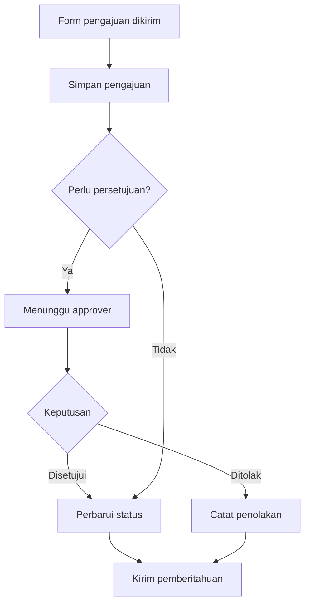

# Tinjau fitur workflow editor

Chat ID: 01a109e2-b166-70b3-a5e5-d32a7886b03e

Hanya pesan pengguna dan laporan akhir; instruksi lingkungan, reasoning, serta output tool mentah tidak diekspor. Kredensial disamarkan. Lampiran biner tetap berada di riwayat asli.

## 2026-10-05 09:27:39 WIB — Pengguna

ChatGPT saya ingin tanya apakah kamu bisa membuat fitur halaman baru, fitur ini adalah fitur workflow editor, untuk contohnya bisa kamu lihat disini [https://github.com/kargulstudio/workflow-editor](https://github.com/kargulstudio/workflow-editor) ? saya tanya kamu dulu

---

## 2026-10-05 09:29:41 WIB — Laporan akhir assistant

**Bisa. Saya bisa membuat Workflow Editor sebagai halaman/menu baru di Phoenix dengan pola interaksi seperti contoh yang Anda kirim.** Saya memahami bahwa saat ini Anda baru menanyakan kemungkinan pembuatannya.

Saya sudah memeriksa beberapa source utama repository tersebut. Editor itu memiliki:

- **Canvas workflow** untuk menempatkan dan menggeser node, menghubungkan langkah, serta zoom dan pan.
- **Jenis langkah** seperti trigger, kondisi bercabang, delay, email, webhook, dan update subscription.
- **Panel pengaturan node** dengan tab Build, Status, dan Logs.
- **Undo/redo** serta struktur data berupa node dan koneksi antarnode.

Fitur tersebut terlihat dalam [source canvas](https://github.com/kargulstudio/workflow-editor/blob/main/components/home/editor/workflow/workflow-canvas.tsx), [workflow store](https://github.com/kargulstudio/workflow-editor/blob/main/stores/workflow-store.ts), dan [panel node](https://github.com/kargulstudio/workflow-editor/blob/main/components/home/editor/workflow/node-panel/node-panel.tsx).

Ada satu hal yang perlu dipahami untuk menentukan scope: **editor visual dan mesin yang menjalankan workflow merupakan dua bagian pekerjaan.** Pada contoh ini, fungsi Run yang saya periksa masih berupa simulasi: cabang dipilih secara acak, sedangkan hasil email dan webhook ditampilkan sebagai pesan log. Jika Anda ingin workflow benar-benar memproses data, mengirim email, atau menjalankan approval, kita perlu menambahkan eksekusi backend sesuai kebutuhan Anda. [Source simulasi Run](https://github.com/kargulstudio/workflow-editor/blob/main/components/home/editor/workflow/workflow-run.ts).

Untuk Phoenix, **kita bisa mengadaptasi tampilan dan interaksinya ke stack yang sudah digunakan**. Contoh tersebut menggunakan Next.js/React, sementara [package.json Phoenix](/D:/Laragon/www/laravel-13-phoenix/package.json) sudah memuat Vue 3 dan Vite. Pilihan awal saya adalah memakai Vue untuk editor dan Laravel untuk penyimpanan serta eksekusi workflow. Teknologi finalnya bisa ditentukan setelah tujuan fiturnya jelas. [Dependencies contoh](https://github.com/kargulstudio/workflow-editor/blob/main/package.json).

Pemeriksaan ini baru berupa pembacaan source dan query Graphify untuk konteks Vue/Vite; belum ada pengujian runtime, perubahan file, atau pembaruan graph. Folder memori `E:\AI\Memories` tidak dapat diakses pada sesi ini, sehingga saya memakai catatan relevan di C sebagai konteks awal.

**Workflow ini nantinya ingin Anda gunakan untuk proses apa—approval, alur Form, otomatisasi pekerjaan/data, atau terlebih dahulu sebagai editor visual untuk menyusun dan menyimpan diagram?**

---

## 2026-10-05 09:43:45 WIB — Pengguna

Sebenarnya untuk semua yang sebutkan sih, gimana menurutmu?

---

## 2026-10-05 09:47:39 WIB — Laporan akhir assistant

**Menurut saya, itu arah yang tepat: satu Workflow Editor di Phoenix yang bisa dipakai untuk approval, alur Form, otomatisasi data, dan menyusun diagram.** Semuanya memiliki pola yang sama: ada pemicu, data yang diproses, kondisi, langkah berikutnya, dan hasil akhir.

Dengan cakupan tersebut, fiturnya menjadi **modul workflow baru**, sehingga kita perlu menyepakati cara kerjanya sebelum masuk ke implementasi. Saya menyarankan fondasinya mendukung semua kebutuhan itu, lalu integrasinya dibangun bertahap.

Penggunaan satu editor tersebut bisa seperti ini:

| Kebutuhan | Contoh workflow |
|---|---|
| Approval | Pengajuan masuk → pemeriksaan → persetujuan → perubahan status → pemberitahuan |
| Form | Form dikirim → validasi → simpan pengajuan → tentukan alur berdasarkan jawaban |
| Otomatisasi data | Data dibuat atau diperbarui → periksa kondisi → jalankan tindakan yang diizinkan → catat hasil |
| Diagram | Susun dan simpan alur sebagai draft untuk ditinjau sebelum diaktifkan |

**Editor yang sama boleh memuat langkah otomatis dan langkah yang menunggu manusia.** Misalnya, satu Form pengajuan bisa memulai alur berikut:

Untuk mewujudkannya, saya akan membagi tanggung jawabnya menjadi tiga bagian:

1. **Workflow Editor** — tempat pengguna menyusun node, koneksi, kondisi, dan pengaturan. Di sini juga ada draft, validasi alur, dan publish.
2. **Workflow Engine di Laravel** — menjalankan langkah, menyimpan posisi terakhir, menunggu approval atau waktu tertentu, serta mencatat keberhasilan dan kegagalan.
3. **Integrasi dengan modul Phoenix** — menghubungkan Form atau kejadian pada modul lain ke workflow, lalu menjalankan tindakan melalui aturan bisnis modul tersebut.

Pembagian ini membuat editor dapat digunakan oleh banyak fitur tanpa harus memahami seluruh detail setiap modul.

Saya sudah memeriksa source aktif [FormSubmissionHandler v2.4](/D:/Laragon/www/laravel-13-phoenix/app/Support/PageBuilderElementorV24/FormSubmissionHandler.php:30). Form saat ini sudah memiliki validasi, penyimpanan melalui aksi `collect`, email, dan webhook. Jadi, **kita punya titik integrasi yang bisa digunakan kembali**. Pengaturan integrasinya perlu menentukan siapa yang menjalankan email atau webhook agar tindakan yang sama tidak terkirim dua kali.

Untuk pekerjaan di belakang layar, saya menyarankan memakai queue Laravel yang sudah tersedia di project. Laravel mendukung pemrosesan melalui database queue, pengulangan pekerjaan yang gagal, dan pengiriman job setelah transaksi database selesai. Itu dapat menjadi dasar eksekusi workflow. [Dokumentasi Laravel Queues](https://laravel.com/framework/docs/queues).

Ada beberapa perilaku yang menurut saya perlu masuk sejak versi pertama:

- **Approval tersimpan sebagai tugas yang menunggu keputusan.** Worker selesai setelah membuat tugas tersebut, lalu workflow dilanjutkan ketika keputusan masuk.
- **Workflow yang berjalan memakai versi yang tetap.** Perubahan desain tidak mengubah proses pengajuan yang sudah berlangsung.
- **Pengulangan proses memiliki perlindungan terhadap tindakan ganda**, terutama email, webhook, dan perubahan data.
- **Draft dan simulasi terpisah dari eksekusi aktif**, supaya pengguna dapat meninjau alur sebelum menjalankannya.

Urutan pembangunan yang saya pilih adalah **editor dan penyimpanan definisi → eksekusi dasar → satu alur Form dan approval yang lengkap → integrasi otomatisasi modul lain**. Dengan begitu, kita membuktikan satu proses nyata dari awal sampai akhir sebelum memperluasnya.

Untuk versi awal, approval bisa diarahkan ke pengguna atau role tertentu. Aturan seperti “atasan langsung” memerlukan data hubungan organisasi yang harus kita pastikan tersedia; role aplikasi saja belum cukup untuk menentukan hubungan tersebut.

**Usul saya, kita memakai “Form pengajuan → approval → perubahan status → pemberitahuan” sebagai contoh pertama untuk mematangkan desain.** Contoh itu sekaligus menguji editor visual, Form, keputusan manusia, dan tindakan otomatis—empat kebutuhan yang Anda inginkan.

Penilaian ini berdasarkan pemeriksaan statis source Form, konfigurasi queue, dependencies, memori relevan di C, dan query Graphify `FormSubmissionHandler`. Memori E masih tidak tersedia. Belum ada perubahan source, pengujian runtime, atau pembaruan graph.

---

## 2026-10-05 09:50:04 WIB — Pengguna

Coba deh kamu buat terlebih dahulu fitur dan halamannya termasuk migration databasenya, ingat kita menggunakan VueJS 3 yah

---

## 2026-10-05 10:23:44 WIB — Pengguna

Lanjutkan proses yang tertunda sampai selesai

---

## 2026-10-05 10:37:18 WIB — Laporan akhir assistant

**Versi awal Workflow Editor sudah selesai dibuat menggunakan VueJS 3, dan kedua migration sudah berhasil dijalankan pada database lokal Phoenix.**

Anda bisa mengaksesnya melalui:

- [Halaman daftar Workflow](https://laravel-13-phoenix.aruna/workflow)
- [Buat Workflow baru](https://laravel-13-phoenix.aruna/workflow/create)

Menu **Workflow Editor** juga sudah ditambahkan untuk Administrator dan Super Admin.

Fitur yang sudah tersedia:

- **Daftar workflow:** pencarian nama/deskripsi, filter kategori/status, dan pagination.
- **Editor visual:** palette node, canvas, koneksi SVG, inspector pengaturan, geser node, zoom, pan, Fit, serta undo/redo.
- **Delapan jenis node:** Trigger, Condition, Approval, Delay, Email, Webhook, Update, dan End.
- **Template awal:** Blank, Approval, Form, dan Automation.
- **Penyimpanan:** simpan draft, publish versi, duplicate, archive, serta import/export JSON.
- **Validasi:** menolak koneksi tidak valid, node terputus, cycle, konfigurasi yang belum lengkap, dan penyimpanan dari revisi lama.
- **Simulasi:** menjalankan kondisi berdasarkan context JSON dan menyimpan hasil beserta lognya.

**Publish saat ini menyimpan definisi workflow yang sudah divalidasi dan snapshot versinya.** Trigger otomatis dari Form/data, inbox approval manusia, scheduler, serta pengiriman email/webhook nyata belum diaktifkan. Pada simulasi, approval diasumsikan disetujui, delay dilewati, dan Update hanya mengubah context simulasi.

Database lokal yang terverifikasi adalah `laravel_12_phoenix`, dengan tabel berikut:

| Tabel | Fungsi |
|---|---|
| `lr_workflows` | Definisi dan draft workflow |
| `lr_workflow_versions` | Snapshot versi publish |
| `lr_workflow_runs` | Riwayat eksekusi/simulasi |
| `lr_workflow_run_logs` | Log setiap langkah |
| `lr_workflow_approval_tasks` | Struktur tugas approval untuk tahap berikutnya |

Hanya dua migration workflow baru yang dijalankan. Kelima tabel masih kosong; data pengujian menggunakan SQLite memory dan fixture terisolasi.

Verifikasi akhir:

| Pemeriksaan | Hasil |
|---|---|
| Backend PHP | **12 test lulus, 79 assertion** |
| Graph dan interaksi JavaScript | **12 test lulus** |
| Syntax PHP/JavaScript dan `git diff --check` | Lulus |
| Browser QA terisolasi | Create → Save → Publish → Simulasi, koneksi keyboard, undo/redo, dan daftar berhasil |
| Layout tablet dan ponsel | Tidak ditemukan overflow horizontal |
| File lama yang sudah berubah sebelum pekerjaan ini | **0 perubahan SHA-256 terhadap baseline** |

Browser yang tersedia belum memiliki sesi login CMS, sehingga **tampilan dalam layout CMS setelah login belum diverifikasi langsung**. Screenshot berikut memakai template, Vue, dan stylesheet produksi dengan layout QA minimal. Import/export lolos pengujian round-trip JSON; unduhan browser dan picker import masih belum terverifikasi melalui browser karena tooling mengalami timeout.

Source utama berada pada [editor Blade](/D:/Laragon/www/laravel-13-phoenix/resources/views/workflow/editor.blade.php), [editor Vue 3](/D:/Laragon/www/laravel-13-phoenix/public/assets/js/vue3/workflow/workflow-editor.js), [controller](/D:/Laragon/www/laravel-13-phoenix/app/Http/Controllers/Web/Workflow/WorkflowController.php), dan [validasi/simulasi graph](/D:/Laragon/www/laravel-13-phoenix/app/Support/Workflow/WorkflowGraph.php). Migration tersedia pada [schema workflow](/D:/Laragon/www/laravel-13-phoenix/database/migrations/2026_10_05_000001_create_workflow_tables.php) dan [navigasi workflow](/D:/Laragon/www/laravel-13-phoenix/database/migrations/2026_10_05_000002_add_workflow_navigation.php).

Backup tersimpan di [folder backup Workflow](/D:/Laragon/www/laravel-13-phoenix/project-artifacts/backups/20261005_095620_workflow-editor). Daftar file yang dibaca, perubahan, pengujian, screenshot, dan keterbatasan lengkap ada dalam [laporan QA](/D:/Laragon/www/laravel-13-phoenix/project-artifacts/qa/workflow-20261005/QA-REPORT.md).

Memori E tidak tersedia pada sesi ini; salinan memori C dipakai sebagai konteks dan diperiksa kembali terhadap source aktif. Graphify digunakan untuk menelusuri pola CMS, **belum diperbarui** sesuai instruksi manual Anda. Tidak ada commit atau push.

---

## 2026-10-05 10:44:57 WIB — Pengguna

Kok ini seperti ada batas tidak terlihat atau invisble wall pada canvas bagian kirinya? jadi card atau blocknya tidak bisa saya drag sampai pojok kiri, coba check yang bagian kanan atas dan bawahnya juga pastikan dibuat ideal

<image name=[Image #1] path="C:\Users\aruna\AppData\Local\Temp\codex-clipboard-ecea2e0a-d358-435f-8c72-d2f4d86ae10c.png">

</image>

---

## 2026-10-05 10:44:57 WIB — Pengguna

Kok ini seperti ada batas tidak terlihat atau invisble wall pada canvas bagian kirinya? jadi card atau blocknya tidak bisa saya drag sampai pojok kiri, coba check yang bagian kanan atas dan bawahnya juga pastikan dibuat ideal

---

## 2026-10-05 10:54:52 WIB — Laporan akhir assistant

**Betul, itu bug pada perhitungan drag yang saya buat, dan sekarang sudah diperbaiki.** Kode sebelumnya membatasi koordinat card minimal `0`, padahal origin canvas ikut bergeser saat pan atau Fit. Akibatnya, batas tersebut terlihat seperti dinding di tengah canvas.

Perbaikannya mencakup:

- **Kiri dan atas:** card sekarang dapat melewati koordinat `0` ke posisi negatif, sehingga tidak tertahan setelah canvas digeser.
- **Kanan dan bawah:** pergerakan sudah diperiksa dan diuji sampai ke sudut area canvas.
- **Drag dan zoom:** titik pegangan card tetap mengikuti pointer; offset tetap `12` yang mengganggu konversi koordinat sudah dihapus.
- **Pan:** posisi visual langsung mengikuti perhitungan pointer, tanpa jeda animasi transform.
- **Fit:** zoom-out diperluas hingga **10%** agar alur yang melebar ke kanan atau bawah lebih mudah terlihat seluruhnya.

**Uji drag pointer aktual berhasil pada keempat sudut**, termasuk setelah origin digeser ke tengah canvas seperti kasus Anda. Target margin pengujian adalah 16 px—itu bukan batas dalam kode. Card berhasil mencapai posisi kiri atas `x = -314, y = -294`, dan garis koneksi tetap mengikuti card.

Verifikasi terakhir: **17 test Node lulus**, **13 test PHP lulus dengan 81 assertion**, serta syntax dan `git diff --check` lulus. Pengujian browser menggunakan template, Vue, dan CSS produksi dalam harness terisolasi; sesi Firefox/CMS Anda belum dapat saya akses langsung.

Berikut bukti card sudah dapat mencapai pojok kiri bawah:

Source yang diubah hanya [workflow-editor.js](/D:/Laragon/www/laravel-13-phoenix/public/assets/js/vue3/workflow/workflow-editor.js:314) dan [workflow-editor.css](/D:/Laragon/www/laravel-13-phoenix/public/assets/css/workflow-editor.css:569), ditambah test regresi. Backup ada di [folder backup drag canvas](/D:/Laragon/www/laravel-13-phoenix/project-artifacts/backups/20261005_104704_workflow-canvas-drag), dan rincian pemeriksaan tersedia dalam [laporan QA](/D:/Laragon/www/laravel-13-phoenix/project-artifacts/qa/workflow-canvas-drag-20261005/QA-REPORT.md). Perubahan lama Anda tetap utuh.

Memori E masih tidak tersedia; catatan C digunakan sebagai konteks. Graphify belum memuat modul Workflow yang baru dan **tidak diperbarui**, sesuai instruksi Anda.

**Simpan atau export draft yang sedang Anda kerjakan terlebih dahulu, lalu tekan `Ctrl + F5`** agar browser memuat JavaScript dan CSS terbaru.

---

## 2026-10-05 10:59:22 WIB — Pengguna

Ok nice, saya ingin ada penambahan widget atau fitur didalamnya seperti di link ini [https://app.diagrams.net/#G1kzhR4FFWozrngwqde1qM6zYch8cTW317#%7B%22pageId%22%3A%22AiLA2Dl_eb1K4rV_zQmP%22%7D](https://app.diagrams.net/#G1kzhR4FFWozrngwqde1qM6zYch8cTW317#%7B%22pageId%22%3A%22AiLA2Dl_eb1K4rV_zQmP%22%7D) saya ingin bisa menambahkan table lengkap dengan opsi custom row dan column termasuk resizenya juga serta ada ada icon list gitu, kalau bisa dari fontawesome yang dipakai di page builder kamu bisa pakai itu

---

## 2026-10-05 11:00:10 WIB — Laporan akhir assistant

Untuk “icon list”, maksud Anda daftar ikon Font Awesome yang bisa dipilih lalu ditempel ke canvas, atau widget daftar ikon beserta teks seperti Icon List di Page Builder?
- Daftar pilihan ikon + elemen Icon di canvas
- Widget Icon List berisi ikon dan teks
- Keduanya

---

## 2026-10-05 11:01:10 WIB — Pengguna

<send_user_message_question_reply>
[{"questionItemId":"[\"request_user_input_async\",\"call_5EsnjO3dQH4mn6nen94lvYwm\",0]","question":"Untuk “icon list”, maksud Anda daftar ikon Font Awesome yang bisa dipilih lalu ditempel ke canvas, atau widget daftar ikon beserta teks seperti Icon List di Page Builder?","answer":"Keduanya"}]
</send_user_message_question_reply>

---

## 2026-10-05 11:40:30 WIB — Laporan akhir assistant

**Sudah saya tambahkan Table, Icon, dan Icon List ke Workflow Editor, tetap menggunakan VueJS 3.** Ketiganya tersedia pada bagian **Diagram Elements** di toolbox.

| Widget | Opsi yang tersedia |
|---|---|
| **Table** | Jumlah row/column custom, edit isi sel langsung di canvas, tambah sebelum/sesudah sel terpilih, hapus row/column, header row, ukuran font, alignment, serta warna teks/background/header/border |
| **Icon** | Pilih ikon Font Awesome, warna, ukuran ikon, serta lebar dan tinggi elemen |
| **Icon List** | Daftar ikon dan teks, tambah/hapus item, pindahkan urutan ke atas/bawah, pilih ikon per item, atur jarak, ukuran font, lebar, dan warna |

**Resize tabel tersedia melalui tiga cara:** drag batas column, drag batas row, dan drag handle di pojok tabel untuk mengubah ukuran keseluruhan secara proporsional. Ukuran masing-masing row/column juga bisa diatur lewat input angka pada inspector. Resize memperhitungkan zoom canvas, dan perubahan tetap mendukung undo/redo.

Font Awesome memakai **aset lokal yang sama dengan Page Builder**, dengan pilihan **Regular, Solid, Brands, Light, dan Duotone**, pencarian ikon, serta tombol *Load more*. Sesuai jawaban Anda, katalog tersebut bisa dipakai untuk elemen Icon tunggal maupun setiap item Icon List.

Berikut hasilnya dari QA terisolasi:

**Verifikasi yang sudah selesai:**

- **32 test Node lulus** dan **17 test PHP lulus, 104 assertion**.
- Browser QA berhasil untuk edit sel, tambah/hapus row-column, resize column/row/seluruh tabel, pemilihan ikon Brands dan Light, serta perubahan urutan Icon List.
- **Save → Publish → Reload** mempertahankan isi tabel, ukuran, ikon, dan urutan daftar.
- Tablet dan ponsel tidak menunjukkan overflow horizontal halaman.
- Pemeriksaan syntax dan `git diff --check` lulus; tidak ada error console pada checkpoint akhir.
- File lama Anda yang tercatat dalam baseline tetap memiliki SHA-256 yang sama.

Data widget tersimpan bersama definisi workflow dalam **graph JSON yang sudah tersedia**, sehingga schema database saat ini sudah mencukupi. Ketiga widget berfungsi sebagai elemen visual diagram; jalur eksekusi workflow tetap menggunakan node langkah yang sudah ada.

Batas saat ini adalah **20 row × 20 column** per Table dan **30 item** per Icon List. Browser QA memakai template, Vue, CSS, dan Font Awesome produksi dalam harness terisolasi; pengujian langsung pada sesi CMS setelah login masih belum tersedia. Dokumen diagrams.net Anda meminta otorisasi Google Drive, sehingga pola row/column dan resize saya pelajari dari [dokumentasi tabel resmi draw.io](https://www.drawio.com/docs/manual/shapes/tables/).

Perubahan utama berada pada [editor Vue](/D:/Laragon/www/laravel-13-phoenix/public/assets/js/vue3/workflow/workflow-editor.js), [helper graph dan tabel](/D:/Laragon/www/laravel-13-phoenix/public/assets/js/vue3/workflow/workflow-graph.js), [katalog ikon](/D:/Laragon/www/laravel-13-phoenix/public/assets/js/vue3/workflow/workflow-icons.js), [Blade editor](/D:/Laragon/www/laravel-13-phoenix/resources/views/workflow/editor.blade.php), [stylesheet](/D:/Laragon/www/laravel-13-phoenix/public/assets/css/workflow-editor.css), dan [validasi backend](/D:/Laragon/www/laravel-13-phoenix/app/Support/Workflow/WorkflowGraph.php).

Backup tersedia di [folder backup Table dan Icons](/D:/Laragon/www/laravel-13-phoenix/project-artifacts/backups/20261005_110244_workflow-table-icons). Daftar source yang dibaca, pengujian, screenshot, dan keterbatasan lengkap ada dalam [laporan QA](/D:/Laragon/www/laravel-13-phoenix/project-artifacts/qa/workflow-table-icons-20261005/QA-REPORT.md). Memori E masih tidak tersedia; konteks C dan source aktif digunakan. **Graphify belum diperbarui**, sesuai instruksi manual Anda.

**Simpan atau export draft yang sedang terbuka, lalu tekan `Ctrl + F5`** untuk memuat toolbox dan widget terbaru.

---

## 2026-10-05 13:55:13 WIB — Pengguna

Lanjutkan proses yang tertunda

---

## 2026-10-05 13:57:55 WIB — Laporan akhir assistant

Saya sudah melanjutkan pemeriksaan dari status terakhir. **Implementasi Table, Icon, dan Icon List sudah selesai; tidak ada tugas coding yang masih tertunda untuk penambahan tersebut.**

Verifikasi terbaru kembali lulus:

- **32 test Node** untuk graph, drag, resize tabel, ikon, Icon List, dan interaksi editor.
- **17 test PHP dengan 104 assertion** untuk validasi, penyimpanan, publish, duplicate, dan simulasi.
- Hash source sesuai dengan manifest hasil QA terakhir.

**Yang masih tertunda adalah QA langsung pada halaman CMS setelah login.** Saya mencoba membuka [Workflow Editor](https://laravel-13-phoenix.aruna/workflow/create), tetapi browser Codex masih diarahkan ke halaman login. Koneksi Chrome juga belum dapat diakses pada pemeriksaan ini. Jadi, hasil browser yang sudah terverifikasi tetap berasal dari harness terisolasi dengan template, Vue, CSS, dan Font Awesome produksi.

Untuk menuntaskan pemeriksaan tersebut, **login terlebih dahulu pada tab browser Codex yang menampilkan halaman login Phoenix, lalu beri tahu saya setelah berhasil**. Saya tidak memerlukan password Anda di chat.

Tidak ada perubahan source atau database pada pemeriksaan lanjutan ini. [Laporan QA lengkap](/D:/Laragon/www/laravel-13-phoenix/project-artifacts/qa/workflow-table-icons-20261005/QA-REPORT.md) tetap tersedia, dan Graphify belum diperbarui sesuai instruksi Anda.
